# Matrix Smartboard: IT admin's guide

This guide is for whoever sets the system up in a school: the server, the app on the boards and connecting one to the other. Teachers do not need to read it; they have the [teacher's guide](teacher.md).

Every screenshot was taken in the real app on an Android tablet. This guide is also built into the app: "Help for IT admins" on the first-setup and connection screens.

**Contents**

1. [How it works](#1-how-it-works)
2. [What the server needs](#2-what-the-server-needs)
3. [Installing the app on a board](#3-installing-the-app-on-a-board)
4. [First launch: two paths](#4-first-launch-two-paths)
5. [Path A: automatic server setup over SSH](#5-path-a-automatic-server-setup-over-ssh)
6. [Path B: connecting to a server that is already set up](#6-path-b-connecting-to-a-server-that-is-already-set-up)
7. [Connection security: Server ID and key PIN](#7-connection-security-server-id-and-key-pin)
8. [How a board finds the server on later launches](#8-how-a-board-finds-the-server-on-later-launches)
9. [School account and rooms](#9-school-account-and-rooms)
10. [The "Server" screen: monitoring, updates, backups](#10-the-server-screen-monitoring-updates-backups)
11. [Where things are on the server](#11-where-things-are-on-the-server)
12. [Network and ports](#12-network-and-ports)
13. [Updates and rollback](#13-updates-and-rollback)
14. [Connecting more boards](#14-connecting-more-boards)
15. [IT admin FAQ](#15-it-admin-faq)

---

## 1. How it works

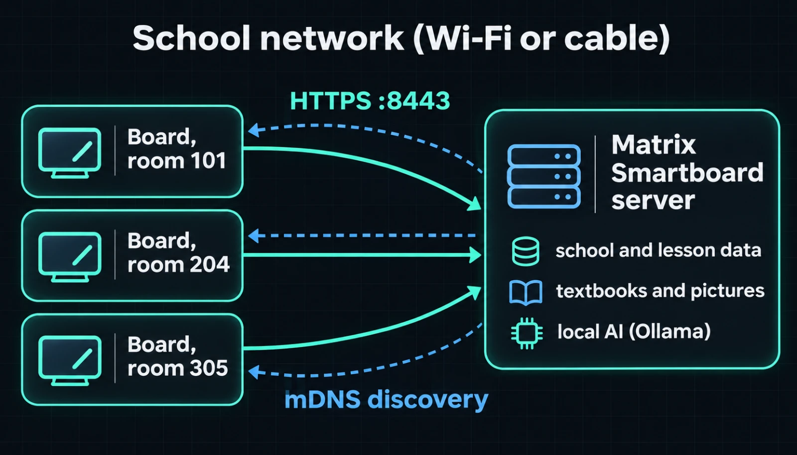

- **One server per school.** It stores the school account, rooms, lessons, boards, textbooks and pictures. The local AI runs on it too.
- **Boards** run the Android app on interactive boards or tablets. The app keeps nothing for long on its own: everything goes to the server.
- **No internet is needed** for lessons. It is needed only for installation, updates and downloading the AI models.
- The app talks only over **HTTPS** and checks the server's key (see [section 7](#7-connection-security-server-id-and-key-pin)). It does not accept plain HTTP.

---

## 2. What the server needs

Any computer that is always on and is on the same network as the boards will do.

| | Without AI | With local AI |
|---|---|---|
| Processor | any 64-bit | 4+ cores |
| Memory | 2 GB | **16 GB** (the models take about 8 GB) |
| Disk | 2 GB + textbooks | about 8 GB more for the models |
| Graphics card | not needed | speeds up the AI, but optional |

**Supported systems and what to prepare:**

- **Debian / Ubuntu** — an SSH server must be running, with a `sudo` user (or `root`). The installer adds everything else (git, Python, curl) through `apt`.
- **macOS** — turn on "Remote Login" (System Settings → Sharing). Install `python3`, `git` and `curl` with Homebrew. You need an administrator user.
- **Windows 10/11 or Server** — enable the **OpenSSH Server** feature. The SSH user must be in the **Administrators** group. `winget` is required: the installer uses it to add Python 3.13 and Ollama if they are missing.

It is best to give the server a **fixed IP** (a DHCP reservation on the router). It is not required: boards find the server after an address change too. But with a fixed IP the connection is faster.

---

## 3. Installing the app on a board

The app ships as an APK file.

1. Copy `app-debug.apk` to a USB stick, send it over the network, or install it with ADB.
2. On the board, allow installing from unknown sources (Settings → Security). The menu names depend on the board model.
3. Open the APK and install it.

With ADB (USB or network debugging must be on on the board):

```bash
adb connect 192.168.1.55:5555
```

```bash
adb install -r app-debug.apk
```

The `-r` flag updates the app and keeps its data: the server connection and the teacher PIN stay.

---

## 4. First launch: two paths

First choose the language: русский, қазақша or English. The screen title cycles through all three languages.

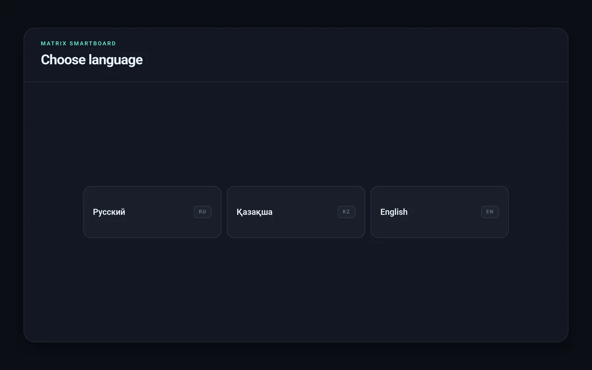

Then the app offers two paths:

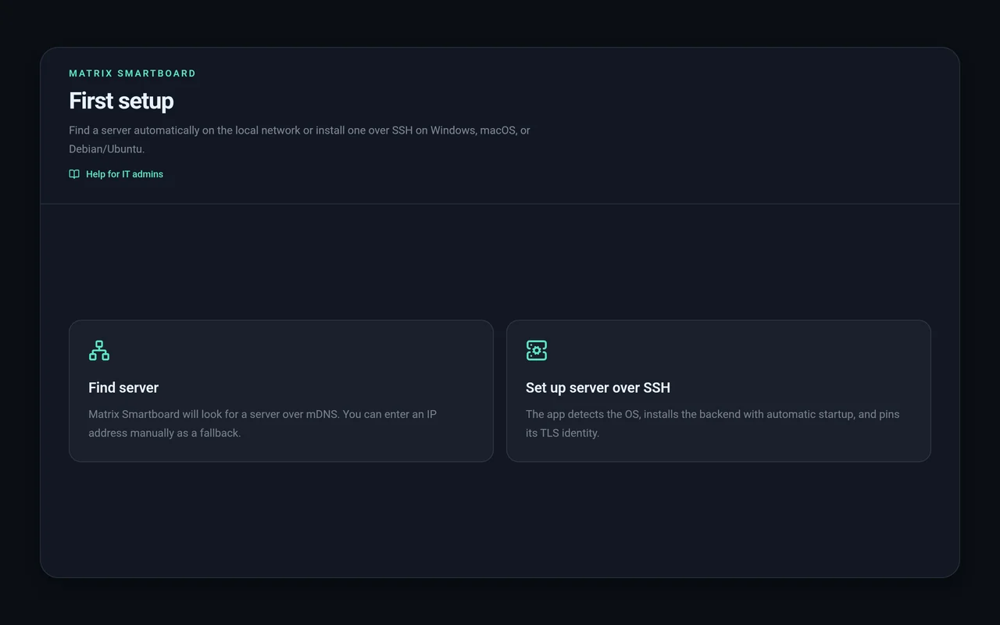

- **"Find server"** — if the school already has a server ([path B](#6-path-b-connecting-to-a-server-that-is-already-set-up)). Every board except the first connects this way.
- **"Set up server over SSH"** — if there is no server yet. The board installs it on the chosen computer by itself ([path A](#5-path-a-automatic-server-setup-over-ssh)).

The "Help for IT admins" link under the title opens this guide at the section for the current step.

---

## 5. Path A: automatic server setup over SSH

The server is installed **right from the board**: you enter the computer's address and SSH password, and the app does the rest. No command line is needed.

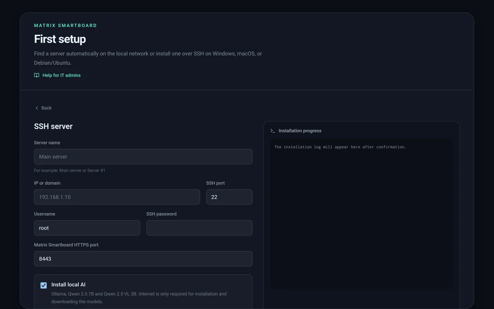

### Form fields

| Field | What to enter |
|---|---|
| **Server name** | A friendly name the boards will show: "Main server", "Server 1". Up to 48 characters |
| **IP or domain** | The future server's address on the school network, for example `192.168.1.10` |
| **SSH port** | Usually `22` |
| **Username** | `root` or a user with administrator rights |
| **SSH password** | That user's password. **It is not saved**: it is used only during installation |
| **sudo password** | Appears when the system is macOS or Linux and the user is not `root`. You can leave it empty; the SSH password is used then |
| **HTTPS port** | Usually `8443`. Change it only if it is taken |
| **Install local AI** | Installs Ollama and two models: Qwen 2.5 7B (hints, checking, lesson generation) and Qwen 2.5 VL 3B (reading what is written on the board). Needs internet and about 8 GB of disk |

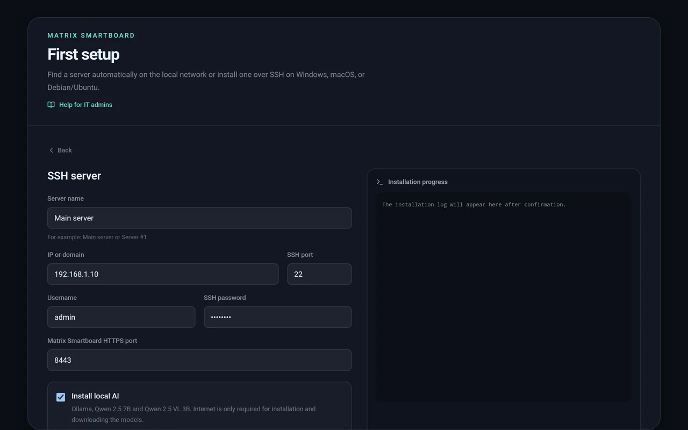

### What happens after "Check SSH"

1. **SSH key check.** The app connects and shows the fingerprint of the computer's SSH key, and detects the system: "Windows" or "macOS / Linux". Compare the fingerprint with the real one to make sure you reached the right computer and not an impostor:
   - Linux / macOS: `ssh-keygen -lf /etc/ssh/ssh_host_ed25519_key.pub`
   - Windows (PowerShell as administrator): `ssh-keygen -lf $env:ProgramData\ssh\ssh_host_ed25519_key.pub`

   The app writes the fingerprint in the same format this command prints: `SHA256:…`. If the server has no ed25519 key, compare `ssh_host_ecdsa_key.pub` instead.
2. Tick the confirmation box and tap **"Install Matrix Smartboard"**. The "Installation progress" pane on the right shows the log live.

### Installation steps (visible in the log)

**Debian / Ubuntu:**

| Step | What it does |
|---|---|
| `[1/7]` | Installs system packages: `git curl python3 python3-venv python3-pip` |
| `[2/7]` | Creates the system user `matrix-smartboard` and the data folder `/var/lib/matrix-smartboard` |
| `[3/7]` | Downloads the program from GitHub into `/opt/matrix-smartboard` |
| `[4/7]` | Creates a Python environment and installs dependencies |
| `[5/7]` | Installs Ollama and downloads the models (if AI was chosen) |
| `[6/7]` | Creates the systemd service `matrix-smartboard` with autostart. If `ufw` is on, opens 8443/TCP and mDNS 5353/UDP |
| `[7/7]` | Checks that the server answered over HTTPS |

**macOS** — the same steps, but launchd replaces systemd (`/Library/LaunchDaemons/ru.matrixhost.smartboard.plist`). If the macOS firewall is on, the installer allows incoming connections for Python.

**Windows** — everything is in `C:\ProgramData\MatrixSmartboard` (`app` is the program, `data` the data). The server starts as the scheduled task **"Matrix Smartboard Server"** under `SYSTEM` at system start, Ollama as the task "Matrix Smartboard Ollama". Windows Firewall gets the rules "Matrix Smartboard HTTPS" and "Matrix Smartboard mDNS".

On Linux and macOS two helpers are also installed:

- `/usr/local/sbin/matrix-smartboard-update` — updates with automatic rollback;
- `/usr/local/sbin/matrix-smartboard-service-control` — restarts Ollama.

Only these two commands may be run by the service through `sudo` without a password, so the "Update" and "Restart" buttons in the app work without root access to the rest of the system.

### How it ends

Right after installation the app pins the new server's key itself. You do not have to confirm it separately: you already confirmed this computer by its SSH fingerprint. The board moves on to creating the school account ([section 9](#9-school-account-and-rooms)).

> The SSH and sudo passwords are wiped from the app's memory straight after installation and are never saved.

---

## 6. Path B: connecting to a server that is already set up

Tap **"Find server"**. The app searches for about 15 seconds: three rounds of 5 seconds, so a server that answers late still makes it into the list.

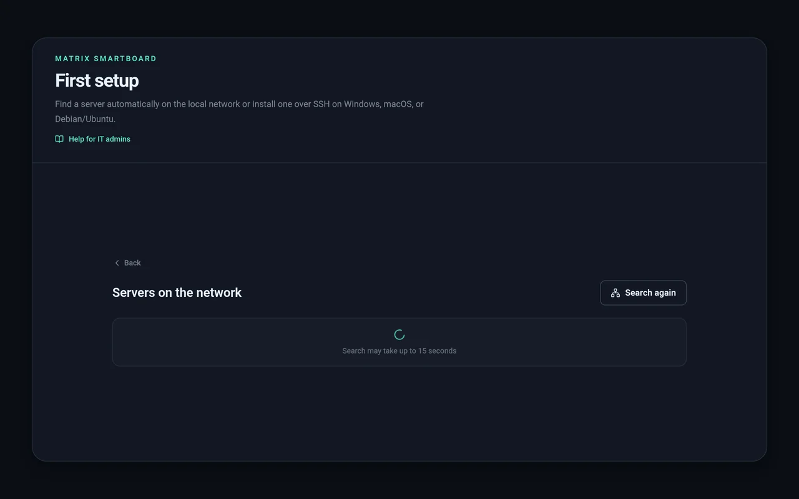

### How the search works

1. **mDNS / DNS-SD.** The server announces itself on the network as the service `_matrixboard._tcp.local`, with its name ("Main server") and Server ID. This works on an ordinary school network with no setup, as long as the router lets multicast through.
2. **Fallback: scanning the subnet.** Guest networks, phone hotspots and networks with "client isolation" often block multicast. Then the app checks its own `/24` subnet (every address like `192.168.1.1–254`) on port **8443**. Only hosts whose `/api/status` says they are Matrix Smartboard get listed. Other devices are never added.
3. **Manual entry.** After 5 seconds an "Enter server address manually" button appears. An IP is enough: without a port and protocol the app uses `https://…:8443`.

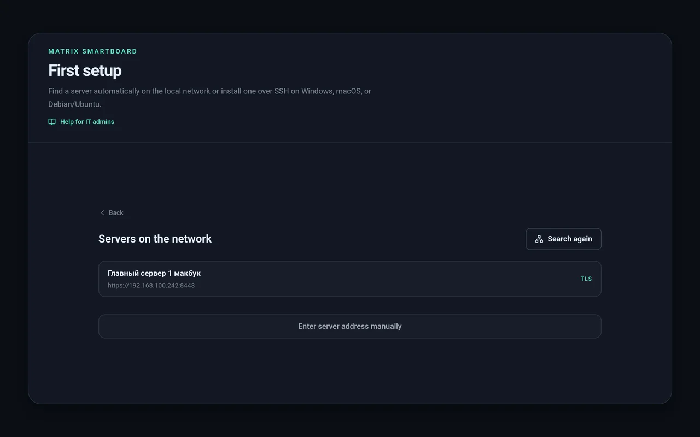

Tap the server in the list. If it was not found, enter the address manually:

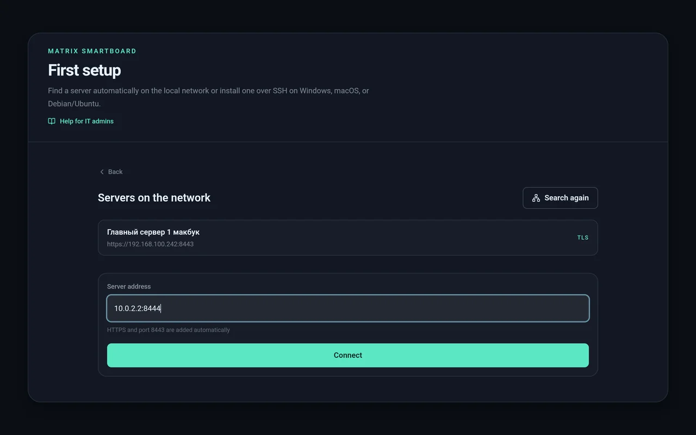

On the first connection the app shows the **Server ID** and the **public key PIN** and asks you to confirm them:

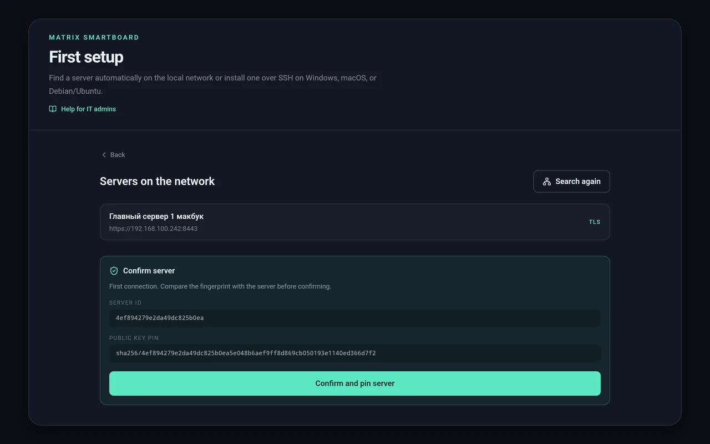

Compare them with the server (see [section 7](#7-connection-security-server-id-and-key-pin) for how) and tap **"Confirm and pin server"**.

---

## 7. Connection security: Server ID and key PIN

Every server has a permanent **TLS identity**: its own key, created at installation. From the key come:

- the **Server ID** — a short identifier such as `4ef894279e2da49dc825b0ea`;
- the **public key pin** — the key's fingerprint, `sha256/…`.

On the first connection the board **pins** this key and from then on talks only to it. Even if a fake server with the same name appears on the network, the board will not connect to it.

**How to check the PIN on the server itself.** Run this on the server or any computer on the same network:

```bash
curl -k https://192.168.1.10:8443/api/status
```

The answer has the fields `serverId` and `publicKeyPin`. They must match what the board showed. The `-k` flag is needed because the certificate is self-signed. Trust comes from comparing the pin.

**If the server's IP changes,** the certificate is reissued for the same key. The Server ID and pin stay the same, nothing needs reconfirming.

---

## 8. How a board finds the server on later launches

On every launch the app:

1. tries the **last saved address**;
2. if it does not answer, searches the network for up to **6.5 seconds** for **the same Server ID** over mDNS (this is how an IP change is survived);
3. accepts a new address only if the server's key matches the pinned one.

If nothing works, a diagnostic screen appears:

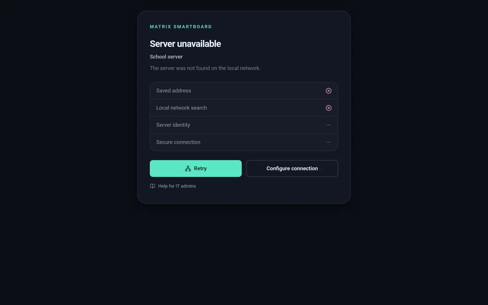

It shows which step failed:

| Row | A red cross means |
|---|---|
| **Saved address** | The server does not answer at the old address: it is off, its IP changed, or the service crashed |
| **Local network search** | mDNS did not find a server with this Server ID: a different network, or multicast is blocked |
| **Server identity** | A server answered, but with a **different key**. That is a reinstall without restoring a backup, or an impostor |
| **Secure connection** | The server was found, but HTTPS or the backend is not working |

"Retry" runs the checks again. "Configure connection" goes back to choosing a server. "Help for IT admins" opens this section.

> During a lesson a short loss of connection does not stop the work. The teacher sees "Offline", changes queue up on the board and go to the server by themselves when the connection is back.

---

## 9. School account and rooms

After connecting to the server, a **school account** is created once: a name and a password (at least 8 characters). Every board in the school signs in to the same account.

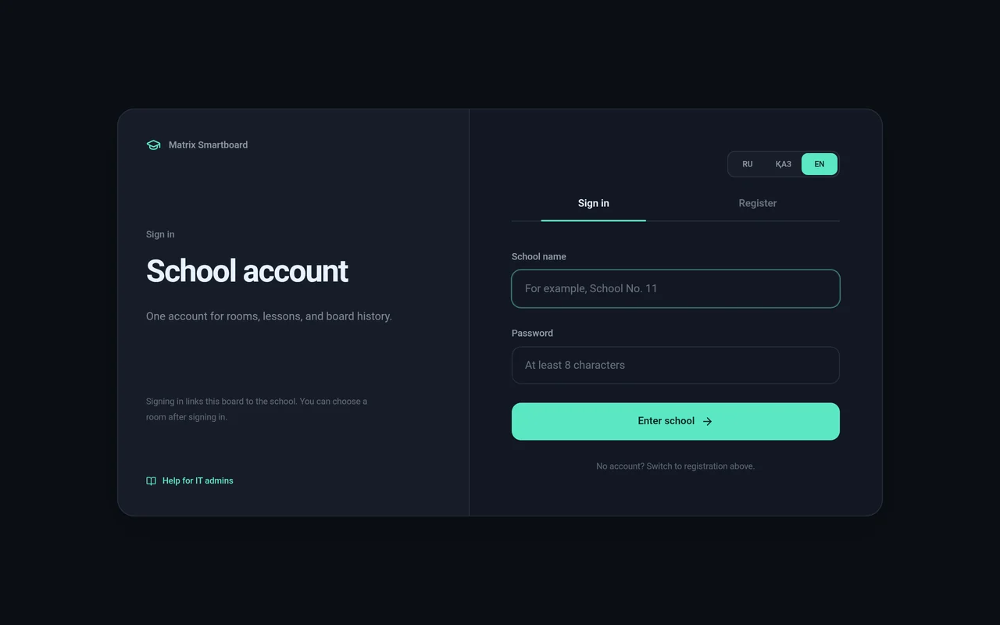

For the first board choose the **"Register"** tab:

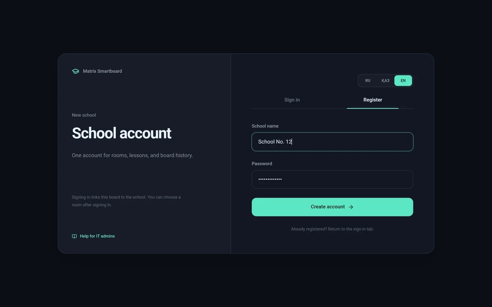

Next the board is **tied to a room**. Each room has its own lesson history.

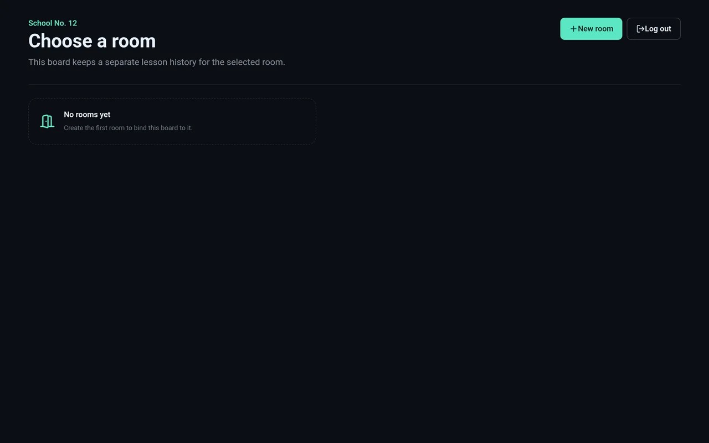

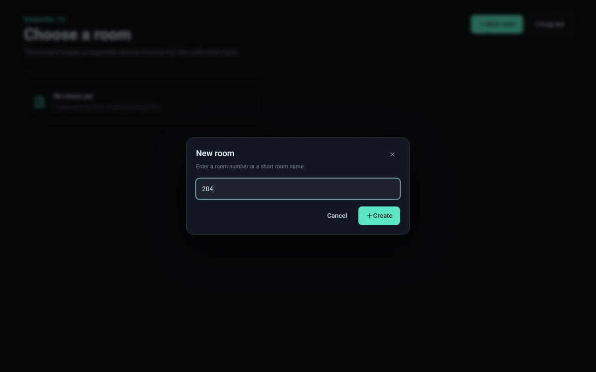

On the next boards choose "Sign in", enter the same name and password, and pick the room from the list or create a new one.

> Keep the school password as a service password. It cannot be reset from the app.

---

## 10. The "Server" screen: monitoring, updates, backups

During a lesson open settings (the sliders icon at the top right) and tap the **"Server"** row.

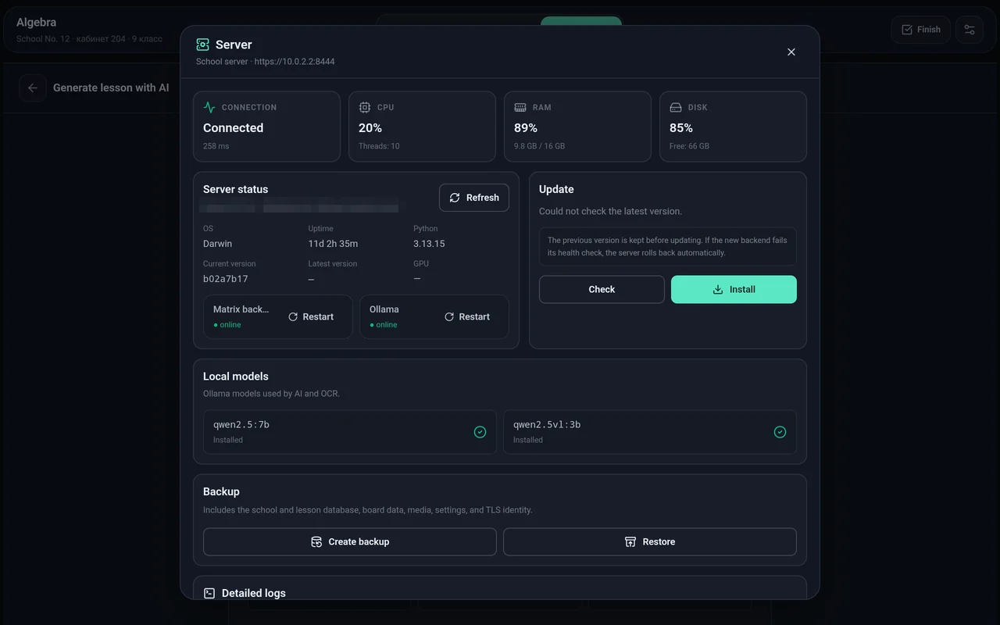

- **Connection, CPU, RAM, disk** — latency to the server and load.
- **Server status** — OS, uptime, Python version, current and latest program versions. **Matrix backend** and **Ollama** are shown separately, each with a "Restart" button.
- **Update** — "Check" and "Install" (more in [section 13](#13-updates-and-rollback)).

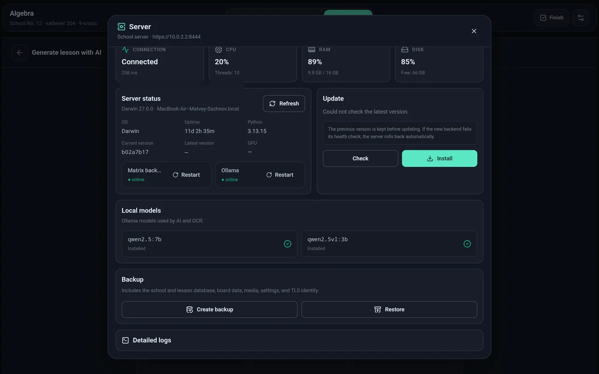

- **Local models** — whether `qwen2.5:7b` and `qwen2.5vl:3b` are installed. A missing model can be downloaded from here.
- **Backup** — "Create backup" downloads an archive: the school and lesson database, boards, textbooks and pictures, settings and the **TLS identity**. "Restore" loads such an archive back.
- **Detailed logs** — server logs, handy to attach to a support request.

> A backup contains the server's private key and all of the school's data. Keep it like a password: not in a shared chat and not on a shared USB stick.

---

## 11. Where things are on the server

| | Linux | macOS | Windows |
|---|---|---|---|
| Program | `/opt/matrix-smartboard` | `/opt/matrix-smartboard` | `C:\ProgramData\MatrixSmartboard\app` |
| Data | `/var/lib/matrix-smartboard` | `/var/lib/matrix-smartboard` | `C:\ProgramData\MatrixSmartboard\data` |
| Database (school, lessons, boards) | `…/practice.db` | `…/practice.db` | `…\practice.db` |
| TLS identity | `…/identity` | `…/identity` | `…\identity` |
| Service | systemd `matrix-smartboard` | launchd `ru.matrixhost.smartboard` | task "Matrix Smartboard Server" |
| Server log | `journalctl -u matrix-smartboard` | `/var/tmp/matrix-smartboard.log` | "Server" screen → logs |
| Update log | `/var/lib/matrix-smartboard/update.log` | `/var/tmp/matrix-smartboard-update.log` | "Server" screen |

Useful commands on Linux:

```bash
sudo systemctl status matrix-smartboard
```

```bash
sudo systemctl restart matrix-smartboard
```

```bash
sudo journalctl -u matrix-smartboard -n 100
```

On macOS:

```bash
sudo launchctl kickstart -k system/ru.matrixhost.smartboard
```

---

## 12. Network and ports

| Port | Protocol | Why |
|---|---|---|
| **8443** | TCP | HTTPS: all traffic between boards and the server |
| **5353** | UDP (multicast `224.0.0.251`) | mDNS: boards find the server by themselves |
| 22 | TCP | SSH: only during automatic setup |
| 11434 | TCP, local only | Ollama, no need to open it to the network |

If the boards and the server are on different VLANs or multicast is blocked, automatic search will not work. That is fine: enter the IP manually once. After that the board remembers the address and the key.

---

## 13. Updates and rollback

You can update the server in two ways:

- **From a board:** settings → "Server" → "Check" → "Install".
- **On the server itself** (Linux, macOS):

  ```bash
  sudo /usr/local/sbin/matrix-smartboard-update
  ```

What the update does:

1. remembers the current version;
2. **keeps the data** (database, textbooks, pictures) and puts it back afterwards with the same file owner;
3. downloads the new version from GitHub and installs dependencies;
4. restarts the service and waits until the new version answers over HTTPS;
5. **if the new version does not come up, rolls back** to the old one automatically.

The update writes its progress to the update log (see [section 11](#11-where-things-are-on-the-server)). The last line is `Update successful: <version>` or a rollback message.

The app on the boards is updated by installing the new APK over the old one (`adb install -r`). Data and the connection are kept.

---

## 14. Connecting more boards

For each new board:

1. Install the APK ([section 3](#3-installing-the-app-on-a-board)).
2. Language → **"Find server"** → choose the server → compare the PIN → "Confirm and pin server".
3. **"Sign in"** → the school name and password.
4. Choose this board's room or create a new one.

Done. The teacher sees the grade screen. From there the [teacher's guide](teacher.md) covers working with the board.

---

## 15. IT admin FAQ

**The search does not find the server.**
1. Are the board and the server on the same network? Guest Wi-Fi is often isolated from the main network.
2. Is the server running? Open `https://<IP>:8443/api/status` in a browser on any computer. A certificate warning is normal.
3. Does the firewall let 8443/TCP through?
4. Enter the IP manually: the button appears after 5 seconds of searching.

**Automatic setup: "SSH is unavailable".**
The SSH server is not running or the port is wrong. Linux: `sudo systemctl status ssh`. Windows: the "OpenSSH SSH Server" (sshd) service must be running. macOS: "Remote Login" is on.

**Automatic setup: "Incorrect SSH username or password".**
Check the keyboard layout and the user name. Login is by password: the app does not support SSH key-only login.

**Automatic setup on Windows fails with a permissions error.**
The SSH user must be in the **Administrators** group. Check that `winget` is available: on older Windows install it from the Microsoft Store ("App Installer").

**Automatic setup: "The server SSH fingerprint changed".**
The SSH key at this address differs from the one the app saw before. If you reinstalled the system, that is expected. If not, check that it is the right computer.

**Error "This is not a Matrix Smartboard server".**
Something else answers at this address and port. Check the IP and port (8443 by default).

**Error "The server version is outdated" or "This app version is outdated".**
The app and server versions are incompatible. Update the server ([section 13](#13-updates-and-rollback)) or install a fresh APK on the board.

**"Server identity" has a red cross / "The server TLS identity does not match the expected identity".**
The server answered with a different key. Usually it was reinstalled from scratch without restoring a backup. If so, on the board tap "Configure connection" and connect again: the board pins the new key. If nobody touched the server, someone may be impersonating it on the network. Find out before confirming.

**How do I move the server to another computer without reconfiguring the boards?**
Create a backup on the old server ("Server" screen → "Create backup"), install the server on the new computer and restore the backup. The TLS identity moves along with the data, the Server ID stays the same, and the boards find the new address over mDNS by themselves. If mDNS does not work on the network, enter the new IP once on each board.

**The server's IP changed. Do I need to do anything on the boards?**
No, if mDNS works on the network: the boards find the server by Server ID. If not, on the "Server unavailable" screen tap "Configure connection" and enter the new IP. The key stays the same.

**The AI says "OCR unavailable" or does not answer.**
Open the "Server" screen: Ollama must be "online" and both models "Installed". If Ollama is not working, tap "Restart". If the models are missing, download them there or on the server:

```bash
ollama pull qwen2.5:7b
```

```bash
ollama pull qwen2.5vl:3b
```

On a server with 8 GB of memory the AI may not fit. It needs 16 GB.

**The AI answers very slowly.**
Without a graphics card the 7B model takes tens of seconds to answer, which is expected. An NVIDIA card or a Mac with Apple Silicon speeds it up. This does not slow down lessons on the board: the AI is needed only for hints, checking and generation.

**A teacher forgot the PIN.**
The PIN is stored only on that board. To reset it, clear the app's data: Android Settings → Apps → Matrix Smartboard → Storage → Clear data, or with ADB:

```bash
adb shell pm clear ru.matrixhost.smartboard
```

After that the board has to be connected to the server again ([section 14](#14-connecting-more-boards)). Lessons and boards are stored on the server and are not lost.

**The school password is forgotten.**
It cannot be reset from the app. Boards that are already signed in keep working. A reset needs access to the server; contact the developer.

**A board shows a message about web mode ("Native drawing failed…").**
Fast ink drawing (native, through Android) failed to start several times in a row, and the board switched to the backup web drawing by itself so the lesson does not stop. The teacher can tap "Try again". If it keeps happening, send the developer the board model and a log. Take the log like this:

```bash
adb logcat -d > board-log.txt
```

**Touches or the line are offset from the pen.**
Update the app on the board to the latest version: it fixes a touch offset that appeared when the window had a system bar at the top. If the offset remains, calibrate the touch screen in the board's own settings.

**Where are the lessons and what should be backed up?**
Everything is in the data folder ([section 11](#11-where-things-are-on-the-server)). The easiest way is a backup from the "Server" screen once a week or before updates. You can also copy the data folder itself, but only while the service is stopped.

**Should the server be exposed to the internet?**
No, and it should not be. The server is meant to work inside the school network.

**How many boards can a server handle?**
Boards send the server only strokes and operations, which is little data. An ordinary computer easily serves every room in a school. The bottleneck is the AI: simultaneous AI requests from several boards queue up.
