# Matrix Smartboard: teacher's guide

This guide is for teachers who run lessons on the interactive board. You do not need to install anything: the school IT admin has already set up the board. If the board shows the "First setup" or "Server unavailable" screen, ask the IT admin. They have a [separate guide](admin.md).

Every screenshot was taken in the real app.

**Contents**

1. [Start a lesson in one minute](#1-start-a-lesson-in-one-minute)
2. [The lesson screen](#2-the-lesson-screen)
3. [The toolbar](#3-the-toolbar)
4. [Pen and colours](#4-pen-and-colours)
5. [Neat shapes without a ruler](#5-neat-shapes-without-a-ruler)
6. [Ruler, protractor and compass](#6-ruler-protractor-and-compass)
7. [Eraser, undo, clear](#7-eraser-undo-clear)
8. [Function graphs](#8-function-graphs)
9. [Textbook pages and pictures on the board](#9-textbook-pages-and-pictures-on-the-board)
10. [Layers: what lies on top of what](#10-layers-what-lies-on-top-of-what)
11. [Moving, lasso, board pages](#11-moving-lasso-board-pages)
12. [Tasks and the AI assistant](#12-tasks-and-the-ai-assistant)
13. [Presentation](#13-presentation)
14. [Teacher panel: preparing a lesson](#14-teacher-panel-preparing-a-lesson)
15. [Generate a lesson with AI from a textbook](#15-generate-a-lesson-with-ai-from-a-textbook)
16. [Finishing a lesson and history](#16-finishing-a-lesson-and-history)
17. [Settings](#17-settings)
18. [Teacher FAQ](#18-teacher-faq)

---

## 1. Start a lesson in one minute

A lesson starts in three steps: grade → subject → board type.

**Step 1. Grade.** Tap the grade number.

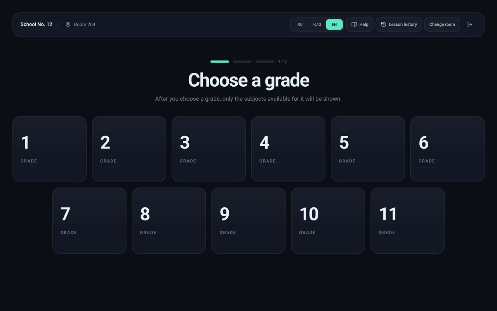

The school and room name are shown at the top. On the right are "Lesson history" (past lessons in this room) and "Change room". The "Help" button opens this guide.

**Step 2. Subject.** The list depends on the grade: grade 9, for example, has algebra, geometry, physics, chemistry, biology, geography and three languages.

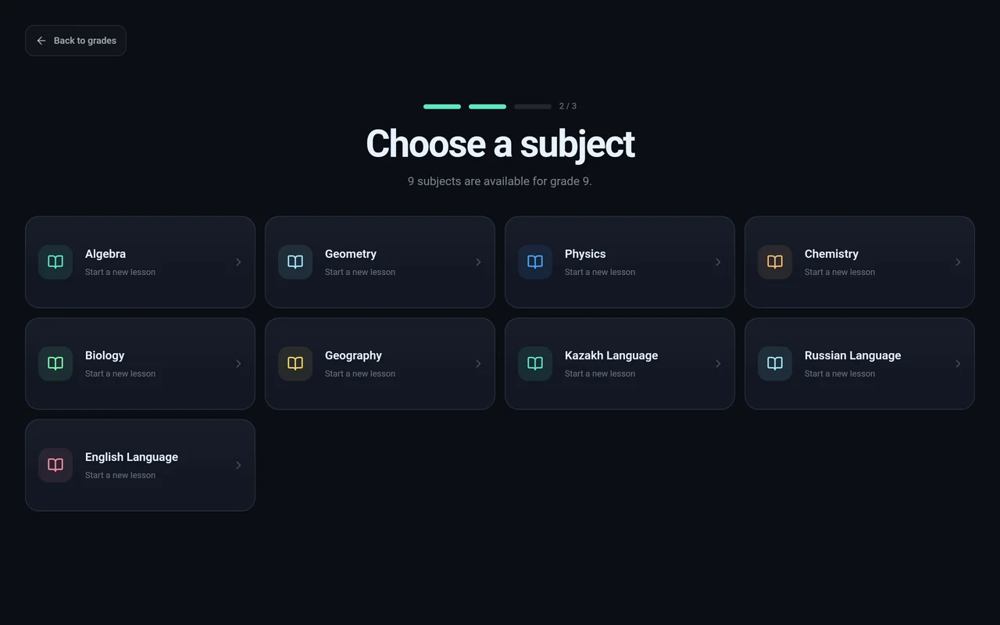

**Step 3. Board type.** It adjusts the tools to the lesson:

- **Analytical** — for maths, physics and other sciences: squared paper, graphs, ruler.
- **Text** — for languages and history: ruled lines as in an exercise book, marker, underline.
- **Universal** — every tool at once.

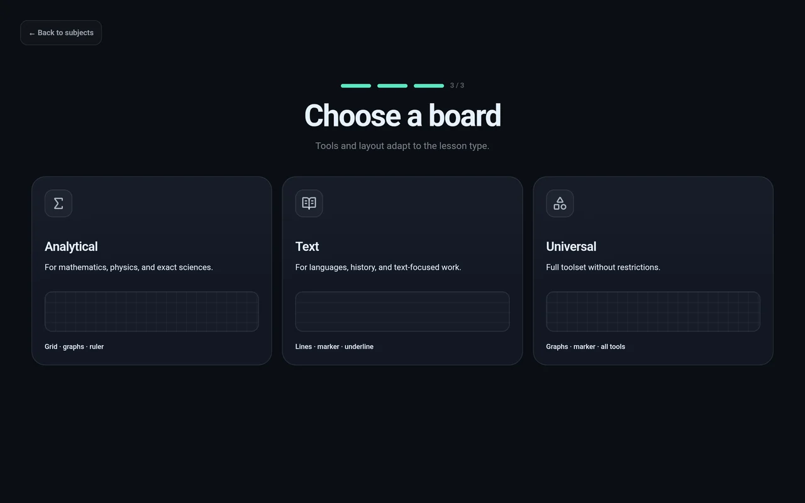

That is it, the lesson is open. The lesson timer in the top right corner has started.

> **If the app was closed in the middle of a lesson** (the board was switched off, the power went out, someone pressed Home), it offers to return to the lesson the next time it starts. The board, the change history and the AI conversation are kept.
>
> 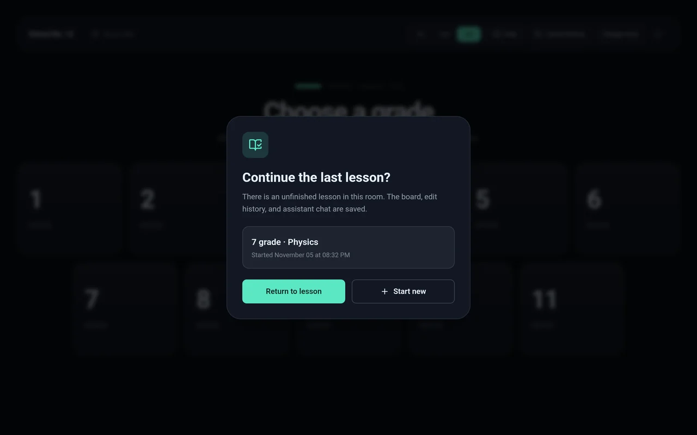

---

## 2. The lesson screen

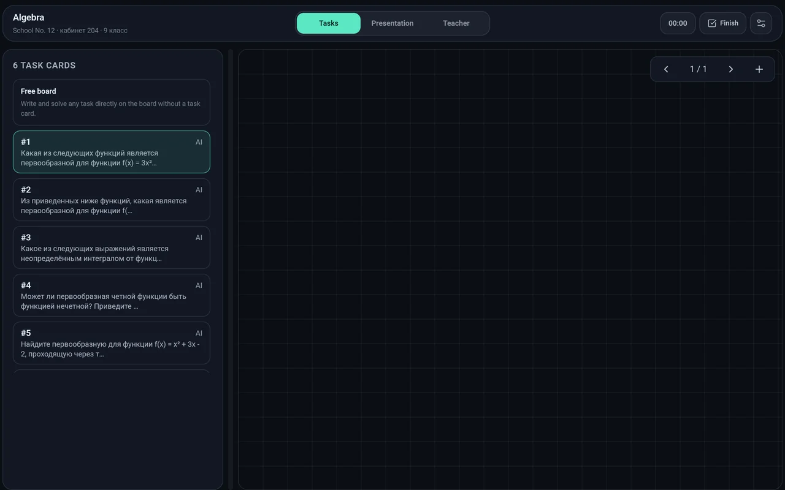

- **On the left are the task cards.** "Free board" is just a board without a task. The numbered cards are the lesson's tasks. Tap a card to choose a task.
- **In the middle is the board.** Write on it with the pen or a finger.
- **At the top in the middle are three tabs:** "Tasks" (the board), "Presentation" (slides) and "Teacher" (lesson preparation, protected by a PIN).
- **At the top right:** the lesson timer, the "Finish" button and settings (the sliders icon).
- **In the top right corner of the board are the pages:** the arrows turn pages, "+" adds a new one.

---

## 3. The toolbar

The toolbar is at the bottom of the board. It hides while you write so it does not get in the way. To bring it back, swipe a finger or the pen along the bottom edge of the board.

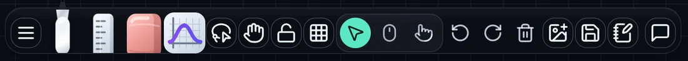

From left to right:

| Button | What it does |
|---|---|
| ☰ **Panels** | Hides or shows the task column on the left, so the board gets wider |
| **Pen** | Writes. Tap again for thickness and colours |
| **Ruler** | Ruler, protractor and compass |
| **Eraser** | Erases. Tap again for the eraser size |
| **Graph** | Places a coordinate plane with function graphs |
| **Lasso** | Circle part of the drawing and move it |
| ✋ **Move** | Move the board and the pictures on it |
| 🔓 **Lock** | Stops the board from being moved or zoomed by accident |
| ▦ **Board** | Grid, zoom, background colour |
| **Auto / Mouse / Touch** | What can draw: everything, only a mouse, or only the pen and fingers |
| ↶ ↷ | Undo and redo |
| 🗑 **Clear board** | Erase everything on the board |
| **Insert picture** | A textbook page or a picture from a file |
| **Snapshot** | Save the board as a picture |
| **Exercise** | Show the chosen task's statement over the board |
| 💬 **AI assistant** | Hint, check the solution, full solution |

---

## 4. Pen and colours

Tap **Pen** again to open thickness and colours. The "…" button shows the remaining colours.

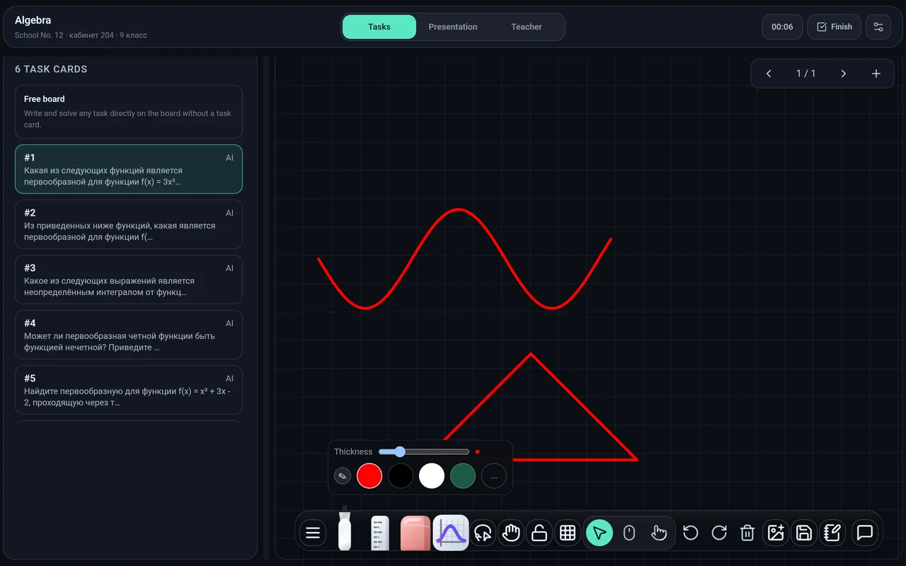

- You can write with the board's stylus or a finger.
- **Two people can write at the same time**: the board tells two touches apart, so two students can solve side by side.
- To move or zoom the board, spread or pinch **two fingers**.

---

## 5. Neat shapes without a ruler

Draw a shape by hand and **at the end hold the pen still for half a second without lifting it**. The board turns the sketch into a neat shape:

- a straight line;
- a circle or an ellipse;
- a triangle;
- a rectangle or a quadrilateral.

In the screenshot above the triangle was drawn by hand and straightened by the board. If you do not want a shape, simply lift the pen straight away: the line stays as you drew it.

---

## 6. Ruler, protractor and compass

Tap **Ruler** on the toolbar. A ruler appears on the board, and a menu of three tools opens above the toolbar: ruler, protractor, compass.

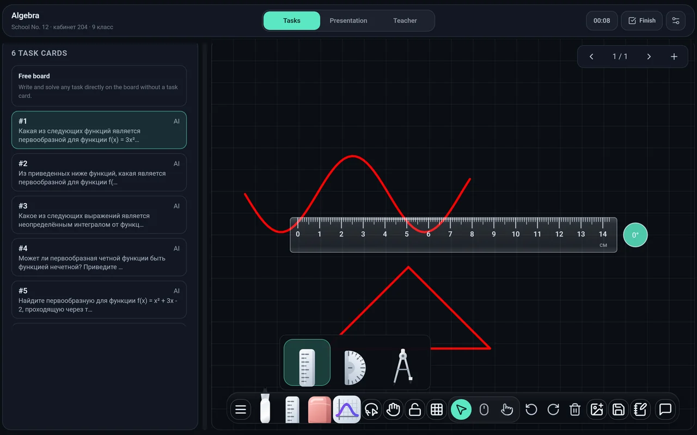

- **Ruler.** Draw along its edge and the line comes out perfectly straight. Drag the middle of the ruler with a finger to move it. The round handle on the right rotates it. The angle is shown on that handle and snaps to 15°, 30°, 45° and so on.
- **Protractor.** Moves and rotates the same way. Handy for measuring and drawing angles.

  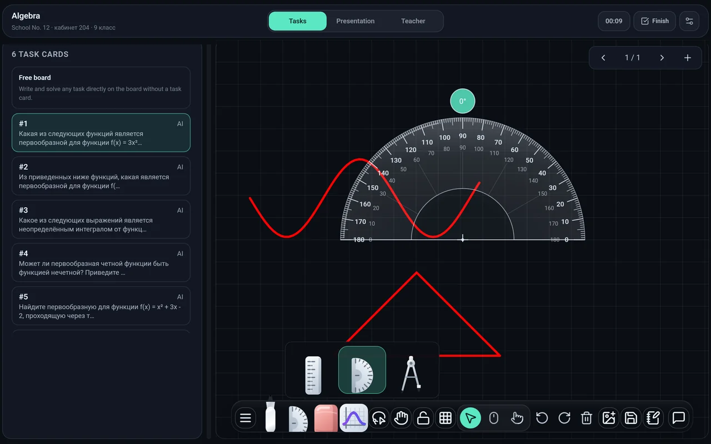

- **Compass.** The left circle is the needle (the centre). The middle one changes the radius, which is shown in centimetres. Put the pen on the right circle and move it to draw a neat circle or arc.

  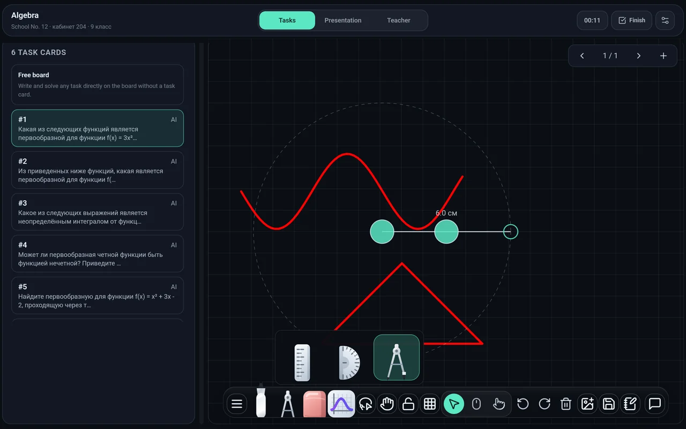

To remove a tool from the board, tap it in the menu again. The toolbar button shows the last tool you picked.

---

## 7. Eraser, undo, clear

- **Eraser** erases whatever you pass over. Tap it again to change the size.

  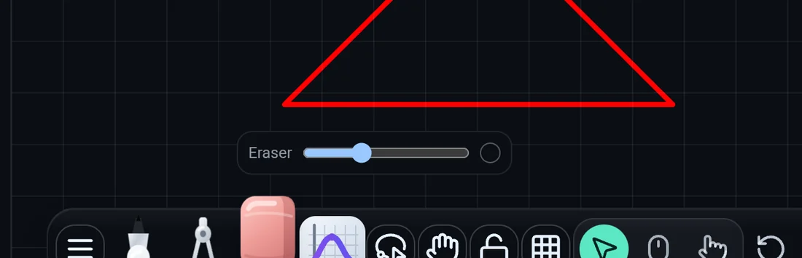

- **↶ Undo / ↷ Redo** undo any action: a line, erasing, moving a graph or a picture.
- **🗑 Clear board** erases everything. To avoid clearing by accident, you have to slide the slider all the way. Clearing can also be undone with ↶.

---

## 8. Function graphs

Tap **Graph**, then tap the board: a coordinate plane appears.

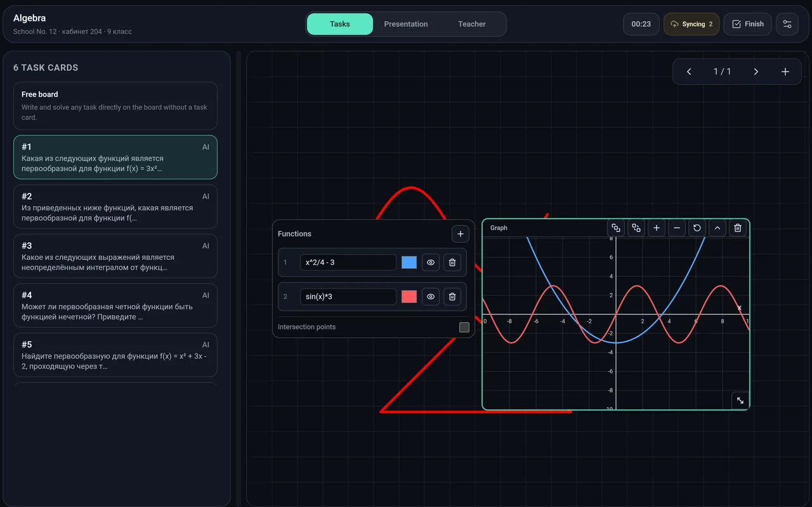

- **Functions** are typed on the left, for example `x^2/4 - 3` or `sin(x)*3`. "+" adds another function, each with its own colour. The eye hides a function, the bin deletes it.
- **Intersection points** — tick the box and the board marks where the graphs cross.
- **Move a graph:** drag the top strip with the word "Graph".
- **Size:** drag the corner at the bottom right.
- **Zoom:** the "+" and "−" buttons on the strip, or two fingers on the graph itself. The ↻ button restores the normal zoom.
- **Axis labels** (`x`, `y`) can be changed by tapping, for example to `t, s` and `v, m/s` for physics.

What you can type: `+ - * / ^`, `sqrt` (root), `abs` (absolute value), `sin cos tan cot` (angles in radians), `ln log`, `pi`, `e` and more.

---

## 9. Textbook pages and pictures on the board

Tap **Insert picture**.

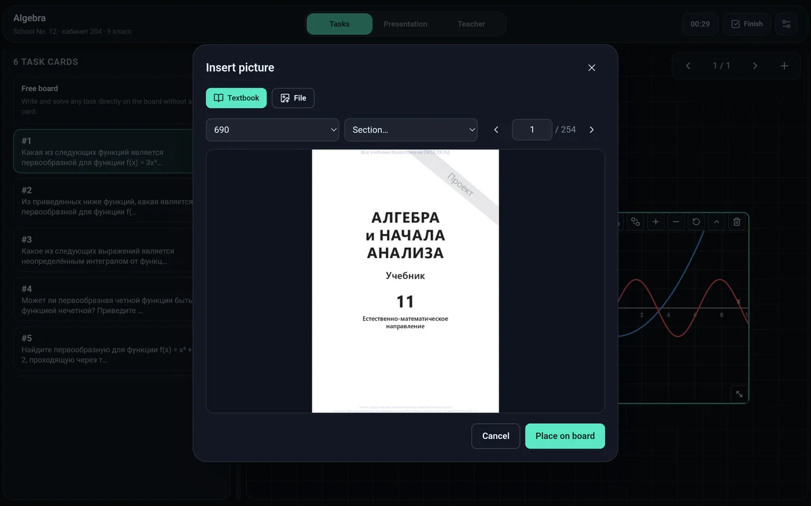

- **"Textbook"** tab: choose a textbook, a section or a page number and tap "Place on board".
- **"File"** tab: a picture from the device (PNG, JPG, WebP).

The picture goes **under the ink**: you can underline, circle and write right over the textbook text.

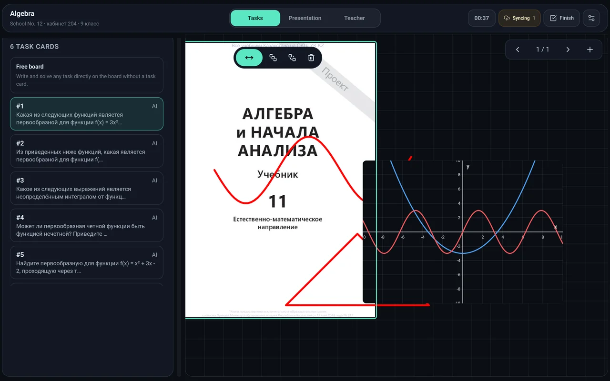

While ✋ **Move** is selected, a picture can be:

- **moved** — drag it with a finger;
- **resized** — drag the green ↔ button right (bigger) or left (smaller);
- **brought forward or sent backward** — the two buttons next to it (see [Layers](#10-layers-what-lies-on-top-of-what));
- **removed** — the bin.

To write again, choose the Pen.

---

## 10. Layers: what lies on top of what

Pictures and graphs have **"Bring forward"** and **"Send backward"** buttons. You need them when objects overlap:

- a picture over a picture — for example, two textbook pages;
- a picture over a graph and the other way round.

Each tap moves the object one place. It can be undone.

Important: **pen writing always lies over pictures, and graphs lie over the writing.** If you bring a picture above a graph, it also covers the writing under it, and you can no longer write on it. Send it back under the graph to write on it again.

---

## 11. Moving, lasso, board pages

- **✋ Move** — move the whole board with a finger or the stylus. With two fingers you can move the board in any mode.
- **🔓 Lock** — stops the board from being moved and zoomed. Useful when children stand at the board and keep bumping it.
- **Lasso** — draw a loop around part of the drawing, then drag the selection elsewhere.
- **Pages** (top right on the board): "+" adds a new blank page, the arrows turn pages. It is like turning a sheet: nothing is erased.
- **▦ Board** — grid (on/off), zoom, the "Center" button (back to the start of the board) and the background colour.

  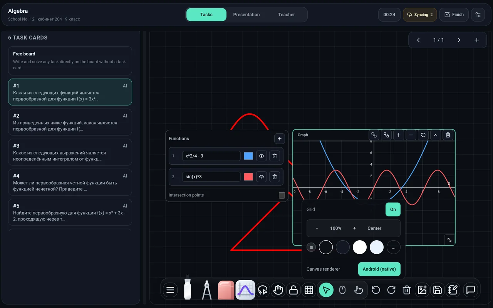

---

## 12. Tasks and the AI assistant

**Exercise.** Choose a card on the left and tap **Exercise** on the toolbar: the statement opens over the board so the whole class can see it. The solution is written right on the board.

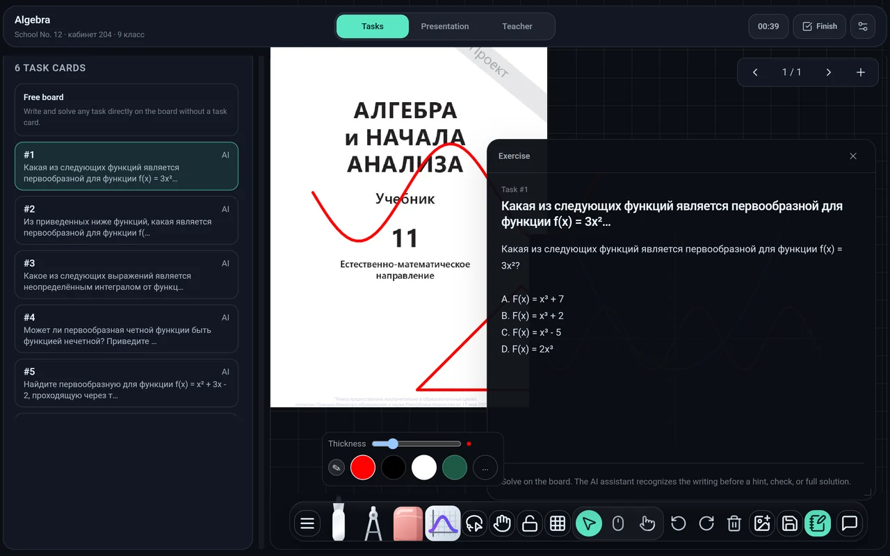

The **AI assistant** (💬) reads what is written on the board by itself and can:

- **Hint** — suggest the next step without solving the whole task;
- **Check solution** — find a mistake in what is written;
- **Full solution** — show a step-by-step solution.

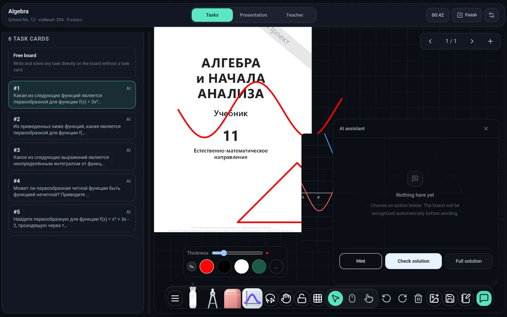

The AI runs on the school server and needs no internet. If "OCR unavailable" appears at the bottom of the window or the AI stays silent, the AI models are not running on the server. Tell the IT admin.

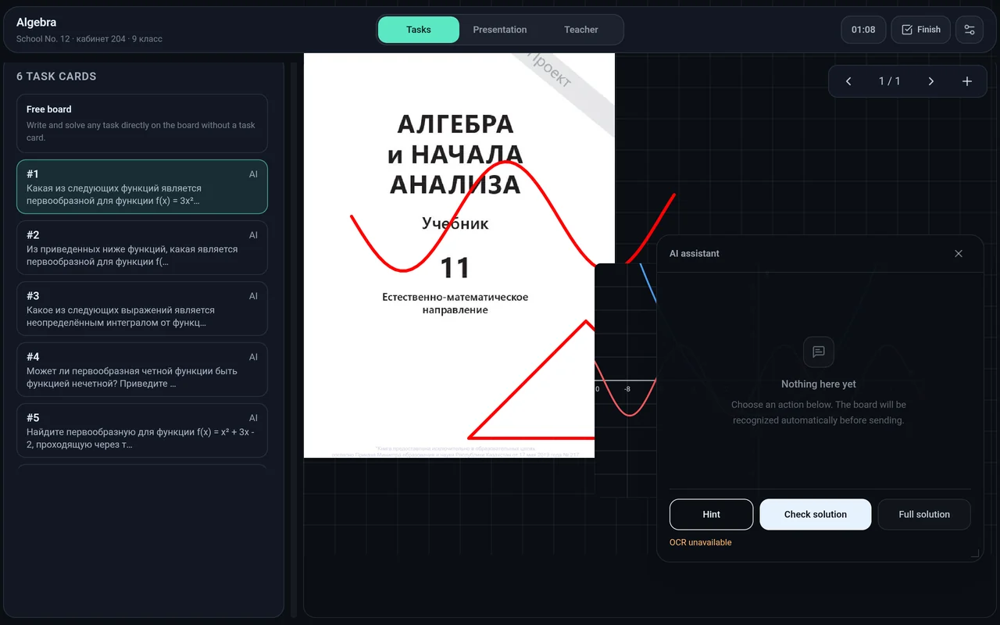

---

## 13. Presentation

The **"Presentation"** tab shows the lesson's slides. "Back" and "Forward" turn the slides, "Slideshow" shows them full screen. "Notes" is presenter mode: the teacher sees the notes for the slide.

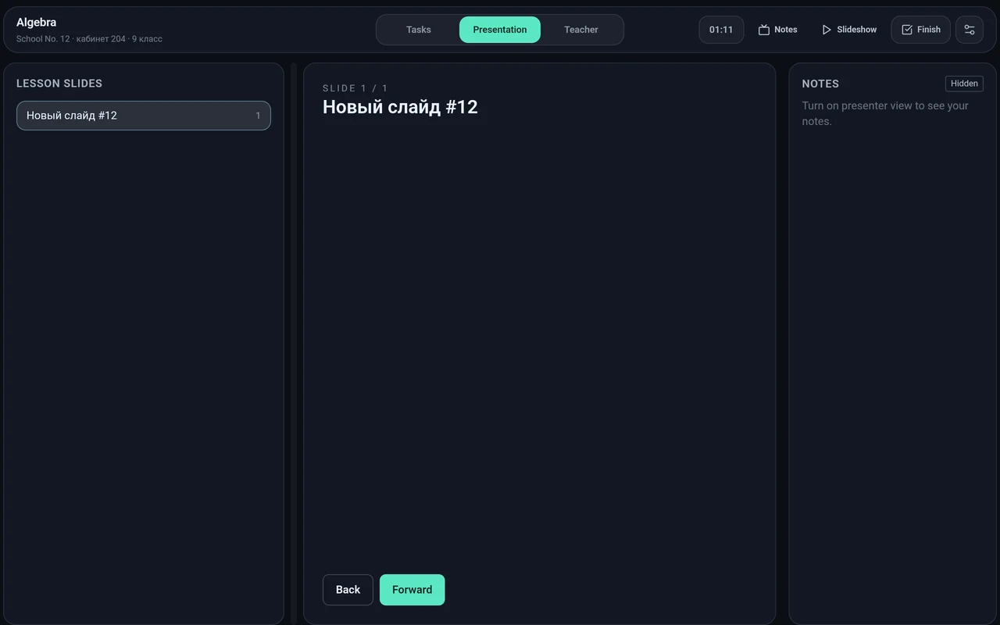

Slides are prepared in the teacher panel: you can upload them from PowerPoint or generate them with AI (see below).

---

## 14. Teacher panel: preparing a lesson

The **"Teacher"** tab is protected by a PIN so students cannot change the lesson. The first time, choose a PIN of 4–8 digits and repeat it.

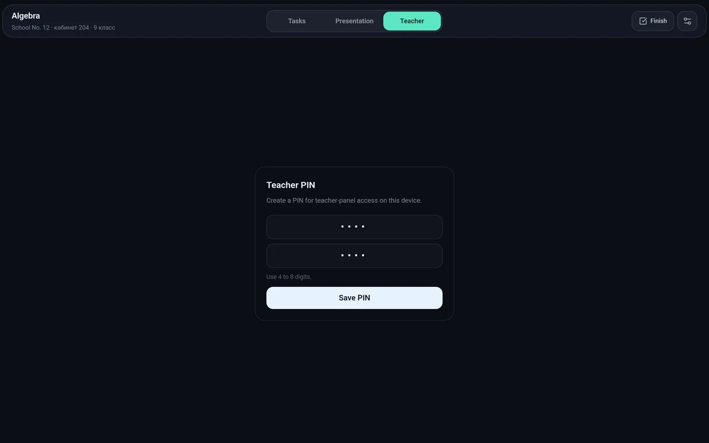

> The PIN is stored **only on this board**. On another board you set it again.

After you enter it:

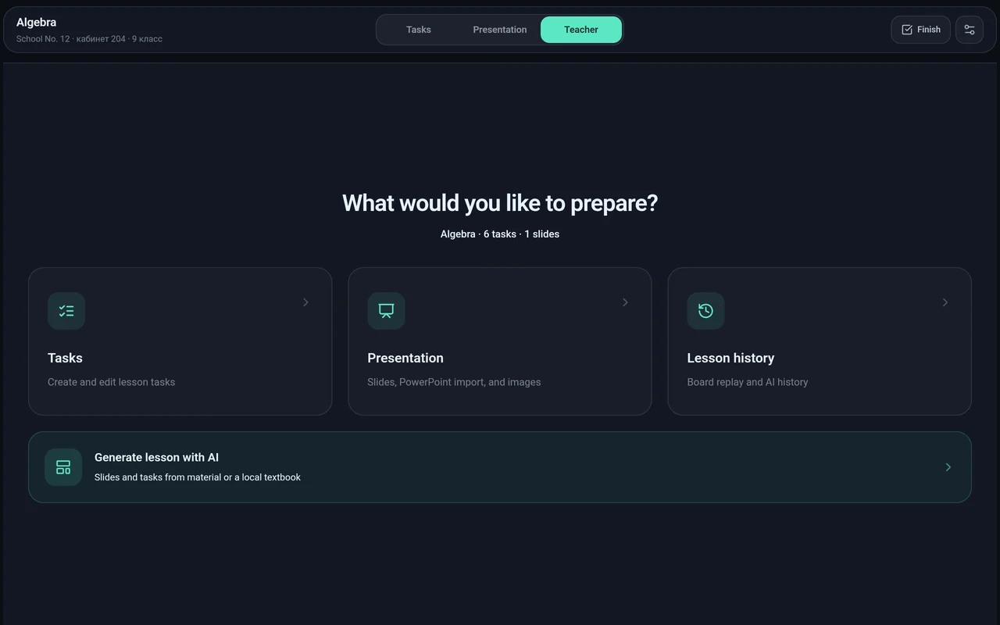

- **Tasks** — add, edit or delete the lesson's tasks. A task has a heading, a statement (write formulas in `$...$`, for example `$x^2$`), tags and a reference answer that the AI compares the solution with.

  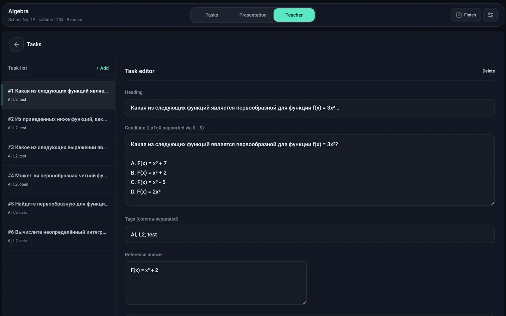

- **Presentation** — slides: create a new one, upload PowerPoint, add pictures.

  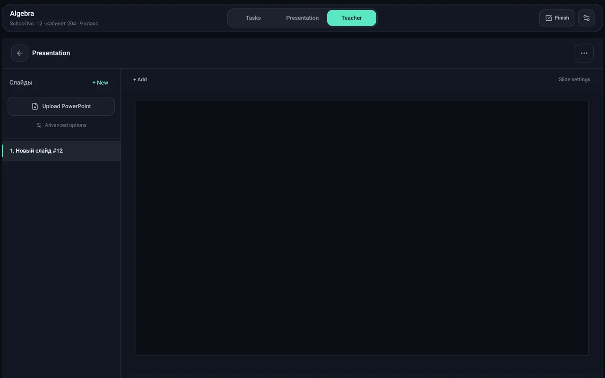

- **Lesson history** — a recording of everything that happened on the board. You can play it back like a video and even download it. The AI answers are there too.

  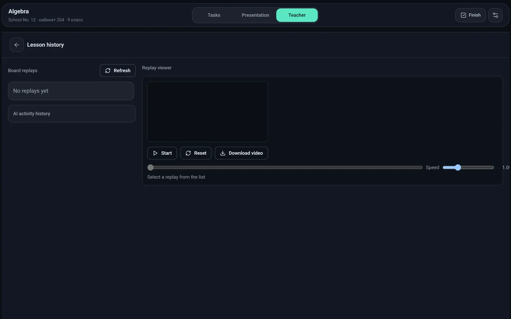

- **Generate lesson with AI** — see the next section.

---

## 15. Generate a lesson with AI from a textbook

The AI prepares slides and tasks by itself, from your text or from a textbook section.

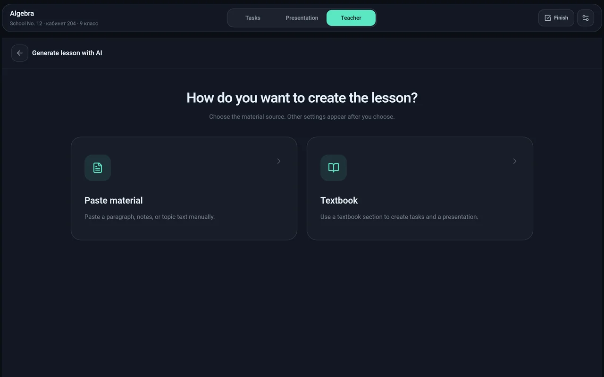

1. Choose **"Textbook"** (or "Paste material" to paste your own text or notes).
2. Choose the textbook and a **section**, or type a **topic**.
3. Optionally set the lesson name, language, and the number of slides and tasks.
4. Tap **"Generate lesson"** and wait: on a school server this can take a few minutes.

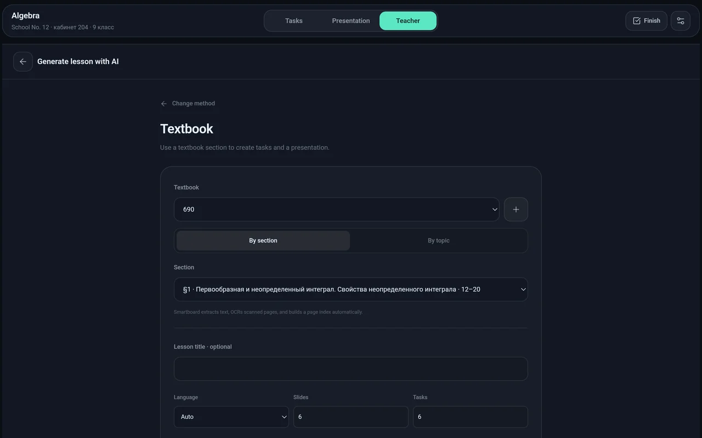

**Your own textbook.** Tap "+" next to the list of textbooks and choose a PDF. The server pulls out the text, recognises scanned pages and finds the sections by itself. While it works through the book, topic search already works on the pages that are done.

Everything the AI creates is a draft. Check it in "Tasks" and "Presentation".

---

## 16. Finishing a lesson and history

The **"Finish"** button closes the lesson at once and returns to choosing a grade. The lesson is not lost: it goes to the room's **Lesson history**.

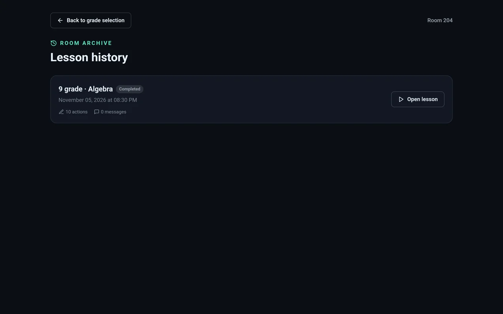

The history shows the grade, subject, date and time, how many actions there were on the board and how many AI messages. "Open lesson" opens it again.

---

## 17. Settings

The sliders icon at the top right.

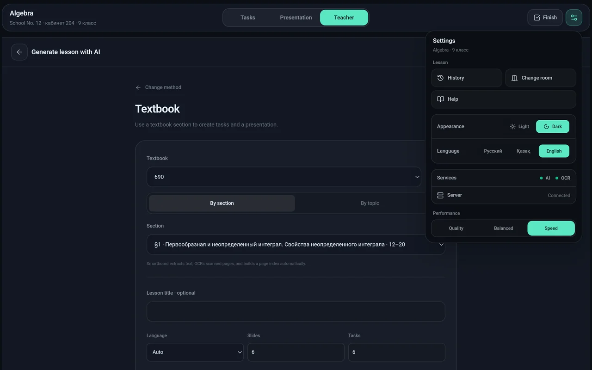

- **History**, **Change room** and **Help** (this guide).
- **Appearance**: light or dark theme.
- **Language**: русский, қазақ, English.
- **Services**: green dots next to "AI" and "OCR" mean they work. "Server" opens the server screen, which the IT admin needs.
- **Performance**: "Quality" looks better, "Speed" is faster on a weak board, "Balanced" is in between.

---

## 18. Teacher FAQ

**I drew the wrong thing. How do I get it back?**
Tap ↶ "Undo" as many times as needed. Everything can be undone: lines, erasing, clearing the board, moving pictures.

**I cleared the board by accident!**
Tap ↶. Clearing is undone like any other action.

**The toolbar disappeared.**
It hides while you write. Swipe a finger along the bottom edge of the board and it comes back.

**The board moved away and I can't see anything.**
Open ▦ "Board" and tap "Center". To stop it moving, turn on 🔓 "Lock".

**The pen does not write.**
1. Check that the Pen is selected, not ✋ Move or Lasso.
2. Look at the "Auto / Mouse / Touch" switch: in "Mouse" mode the pen and fingers do not write. Choose "Auto".
3. You cannot write on a graph or on a picture brought above a graph. Write next to it or send the picture backward.

**The line snapped to the ruler and I didn't want it to.**
A line snaps if you start it right at the ruler's edge. Start a little further from the edge, or remove the ruler by tapping it in the menu again.

**I want a curve, but the board turns it into a neat shape.**
You held the pen still at the end of the line. Lift it straight away and the line stays as it is. Or tap ↶ and draw again.

**I can't move a picture.**
Pictures move only in ✋ "Move" mode. Tap the picture first so it gets a green frame.

**The picture is hidden under a graph.**
Select the picture in ✋ mode and tap "Bring forward", or tap "Send backward" on the graph.

**I wrote on a picture and the writing disappeared.**
The picture is above a graph and so covers the writing. "Send backward" and the writing is visible again: it was never deleted.

**The AI says "OCR unavailable" or does not answer.**
That is a server problem, not the board. Tell the IT admin. You can write and run the lesson on the board without the AI.

**"Offline" appeared.**
The connection to the server dropped, but carry on: everything you draw is kept on the board and is sent to the server by itself when the connection returns.

**A message about web mode appeared ("Native drawing failed…").**
The board switched to a backup, slower way of drawing so the lesson is not interrupted. You can tap "Try again". If it keeps appearing, tell the IT admin.

**I forgot the teacher PIN.**
The PIN is reset only together with the app's data on the board. The IT admin does this, and afterwards the board has to be connected to the server again.

**Can I save what is on the board?**
Yes: "Snapshot" saves the board as a picture. Every lesson is also kept in Lesson history, with a recording of all the work on the board.

**Do we need the internet?**
No. The board works with a server inside the school. The internet is needed only by the IT admin for installation and updates.

**What do other rooms see?**
Only their own. Each room has its own lesson history. The school account is shared.
