# Matrix Smartboard: жүйелік әкімшіге арналған нұсқаулық

Бұл нұсқаулық жүйені мектепте орнататын адамға арналған: сервер, тақталардағы қолданба және оларды бір-біріне қосу. Мұғалімге мұны оқудың қажеті жоқ, оған [мұғалімге арналған нұсқаулық](teacher.md) бар.

Барлық скриншот Android планшетіндегі нақты қолданбада түсірілген. Бұл нұсқаулық қолданбаның өзіне де енгізілген: алғашқы баптау және қосылу экрандарындағы «Жүйелік әкімшіге арналған анықтама» сілтемесі.

**Мазмұны**

1. [Жүйе қалай құрылған](#1-жүйе-қалай-құрылған)
2. [Серверге не қажет](#2-серверге-не-қажет)
3. [Қолданбаны тақтаға орнату](#3-қолданбаны-тақтаға-орнату)
4. [Алғашқы іске қосу: екі жол](#4-алғашқы-іске-қосу-екі-жол)
5. [А жолы: серверді SSH арқылы автоматты баптау](#5-а-жолы-серверді-ssh-арқылы-автоматты-баптау)
6. [Б жолы: дайын серверге қосылу](#6-б-жолы-дайын-серверге-қосылу)
7. [Қосылымды қорғау: Server ID және кілттің PIN-і](#7-қосылымды-қорғау-server-id-және-кілттің-pin-і)
8. [Келесі іске қосуларда тақта серверді қалай табады](#8-келесі-іске-қосуларда-тақта-серверді-қалай-табады)
9. [Мектеп аккаунты және кабинеттер](#9-мектеп-аккаунты-және-кабинеттер)
10. [«Сервер» экраны: бақылау, жаңарту, резервтік көшірмелер](#10-сервер-экраны-бақылау-жаңарту-резервтік-көшірмелер)
11. [Серверде не қайда жатыр](#11-серверде-не-қайда-жатыр)
12. [Желі және порттар](#12-желі-және-порттар)
13. [Жаңарту және кері қайтару](#13-жаңарту-және-кері-қайтару)
14. [Келесі тақталарды қосу](#14-келесі-тақталарды-қосу)
15. [Жүйелік әкімшіге арналған FAQ](#15-жүйелік-әкімшіге-арналған-faq)

---

## 1. Жүйе қалай құрылған

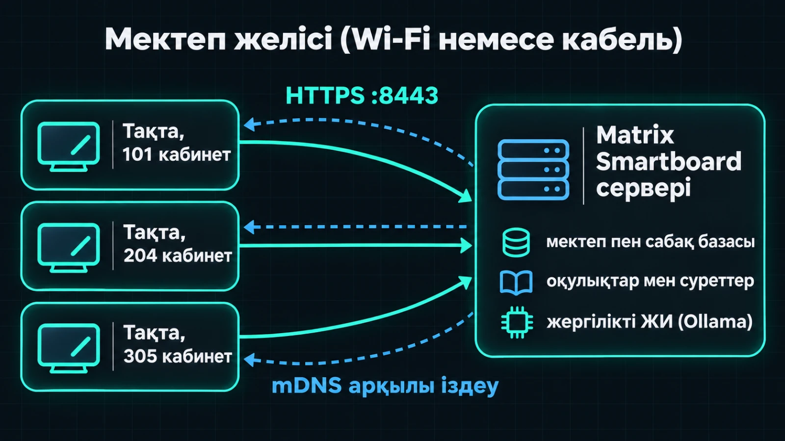

- **Бір мектепке бір сервер.** Онда мектеп аккаунты, кабинеттер, сабақтар, тақталар, оқулықтар мен суреттер сақталады. Жергілікті ЖИ де сонда жұмыс істейді.
- **Тақталар** — интерактивті тақталардағы немесе планшеттердегі Android қолданбасы. Ол өздігінен ештеңені ұзақ сақтамайды: бәрі серверге кетеді.
- Сабақтар үшін **интернет қажет емес**. Ол тек орнату, жаңарту және ЖИ модельдерін жүктеу үшін керек.
- Байланыс тек сервер кілтін тексере отырып, **HTTPS** арқылы жүреді ([7-бөлімді](#7-қосылымды-қорғау-server-id-және-кілттің-pin-і) қараңыз). Қолданба кәдімгі HTTP-ді қабылдамайды.

---

## 2. Серверге не қажет

Үнемі қосулы тұратын және тақталармен бір желіде орналасқан кез келген компьютер жарайды.

| | ЖИ-сіз | Жергілікті ЖИ-мен |
|---|---|---|
| Процессор | кез келген 64-биттік | 4+ ядро |
| Жад | 2 ГБ | **16 ГБ** (модельдер шамамен 8 ГБ алады) |
| Диск | 2 ГБ + оқулықтар | модельдерге тағы ~8 ГБ |
| Бейнекарта | қажет емес | ЖИ-ді жылдамдатады, бірақ міндетті емес |

**Қолдау көрсетілетін жүйелер және не дайындау керек:**

- **Debian / Ubuntu** — қосулы SSH сервері және `sudo` құқығы бар пайдаланушы (немесе `root`) керек. Қалғанын (git, Python, curl) орнатқыш `apt` арқылы өзі қояды.
- **macOS** — «Қашықтан кіру» (Remote Login) параметрін қосыңыз (Жүйе параметрлері → Ортақ пайдалану). Homebrew арқылы `python3`, `git` және `curl` орнатыңыз. Әкімші пайдаланушы керек.
- **Windows 10/11 немесе Server** — **OpenSSH Server** компонентін қосыңыз. SSH пайдаланушысы **Administrators** тобында болуы керек. `winget` керек: Python 3.13 және Ollama жоқ болса, орнатқыш оларды сол арқылы өзі қояды.

Серверге **тұрақты IP** берген дұрыс (маршрутизатордағы DHCP резервтеу). Бұл міндетті емес: мекенжай өзгерсе де, тақталар серверді табады. Бірақ тұрақты IP болса, қосылу жылдамырақ.

---

## 3. Қолданбаны тақтаға орнату

Қолданба APK файлы ретінде таратылады.

1. `app-debug.apk` файлын флешкаға көшіріңіз, желі арқылы жіберіңіз немесе ADB арқылы орнатыңыз.
2. Тақтада белгісіз көздерден орнатуға рұқсат беріңіз (Баптаулар → Қауіпсіздік). Тармақтардың атаулары тақта моделіне байланысты.
3. APK файлын ашып, орнатыңыз.

ADB арқылы (тақтада USB немесе желі арқылы жөндеу қосулы болуы керек):

```bash
adb connect 192.168.1.55:5555
```

```bash
adb install -r app-debug.apk
```

`-r` кілті қолданбаны жаңартады және оның деректерін сақтайды: серверге қосылым мен мұғалімнің PIN-коды қалады.

---

## 4. Алғашқы іске қосу: екі жол

Алдымен тілді таңдаңыз: русский, қазақша немесе English. Экран тақырыбы үш тілде кезекпен көрсетіледі.

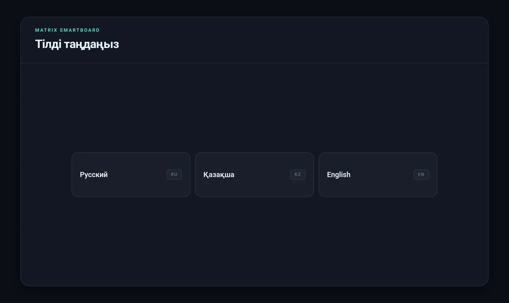

Содан кейін қолданба екі жол ұсынады:

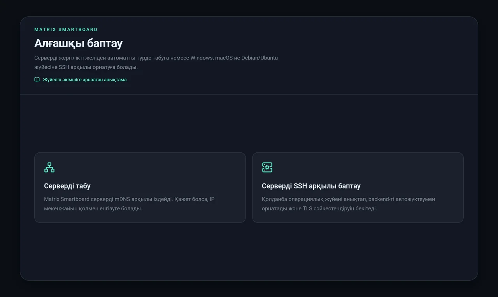

- **«Серверді табу»** — мектепте сервер орнатылып қойған болса ([Б жолы](#6-б-жолы-дайын-серверге-қосылу)). Біріншісінен басқа барлық тақта осылай қосылады.
- **«Серверді SSH арқылы баптау»** — сервер әлі жоқ болса. Тақта оны таңдалған компьютерге өзі орнатады ([А жолы](#5-а-жолы-серверді-ssh-арқылы-автоматты-баптау)).

Тақырыптың астындағы «Жүйелік әкімшіге арналған анықтама» сілтемесі осы нұсқаулықты ағымдағы қадамның бөлімінде ашады.

---

## 5. А жолы: серверді SSH арқылы автоматты баптау

Сервер **тура тақтадан** орнатылады: сіз компьютердің мекенжайы мен SSH құпиясөзін енгізесіз, ал қалғанын қолданба өзі жасайды. Пәрмен жолы қажет емес.

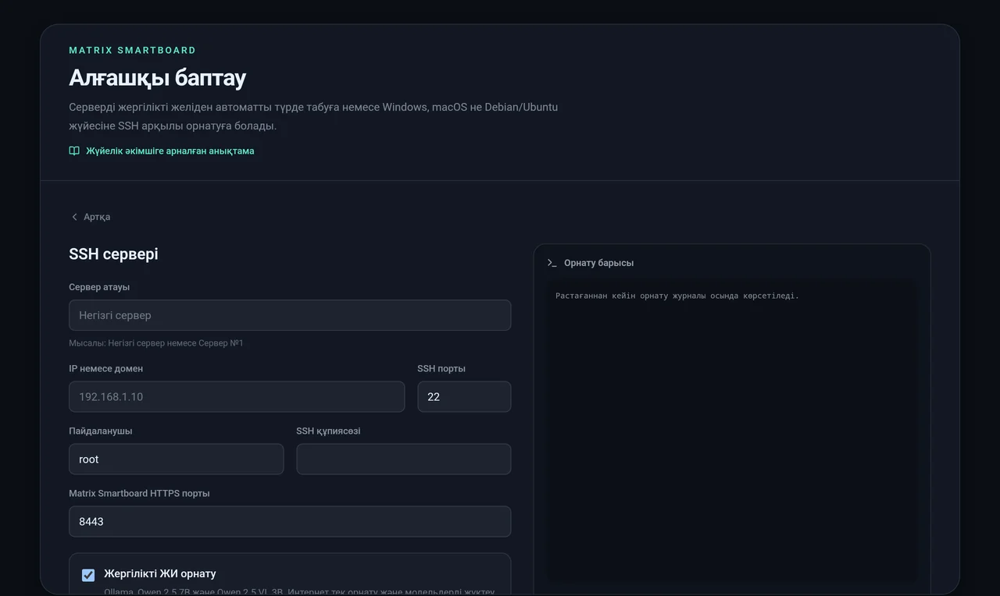

### Пішін өрістері

| Өріс | Не жазу керек |
|---|---|
| **Сервер атауы** | Тақталарда көрінетін түсінікті атау: «Негізгі сервер», «№1 сервер». 48 таңбаға дейін |
| **IP немесе домен** | Болашақ сервердің мектеп желісіндегі мекенжайы, мысалы `192.168.1.10` |
| **SSH порты** | Әдетте `22` |
| **Пайдаланушы** | `root` немесе әкімші құқығы бар пайдаланушы |
| **SSH құпиясөзі** | Осы пайдаланушының құпиясөзі. **Сақталмайды**: тек орнату кезінде қолданылады |
| **sudo құпиясөзі** | Жүйе macOS немесе Linux болса және пайдаланушы `root` болмаса шығады. Бос қалдыруға болады, онда SSH құпиясөзі қолданылады |
| **HTTPS порты** | Әдетте `8443`. Тек бос болмаса ғана өзгертіңіз |
| **Жергілікті ЖИ орнату** | Ollama мен екі модельді орнатады: Qwen 2.5 7B (кеңестер, тексеру, сабақ құру) және Qwen 2.5 VL 3B (тақтада жазылғанды тану). Интернет пен дискте шамамен 8 ГБ керек |


### «SSH-ті тексеру» батырмасын басқаннан кейін не болады

1. **SSH кілтін тексеру.** Қолданба қосылып, осы компьютердің SSH кілтінің іздерін (fingerprint) көрсетеді және жүйені анықтайды: «Windows» немесе «macOS / Linux». Ауыстырылған емес, қажетті компьютерге қосылғаныңызға көз жеткізу үшін іздерді нақтысымен салыстырыңыз:
   - Linux / macOS: `ssh-keygen -lf /etc/ssh/ssh_host_ed25519_key.pub`
   - Windows (әкімші ретінде ашылған PowerShell): `ssh-keygen -lf $env:ProgramData\ssh\ssh_host_ed25519_key.pub`

   Қолданбадағы із осы пәрмен шығаратын пішімде жазылады: `SHA256:…`. Серверде ed25519 кілті болмаса, `ssh_host_ecdsa_key.pub` файлымен салыстырыңыз.
2. Растау белгісін қойып, **«Matrix Smartboard орнату»** батырмасын басыңыз. Оң жақтағы «Орнату барысы» терезесінде журнал нақты уақытта көрінеді.

### Орнату қадамдары (журналда көрінеді)

**Debian / Ubuntu:**

| Қадам | Не істейді |
|---|---|
| `[1/7]` | Жүйелік пакеттерді орнатады: `git curl python3 python3-venv python3-pip` |
| `[2/7]` | `matrix-smartboard` жүйелік пайдаланушысын және `/var/lib/matrix-smartboard` деректер қалтасын жасайды |
| `[3/7]` | Бағдарламаны GitHub-тан `/opt/matrix-smartboard` ішіне жүктейді |
| `[4/7]` | Python ортасын жасап, тәуелділіктерді орнатады |
| `[5/7]` | Ollama-ны орнатып, модельдерді жүктейді (ЖИ таңдалса) |
| `[6/7]` | Автоматты іске қосылатын `matrix-smartboard` systemd қызметін жасайды. `ufw` қосулы болса, 8443/TCP портын және mDNS 5353/UDP ашады |
| `[7/7]` | Сервердің HTTPS арқылы жауап бергенін тексереді |

**macOS** — қадамдар сол, бірақ systemd орнына launchd қолданылады (`/Library/LaunchDaemons/ru.matrixhost.smartboard.plist`). macOS брандмауэрі қосулы болса, орнатқыш Python үшін кіріс қосылымдарына рұқсат береді.

**Windows** — бәрі `C:\ProgramData\MatrixSmartboard` ішінде (`app` — бағдарлама, `data` — деректер). Сервер жүйе іске қосылғанда `SYSTEM` атынан **«Matrix Smartboard Server»** жоспарлағыш тапсырмасымен, Ollama — «Matrix Smartboard Ollama» тапсырмасымен іске қосылады. Windows брандмауэрінде «Matrix Smartboard HTTPS» және «Matrix Smartboard mDNS» ережелері жасалады.

Сонымен қатар Linux пен macOS жүйелерінде екі қызметтік көмекші орнатылады:

- `/usr/local/sbin/matrix-smartboard-update` — автоматты кері қайтаруы бар жаңарту;
- `/usr/local/sbin/matrix-smartboard-service-control` — Ollama-ны қайта іске қосу.

Қызметке `sudo` арқылы құпиясөзсіз тек осы екі пәрменге рұқсат етілген: осылайша қолданбадағы «Жаңарту» және «Қайта іске қосу» батырмалары жүйенің қалған бөлігіне root қолжетімділігінсіз жұмыс істейді.

### Немен аяқталады

Орнатқаннан кейін бірден қолданба жаңа сервердің кілтін өзі бекітеді. Оны бөлек растаудың қажеті жоқ: сіз бұл компьютерді SSH ізі бойынша растап қойдыңыз. Тақта мектеп аккаунтын жасауға өтеді ([9-бөлім](#9-мектеп-аккаунты-және-кабинеттер)).

> SSH және sudo құпиясөздері орнатудан кейін бірден қолданба жадынан өшіріледі және еш жерде сақталмайды.

---

## 6. Б жолы: дайын серверге қосылу

**«Серверді табу»** батырмасын басыңыз. Қолданба серверлерді шамамен 15 секунд іздейді: 5 секундтан үш раунд, кеш жауап берген сервер де тізімге ілігуі үшін.

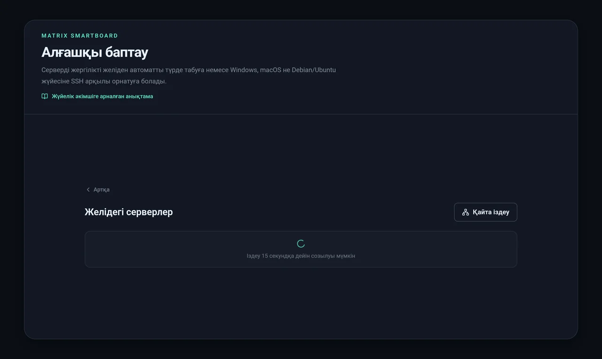

### Іздеу қалай жұмыс істейді

1. **mDNS / DNS-SD.** Сервер желіде өзін `_matrixboard._tcp.local` қызметі ретінде атауымен («Негізгі сервер») және Server ID-мен бірге жариялайды. Маршрутизатор multicast өткізсе, бұл кәдімгі мектеп желісінде баптаусыз жұмыс істейді.
2. **Қосалқы нұсқа: ішкі желіні сканерлеу.** Қонақ желілерде, телефоннан таратылған нүктелерде және «клиенттерді оқшаулау» қосулы желілерде multicast жиі бұғатталады. Онда қолданба өз `/24` ішкі желісін (`192.168.1.1–254` түріндегі барлық мекенжай) **8443** портында өзі тексереді. Тізімге `/api/status` сұрауына өзін Matrix Smartboard деп жауап бергендер ғана түседі. Бөгде құрылғылар қосылмайды.
3. **Қолмен енгізу.** 5 секундтан кейін «Сервер мекенжайын қолмен енгізу» батырмасы шығады. IP енгізу жеткілікті: порт пен хаттаманы көрсетпесеңіз, қолданба `https://…:8443` қояды.

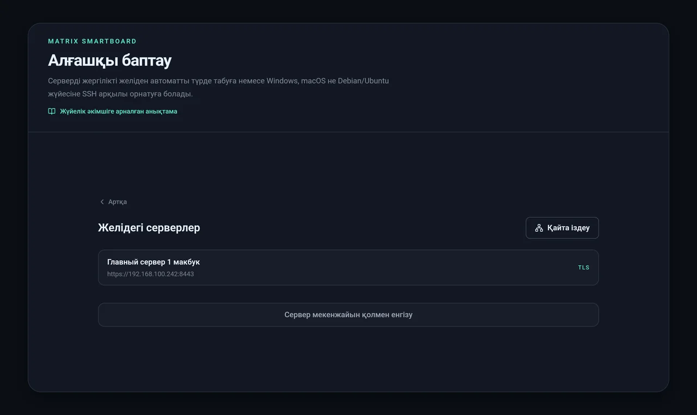

Тізімдегі серверді басыңыз. Ол табылмаса, мекенжайды қолмен енгізіңіз:

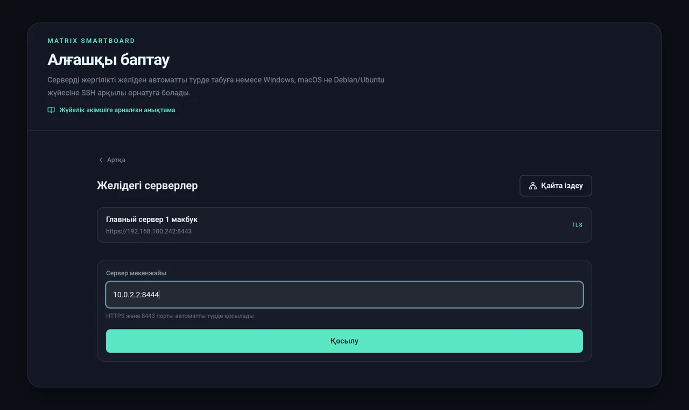

Алғаш қосылғанда қолданба **Server ID** мен **ашық кілттің PIN-ін** көрсетіп, оларды растауды сұрайды:

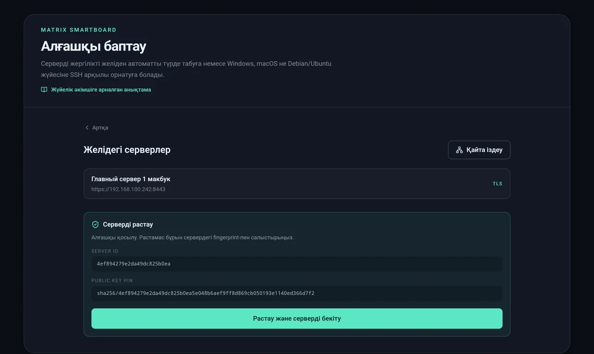

Оларды сервермен салыстырыңыз (қалай жасау керегін [7-бөлімнен](#7-қосылымды-қорғау-server-id-және-кілттің-pin-і) қараңыз) және **«Растау және серверді бекіту»** батырмасын басыңыз.

---

## 7. Қосылымды қорғау: Server ID және кілттің PIN-і

Әр сервердің тұрақты **TLS сәйкестендіруі** бар: орнату кезінде жасалған өз кілті. Кілттен мыналар алынады:

- **Server ID** — қысқа идентификатор, мысалы `4ef894279e2da49dc825b0ea`;
- **Public key pin** — `sha256/…` түріндегі кілт ізі.

Алғаш қосылғанда тақта бұл кілтті **бекітеді** (pin) және әрі қарай тек онымен сөйлеседі. Желіде дәл сондай атауы бар жалған сервер пайда болса да, тақта оған қосылмайды.

**PIN-ді сервердің өзінде қалай тексеру керек.** Серверде немесе сол желідегі кез келген компьютерде іске қосыңыз:

```bash
curl -k https://192.168.1.10:8443/api/status
```

Жауапта `serverId` және `publicKeyPin` өрістері бар. Олар тақта көрсеткенмен сәйкес келуі керек. `-k` жалауы сертификат өздігінен қол қойылған болғандықтан керек. Сенімді дәл pin салыстыру қамтамасыз етеді.

**Сервердің IP мекенжайы өзгерсе,** сертификат сол кілтке қайта шығарылады. Server ID мен pin өзгермейді, ештеңені қайта растаудың қажеті жоқ.

---

## 8. Келесі іске қосуларда тақта серверді қалай табады

Әр іске қосылған сайын қолданба:

1. **соңғы сақталған мекенжайды** тексереді;
2. ол жауап бермесе, желіден mDNS арқылы **сол Server ID-ні** **6,5 секундқа** дейін іздейді (IP өзгерісі осылай еңсеріледі);
3. жаңа мекенжайды тек сервер кілті бекітілгенімен сәйкес келсе ғана қабылдайды.

Ештеңе шықпаса, диагностика экраны пайда болады:

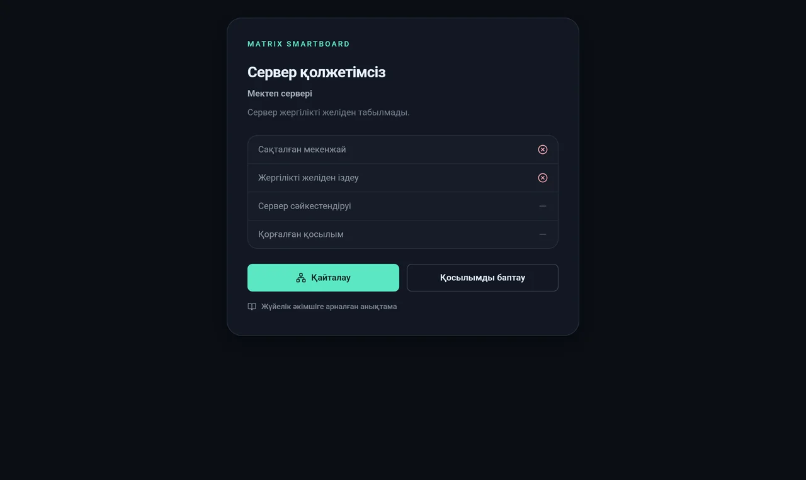

Ол қай қадамда ақау болғанын көрсетеді:

| Жол | Қызыл айқыш болса |
|---|---|
| **Сақталған мекенжай** | Сервер ескі мекенжай бойынша жауап бермейді: өшірулі, IP өзгерген немесе қызмет құлаған |
| **Жергілікті желіден іздеу** | mDNS осы Server ID бар серверді таппады: басқа желі немесе multicast бұғатталған |
| **Сервер сәйкестендіруі** | Сервер жауап берді, бірақ **басқа кілтпен**. Бұл резервтік көшірмені қалпына келтірмей қайта орнату немесе алмастыру |
| **Қорғалған қосылым** | Сервер табылды, бірақ HTTPS немесе backend жұмыс істемейді |

«Қайталау» батырмасы тексеруді қайта іске қосады. «Қосылымды баптау» серверді таңдауға қайтарады. «Жүйелік әкімшіге арналған анықтама» осы бөлімді ашады.

> Сабақ кезінде байланыс қысқа уақытқа үзілсе, жұмыс тоқтамайды. Мұғалім «Байланыс жоқ» дегенді көреді, өзгерістер тақтадағы кезекке жиналады да, байланыс қалпына келгенде серверге өздері кетеді.

---

## 9. Мектеп аккаунты және кабинеттер

Серверге қосылғаннан кейін бір рет **мектеп аккаунты** жасалады: атауы мен құпиясөзі (кемінде 8 таңба). Мектептің барлық тақтасы бір аккаунтқа кіреді.


Бірінші тақта үшін **«Тіркелу»** қойындысын таңдаңыз:

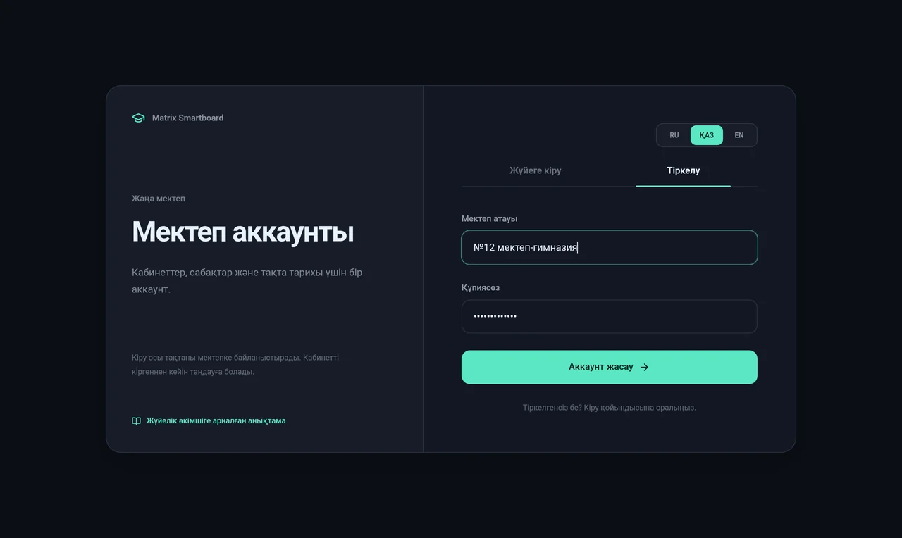

Әрі қарай тақта **кабинетке байланады**. Әр кабинеттің өз сабақтар тарихы бар.

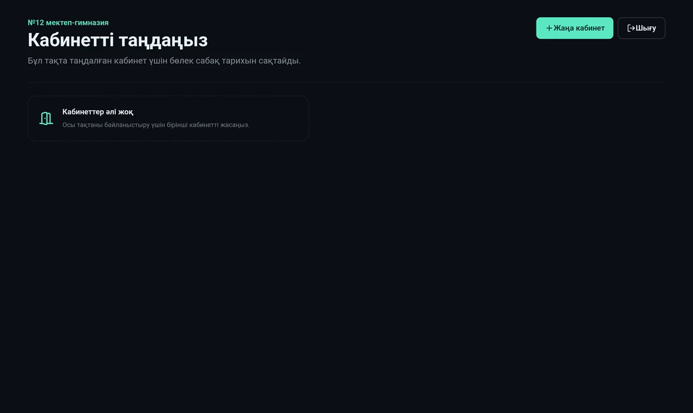

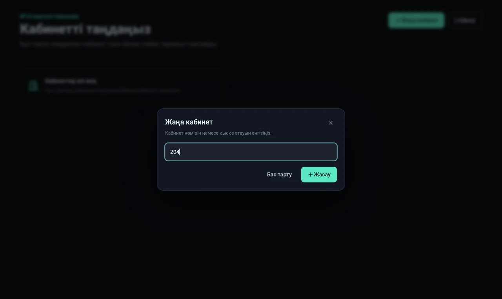

Келесі тақталарда «Жүйеге кіру» таңдап, сол атау мен құпиясөзді енгізіңіз де, тізімнен кабинетті таңдаңыз немесе жаңасын жасаңыз.

> Мектеп құпиясөзін қызметтік құпиясөз ретінде сақтаңыз. Оны қолданба арқылы тастау мүмкін емес.

---

## 10. «Сервер» экраны: бақылау, жаңарту, резервтік көшірмелер

Сабақ кезінде баптауларды ашып (жоғарғы оң жақтағы жүгірткілер белгішесі), **«Сервер»** жолын басыңыз.

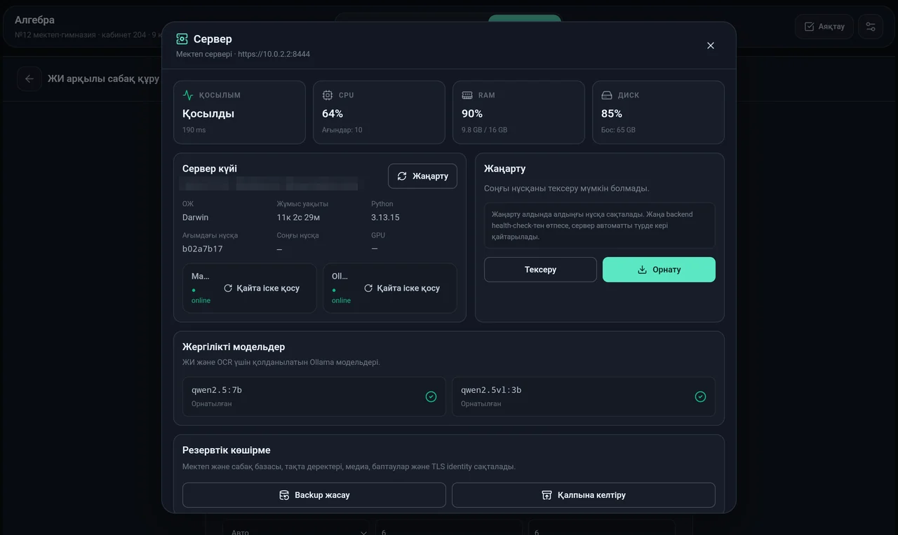

- **Қосылым, CPU, RAM, диск** — серверге дейінгі кідіріс және жүктеме.
- **Сервер күйі** — ОЖ, жұмыс уақыты, Python нұсқасы, бағдарламаның ағымдағы және соңғы нұсқалары. **Matrix backend** пен **Ollama** күйі бөлек көрсетіледі, әрқайсысында «Қайта іске қосу» батырмасы бар.
- **Жаңарту** — «Тексеру» және «Орнату» (толығырақ [13-бөлімде](#13-жаңарту-және-кері-қайтару)).

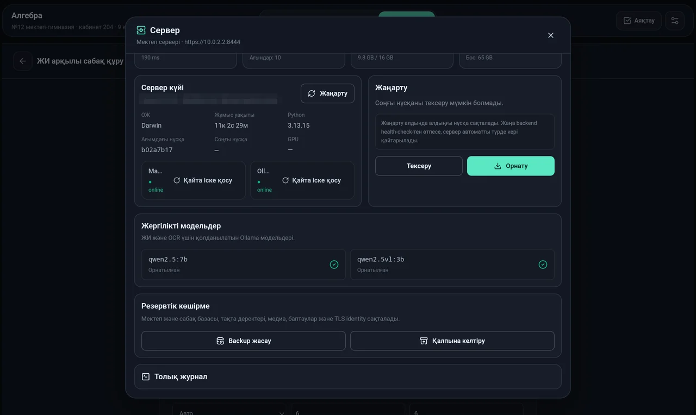

- **Жергілікті модельдер** — `qwen2.5:7b` және `qwen2.5vl:3b` орнатылған ба. Жетіспейтін модельді осы жерден жүктеуге болады.
- **Резервтік көшірме** — «Backup жасау» мұрағатты жүктеп алады: мектеп пен сабақтар базасы, тақталар, оқулықтар мен суреттер, баптаулар және **TLS сәйкестендіруі**. «Қалпына келтіру» осындай мұрағатты қайта жүктейді.
- **Толық журнал** — сервер журналдары, оларды өтінішке тіркеу ыңғайлы.

> Резервтік көшірмеде сервердің жеке кілті және мектептің барлық деректері бар. Оны құпиясөз сияқты сақтаңыз: ортақ чатта да, ортақ флешкада да емес.

---

## 11. Серверде не қайда жатыр

| | Linux | macOS | Windows |
|---|---|---|---|
| Бағдарлама | `/opt/matrix-smartboard` | `/opt/matrix-smartboard` | `C:\ProgramData\MatrixSmartboard\app` |
| Деректер | `/var/lib/matrix-smartboard` | `/var/lib/matrix-smartboard` | `C:\ProgramData\MatrixSmartboard\data` |
| База (мектеп, сабақтар, тақталар) | `…/practice.db` | `…/practice.db` | `…\practice.db` |
| TLS сәйкестендіруі | `…/identity` | `…/identity` | `…\identity` |
| Қызмет | systemd `matrix-smartboard` | launchd `ru.matrixhost.smartboard` | «Matrix Smartboard Server» тапсырмасы |
| Сервер журналы | `journalctl -u matrix-smartboard` | `/var/tmp/matrix-smartboard.log` | «Сервер» экраны → журнал |
| Жаңарту журналы | `/var/lib/matrix-smartboard/update.log` | `/var/tmp/matrix-smartboard-update.log` | «Сервер» экраны |

Linux-тағы пайдалы пәрмендер:

```bash
sudo systemctl status matrix-smartboard
```

```bash
sudo systemctl restart matrix-smartboard
```

```bash
sudo journalctl -u matrix-smartboard -n 100
```

macOS-та:

```bash
sudo launchctl kickstart -k system/ru.matrixhost.smartboard
```

---

## 12. Желі және порттар

| Порт | Хаттама | Не үшін |
|---|---|---|
| **8443** | TCP | HTTPS: тақта мен сервердің бүкіл байланысы |
| **5353** | UDP (multicast `224.0.0.251`) | mDNS: тақталар серверді өздері табады |
| 22 | TCP | SSH: тек автоматты баптау кезінде |
| 11434 | TCP, тек жергілікті | Ollama, сыртқа ашудың қажеті жоқ |

Тақталар мен сервер әртүрлі VLAN-да болса немесе multicast тыйым салынса, автоматты іздеу жұмыс істемейді. Ештеңе етпейді: IP-ді бір рет қолмен енгізіңіз. Әрі қарай тақта мекенжай мен кілтті өзі есте сақтайды.

---

## 13. Жаңарту және кері қайтару

Серверді екі тәсілмен жаңартуға болады:

- **Тақтадан:** баптаулар → «Сервер» → «Тексеру» → «Орнату».
- **Сервердің өзінде** (Linux, macOS):

  ```bash
  sudo /usr/local/sbin/matrix-smartboard-update
  ```

Жаңарту не істейді:

1. ағымдағы нұсқаны есте сақтайды;
2. **деректерді сақтайды** (базаны, оқулықтарды, суреттерді) және кейін оларды файлдардың бұрынғы иесімен орнына қайтарады;
3. жаңа нұсқаны GitHub-тан жүктеп, тәуелділіктерді орнатады;
4. қызметті қайта іске қосып, жаңа нұсқаның HTTPS арқылы жауап беруін күтеді;
5. **жаңа нұсқа іске қосылмаса, ескісіне автоматты түрде кері қайтарады**.

Жаңарту барысы жаңарту журналына жазылады ([11-бөлімді](#11-серверде-не-қайда-жатыр) қараңыз). Соңғы жол `Update successful: <нұсқа>` немесе кері қайтару туралы хабар болады.

Тақталардағы қолданба жаңа APK-ны ескісінің үстінен орнату арқылы жаңартылады (`adb install -r`). Деректер мен қосылым сақталады.

---

## 14. Келесі тақталарды қосу

Әр жаңа тақта үшін:

1. APK орнатыңыз ([3-бөлім](#3-қолданбаны-тақтаға-орнату)).
2. Тіл → **«Серверді табу»** → серверді таңдаңыз → PIN-ді салыстырыңыз → «Растау және серверді бекіту».
3. **«Жүйеге кіру»** → мектептің атауы мен құпиясөзі.
4. Осы тақтаның кабинетін таңдаңыз немесе жаңасын жасаңыз.

Болды. Мұғалім сыныпты таңдау экранын көреді. Тақтамен әрі қарай жұмысты [мұғалімге арналған нұсқаулық](teacher.md) сипаттайды.

---

## 15. Жүйелік әкімшіге арналған FAQ

**Іздеу серверді таппайды.**
1. Тақта мен сервер бір желіде ме? Қонақ Wi-Fi көбіне негізгі желіден оқшауланған.
2. Сервер жұмыс істеп тұр ма? Кез келген компьютердің браузерінде `https://<IP>:8443/api/status` ашыңыз. Сертификат туралы ескерту — қалыпты жағдай.
3. Брандмауэр 8443/TCP өткізе ме?
4. IP-ді қолмен енгізіңіз: батырма іздеудің 5 секундынан кейін шығады.

**Автоматты баптау: «SSH қолжетімсіз».**
SSH сервері іске қосылмаған немесе порт қате көрсетілген. Linux: `sudo systemctl status ssh`. Windows: «OpenSSH SSH Server» (sshd) қызметі іске қосулы болуы керек. macOS: «Қашықтан кіру» қосулы.

**Автоматты баптау: «SSH пайдаланушысы немесе құпиясөзі қате».**
Пернетақта тілін және пайдаланушы атын тексеріңіз. Кіру құпиясөз арқылы жүреді: тек SSH кілті арқылы кіруді қолданба қолдамайды.

**Windows-та автоматты баптау құқық қатесімен құлайды.**
SSH пайдаланушысы **Administrators** тобында болуы керек. `winget` қолжетімді екенін тексеріңіз: ескі Windows нұсқаларында оны Microsoft Store-дан («Қолданба орнатқышы») орнату керек.

**Автоматты баптау: «Сервердің SSH fingerprint мәні өзгерді».**
Осы мекенжайдың SSH кілті қолданба бұрын көргенінен өзгеше. Жүйені қайта орнатқан болсаңыз, бұл қалыпты. Олай болмаса, сол компьютер ме екенін тексеріңіз.

**«Бұл Matrix Smartboard сервері емес» қатесі.**
Бұл мекенжай мен портта басқа бірдеңе жауап береді. IP мен портты тексеріңіз (әдепкі бойынша 8443).

**«Сервер нұсқасы ескірген» немесе «Қолданбаның бұл нұсқасы ескірген» қатесі.**
Қолданба мен сервер нұсқалары үйлеспейді. Серверді жаңартыңыз ([13-бөлім](#13-жаңарту-және-кері-қайтару)) немесе тақтаға жаңа APK орнатыңыз.

**«Сервер сәйкестендіруі» қызыл айқышпен / «Сервердің TLS сәйкестендіруі күтілген мәнмен сәйкес емес».**
Сервер басқа кілтпен жауап берді. Әдетте бұл оны резервтік көшірмені қалпына келтірмей нөлден қайта орнатқанын білдіреді. Солай болса, тақтада «Қосылымды баптау» басып, қайта қосылыңыз: тақта жаңа кілтті бекітеді. Серверге ешкім тимесе, біреу желіде серверді алмастыруы мүмкін. Растамас бұрын анықтаңыз.

**Тақталарды қайта баптамай серверді басқа компьютерге қалай көшіруге болады?**
Ескі серверде резервтік көшірме жасаңыз («Сервер» экраны → «Backup жасау»), серверді жаңа компьютерге орнатып, көшірмені қалпына келтіріңіз. TLS сәйкестендіруі деректермен бірге көшеді, Server ID бұрынғыдай қалады, ал тақталар жаңа мекенжайды mDNS арқылы өздері табады. Желіде mDNS жұмыс істемесе, әр тақтада жаңа IP-ді бір рет енгізіңіз.

**Сервердің IP-і өзгерді. Тақталарда бірдеңе істеу керек пе?**
Желіде mDNS жұмыс істесе — жоқ: тақталар серверді Server ID бойынша табады. Жұмыс істемесе, «Сервер қолжетімсіз» экранында «Қосылымды баптау» басып, жаңа IP енгізіңіз. Кілт сол күйі қалады.

**ЖИ «OCR қолжетімсіз» деп жазады немесе жауап бермейді.**
«Сервер» экранын ашыңыз: Ollama «online», ал екі модель «Орнатылған» болуы керек. Ollama жұмыс істемесе, «Қайта іске қосу» басыңыз. Модельдер жоқ болса, оларды сол жерден немесе серверде жүктеңіз:

```bash
ollama pull qwen2.5:7b
```

```bash
ollama pull qwen2.5vl:3b
```

Жады 8 ГБ серверге ЖИ сыймауы мүмкін. 16 ГБ керек.

**ЖИ өте ұзақ жауап береді.**
Бейнекартасыз 7B моделі ондаған секундта жауап береді, бұл күтілетін жағдай. NVIDIA бейнекартасы немесе Apple Silicon-дағы Mac жылдамдатады. Бұл тақтадағы сабақты баяулатпайды: ЖИ тек кеңес, тексеру және сабақ құру үшін керек.

**Мұғалім PIN-кодты ұмытып қалды.**
PIN тек осы тақтада сақталады. Оны тастау үшін қолданба деректерін тазалаңыз: Android баптаулары → Қолданбалар → Matrix Smartboard → Жад → Деректерді тазалау, немесе ADB арқылы:

```bash
adb shell pm clear ru.matrixhost.smartboard
```

Содан кейін тақтаны серверге қайта қосу керек ([14-бөлім](#14-келесі-тақталарды-қосу)). Сабақтар мен тақталар серверде сақталады және жоғалмайды.

**Мектеп құпиясөзі ұмытылды.**
Оны қолданба арқылы тастау мүмкін емес. Аккаунтқа кіріп қойған тақталар жұмысын жалғастырады. Тастау үшін серверге қолжетімділік керек, әзірлеушіге хабарласыңыз.

**Тақтада веб-режим туралы хабар шықты («…нативті сызу істен шықты…»).**
Жылдам сия сызу (Android арқылы нативті) қатарынан бірнеше рет іске қосылмады, ал тақта сабақ тоқтап қалмауы үшін қосалқы веб-сызуға өзі ауысты. Мұғалім «Қайта көру» батырмасын баса алады. Бұл қайталанса, әзірлеушіге тақтаның моделі мен журналын жіберіңіз. Журналды былай алыңыз:

```bash
adb logcat -d > board-log.txt
```

**Жанасулар немесе сызық қаламнан ығысқан.**
Тақтадағы қолданбаны соңғы нұсқаға дейін жаңартыңыз: онда терезенің жоғарғы жағында жүйелік жолақ болғанда пайда болатын жанасу ығысуы түзетілген. Ығысу қалса, сенсорды тақтаның өз баптауларында калибрлеңіз.

**Сабақтар қайда жатыр және нені резервтеу керек?**
Бәрі деректер қалтасында ([11-бөлім](#11-серверде-не-қайда-жатыр)). Ең оңайы — аптасына бір рет немесе жаңарту алдында «Сервер» экранынан резервтік көшірме жасау. Деректер қалтасының өзін де көшіруге болады, бірақ тек қызмет тоқтатылған кезде.

**Серверді интернетке ашу керек пе?**
Жоқ, ашпаған жөн. Сервер мектеп желісінің ішінде жұмыс істеуге арналған.

**Сервер қанша тақтаны көтереді?**
Тақталар серверге тек сызықтар мен операцияларды жібереді, бұл деректердің аз көлемі. Кәдімгі компьютер мектептің барлық кабинетіне еркін қызмет көрсетеді. Тар жер — ЖИ: бірнеше тақтадан бір мезгілде келген ЖИ сұраулары кезекке тұрады.
