# Matrix Smartboard: мұғалімге арналған нұсқаулық

Бұл нұсқаулық интерактивті тақтада сабақ өткізетін мұғалімге арналған. Ештеңе орнатудың қажеті жоқ: тақтаны мектептің жүйелік әкімшісі дайындап қойған. Егер тақтада «Алғашқы баптау» немесе «Сервер қолжетімсіз» экраны ашылса, жүйелік әкімшіні шақырыңыз. Оған арналған [бөлек нұсқаулық](admin.md) бар.

Барлық скриншот нақты қолданбада түсірілген.

**Мазмұны**

1. [Сабақты бір минутта бастау](#1-сабақты-бір-минутта-бастау)
2. [Сабақ экраны](#2-сабақ-экраны)
3. [Құралдар панелі](#3-құралдар-панелі)
4. [Қалам және түстер](#4-қалам-және-түстер)
5. [Сызғышсыз тегіс фигуралар](#5-сызғышсыз-тегіс-фигуралар)
6. [Сызғыш, транспортир және циркуль](#6-сызғыш-транспортир-және-циркуль)
7. [Өшіргіш, болдырмау, тазарту](#7-өшіргіш-болдырмау-тазарту)
8. [Функция графиктері](#8-функция-графиктері)
9. [Оқулық беттері мен суреттер тақтада](#9-оқулық-беттері-мен-суреттер-тақтада)
10. [Қабаттар: не неден жоғары жатады](#10-қабаттар-не-неден-жоғары-жатады)
11. [Жылжыту, лассо, тақта беттері](#11-жылжыту-лассо-тақта-беттері)
12. [Тапсырмалар және ЖИ-көмекші](#12-тапсырмалар-және-жи-көмекші)
13. [Презентация](#13-презентация)
14. [Мұғалім панелі: сабаққа дайындық](#14-мұғалім-панелі-сабаққа-дайындық)
15. [Оқулық бойынша ЖИ арқылы сабақ құру](#15-оқулық-бойынша-жи-арқылы-сабақ-құру)
16. [Сабақты аяқтау және тарих](#16-сабақты-аяқтау-және-тарих)
17. [Баптаулар](#17-баптаулар)
18. [Мұғалімге арналған FAQ](#18-мұғалімге-арналған-faq)

---

## 1. Сабақты бір минутта бастау

Сабақ үш қадаммен басталады: сынып → пән → тақта түрі.

**1-қадам. Сынып.** Сынып нөмірін басыңыз.

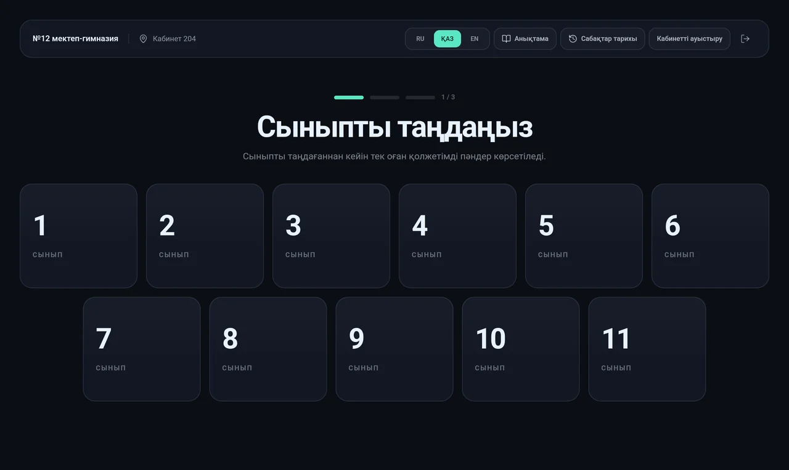

Жоғарыда мектеп пен кабинеттің атауы көрінеді. Оң жақта «Сабақтар тарихы» (осы кабинеттің өткен сабақтары) және «Кабинетті ауыстыру» батырмалары бар. «Анықтама» батырмасы осы нұсқаулықты ашады.

**2-қадам. Пән.** Тізім сыныпқа байланысты: мысалы, 9-сыныпта алгебра, геометрия, физика, химия, биология, география және үш тіл бар.

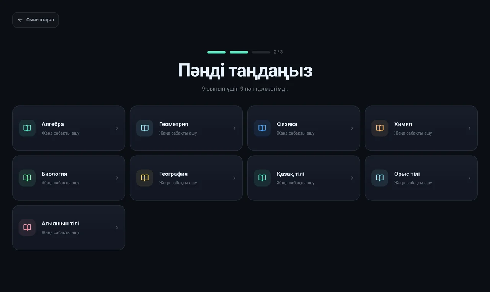

**3-қадам. Тақта түрі.** Ол құралдарды сабаққа қарай бейімдейді:

- **Аналитикалық** — математика, физика және басқа нақты пәндерге: тор, графиктер, сызғыш.
- **Мәтіндік** — тілдер мен тарихқа: дәптердегідей жолдар, маркер, астын сызу.
- **Әмбебап** — барлық құрал бірден.

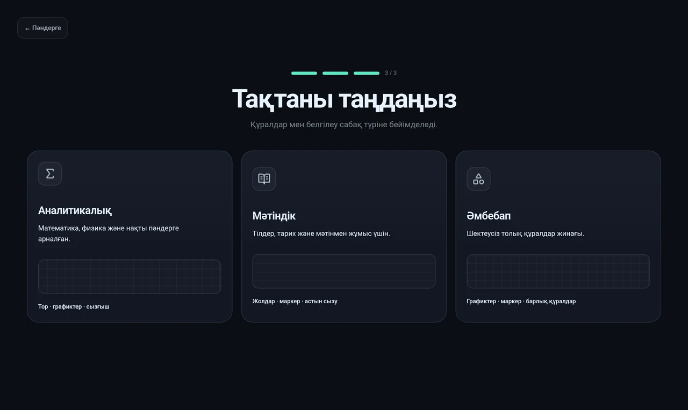

Болды, сабақ ашылды. Жоғарғы оң жақ бұрыштағы сабақ таймері іске қосылды.

> **Егер сабақ ортасында қолданба жабылып қалса** (тақта өшірілсе, жарық сөнсе, біреу «Үйге» батырмасын басса), келесі іске қосқанда ол сабаққа оралуды ұсынады. Тақта, өзгерістер тарихы және ЖИ-мен хат алмасу сақталады.
>
> 

---

## 2. Сабақ экраны

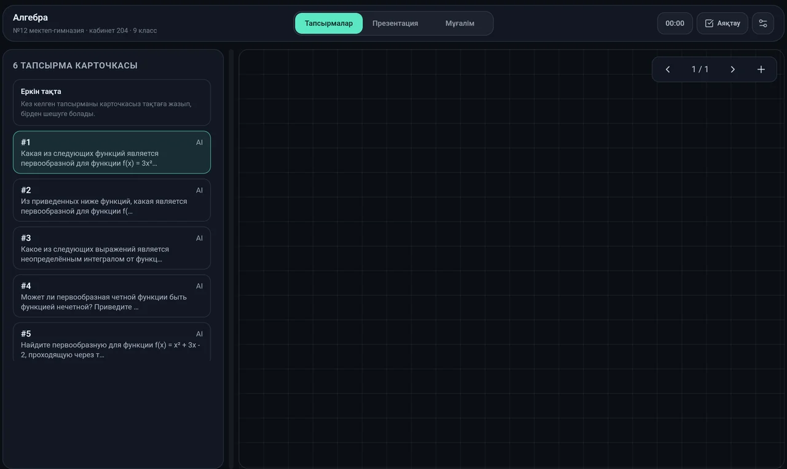

- **Сол жақта — тапсырма карточкалары.** «Еркін тақта» — тапсырмасыз жай тақта. Нөмірлі карточкалар — сабақтың тапсырмалары. Тапсырманы таңдау үшін карточканы басыңыз.
- **Ортасында — тақта.** Оған қаламмен немесе саусақпен жазады.
- **Жоғарыда ортада — үш қойынды:** «Тапсырмалар» (тақта), «Презентация» (слайдтар) және «Мұғалім» (сабаққа дайындық, PIN-кодпен жабық).
- **Жоғарыда оң жақта:** сабақ таймері, «Аяқтау» батырмасы және баптаулар (жүгірткілер белгішесі).
- **Тақтаның жоғарғы оң бұрышында — беттер:** көрсеткілер беттерді парақтайды, «+» жаңа бет қосады.

---

## 3. Құралдар панелі

Құралдар панелі тақтаның төменгі жағында орналасқан. Жазып жатқанда ол жасырынады да, кедергі келтірмейді. Оны қайтару үшін тақтаның төменгі шетімен саусақпен немесе қаламмен жүргізіңіз.

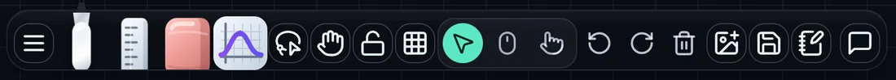

Солдан оңға қарай:

| Батырма | Не істейді |
|---|---|
| ☰ **Панельдер** | Сол жақтағы тапсырмалар бағанын жасырады не көрсетеді — тақта кеңейеді |
| **Қалам** | Жазады. Қайта басқанда қалыңдық пен түстер ашылады |
| **Сызғыш** | Сызғыш, транспортир және циркуль |
| **Өшіргіш** | Өшіреді. Қайта басқанда өшіргіштің өлшемі |
| **График** | Функция графиктері бар координаталық жазықтықты қояды |
| **Лассо** | Суреттің бір бөлігін қоршап, жылжыту |
| ✋ **Жылжыту** | Тақтаны және ондағы суреттерді жылжыту |
| 🔓 **Құлып** | Тақтаны байқаусызда жылжытуға және масштабтауға тыйым салады |
| ▦ **Тақта** | Тор, масштаб, фон түсі |
| **Авто / Тінтуір / Сенсор** | Немен сызуға болады: бәрімен, тек тінтуірмен немесе тек қалам мен саусақпен |
| ↶ ↷ | Болдырмау және қайталау |
| 🗑 **Тақтаны тазарту** | Тақтадағының бәрін өшіру |
| **Сурет қою** | Оқулық беті немесе файлдағы сурет |
| **Сурет** | Тақтаны сурет ретінде сақтау |
| **Тапсырма** | Таңдалған тапсырманың шартын тақтаның үстінен көрсету |
| 💬 **ЖИ-көмекші** | Кеңес, шешімді тексеру, толық шешім |

---

## 4. Қалам және түстер

**Қаламды** қайта басыңыз — қалыңдық пен түстер ашылады. «…» батырмасы қалған түстерді көрсетеді.

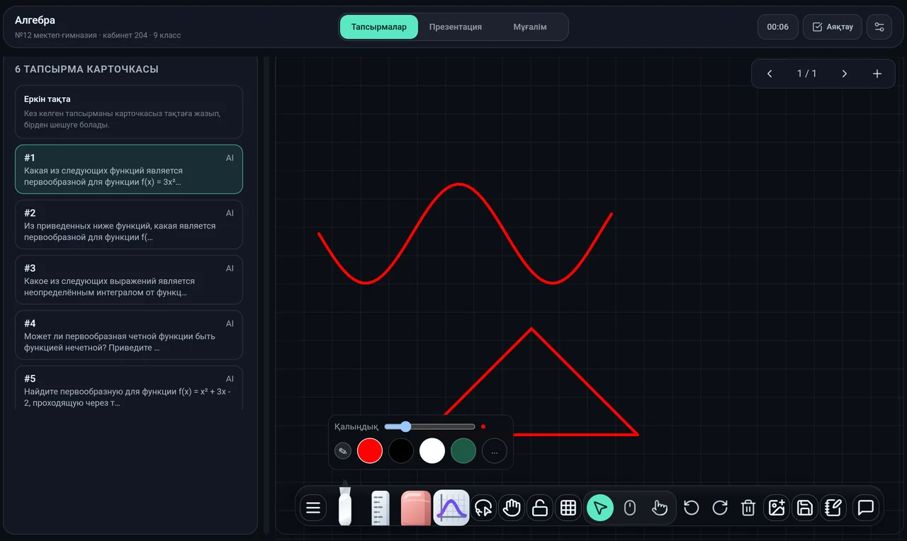

- Тақтаның стилусымен немесе саусақпен жазуға болады.
- **Бір мезгілде екеуі жаза алады**: тақта екі жанасуды ажыратады, сондықтан екі оқушы қатар шығара алады.
- Тақтаны жылжыту немесе үлкейту үшін **екі саусақты** ашыңыз не жабыңыз.

---

## 5. Сызғышсыз тегіс фигуралар

Фигураны қолмен салып, **соңында қаламды көтермей жарты секунд ұстап тұрыңыз**. Тақта нобайды өзі тегіс фигураға айналдырады:

- түзу сызық;
- шеңбер немесе сопақ;
- үшбұрыш;
- тіктөртбұрыш немесе төртбұрыш.

Жоғарыдағы скриншотта үшбұрыш қолмен салынған, ал тақта оны өзі түзеткен. Фигура керек болмаса, қаламды бірден көтеріңіз: сызық сіз салғандай қалады.

---

## 6. Сызғыш, транспортир және циркуль

Панельдегі **Сызғышты** басыңыз. Тақтада сызғыш пайда болады, ал панельдің үстінде үш құрал мәзірі ашылады: сызғыш, транспортир, циркуль.

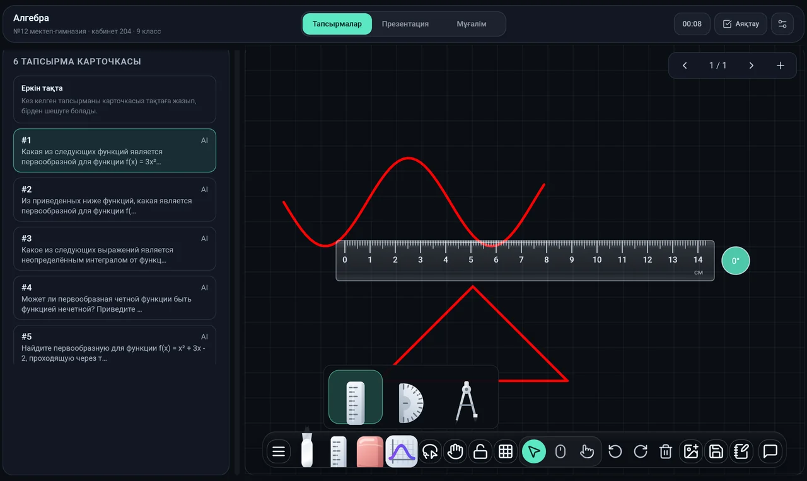

- **Сызғыш.** Шетімен жүргізсеңіз, сызық мінсіз түзу шығады. Жылжыту үшін сызғышты ортасынан саусақпен тартыңыз. Оң жақтағы дөңгелек тұтқа оны бұрады. Бұрыш осы тұтқада көрсетіледі және 15°, 30°, 45° т.с.с. мәндерге өзі жабысады.
- **Транспортир.** Дәл солай жылжиды және бұрылады. Бұрыштарды өлшеуге және салуға ыңғайлы.

  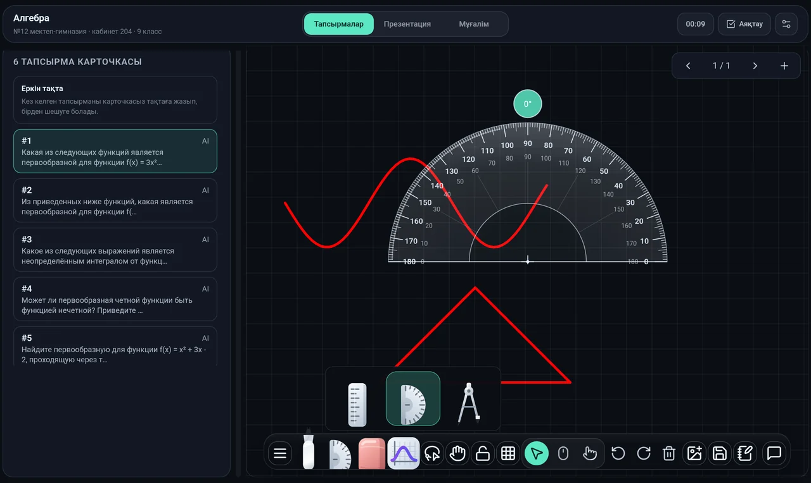

- **Циркуль.** Сол жақтағы шеңбер — ине (шеңбердің центрі). Ортасындағысы радиусты өзгертеді, радиус сантиметрмен жазылған. Қаламды оң жақтағы шеңберге қойып, жүргізіңіз — тегіс шеңбер немесе доға шығады.

  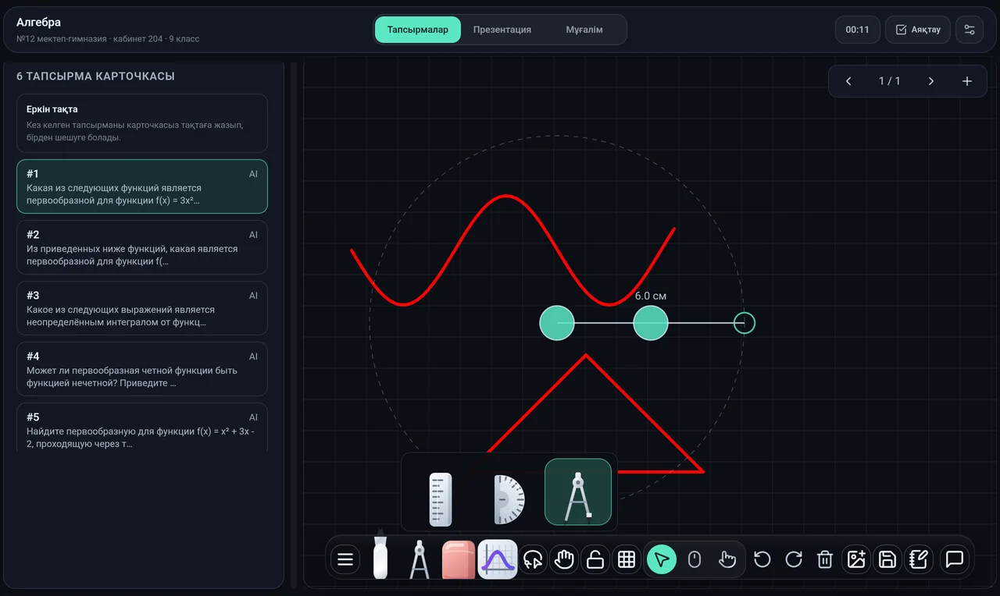

Құралды тақтадан алып тастау үшін оны мәзірде қайта басыңыз. Панельдегі батырма соңғы таңдалған құралды көрсетеді.

---

## 7. Өшіргіш, болдырмау, тазарту

- **Өшіргіш** өзі өткен жерді өшіреді. Өлшемін өзгерту үшін оны қайта басыңыз.

  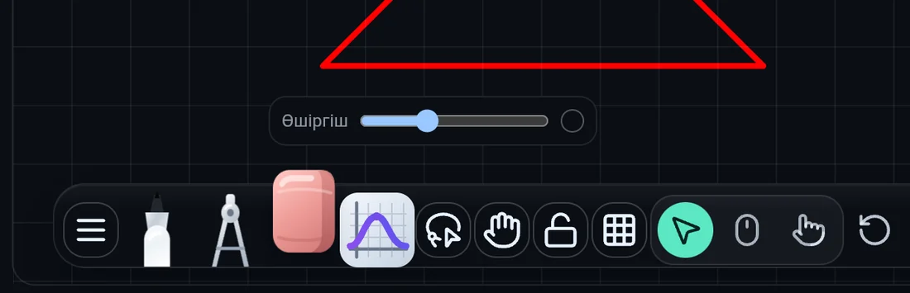

- **↶ Болдырмау / ↷ Қайталау** — кез келген әрекетті болдырмайды: сызықты, өшіруді, график пен суреттің жылжуын.
- **🗑 Тақтаны тазарту** — бәрін өшіреді. Тақтаны байқаусызда өшіріп алмау үшін слайдерді соңына дейін жылжыту керек. Тазартуды да ↶ батырмасымен болдырмауға болады.

---

## 8. Функция графиктері

**Графикті** басыңыз, содан кейін тақтаны басыңыз — координаталық жазықтық пайда болады.

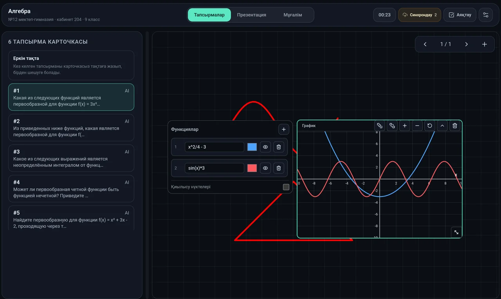

- **Функциялар** сол жақта енгізіледі, мысалы `x^2/4 - 3` немесе `sin(x)*3`. «+» тағы бір функция қосады, әрқайсысының өз түсі бар. Көз белгісі функцияны жасырады, себет өшіреді.
- **Қиылысу нүктелері** — белгіні қойсаңыз, тақта графиктердің қай жерде қиылысатынын көрсетеді.
- **Графикті жылжыту:** «График» сөзі жазылған жоғарғы жолақтан тартыңыз.
- **Өлшем:** төменгі оң бұрыштан тартыңыз.
- **Масштаб:** жолақтағы «+» және «−» батырмалары немесе графиктің өзінде екі саусақ. ↻ батырмасы қалыпты масштабты қайтарады.
- **Осьтердің белгілері** (`x`, `y`) басу арқылы өзгереді, мысалы физика үшін `t, с` және `v, м/с`.

Не жазуға болады: `+ - * / ^`, `sqrt` (түбір), `abs` (модуль), `sin cos tg ctg` (бұрыштар радианмен), `ln log`, `pi`, `e` және т.б.

---

## 9. Оқулық беттері мен суреттер тақтада

**Сурет қою** батырмасын басыңыз.

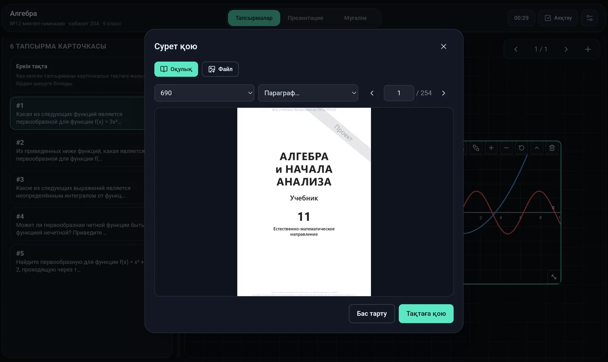

- **«Оқулық»** қойындысы: оқулықты, параграфты немесе бет нөмірін таңдап, «Тақтаға қою» батырмасын басыңыз.
- **«Файл»** қойындысы: құрылғыдағы сурет (PNG, JPG, WebP).

Сурет **жазудың астына** жатады: оқулық бетінде тура мәтіннің үстінен астын сызуға, қоршауға және жазуға болады.

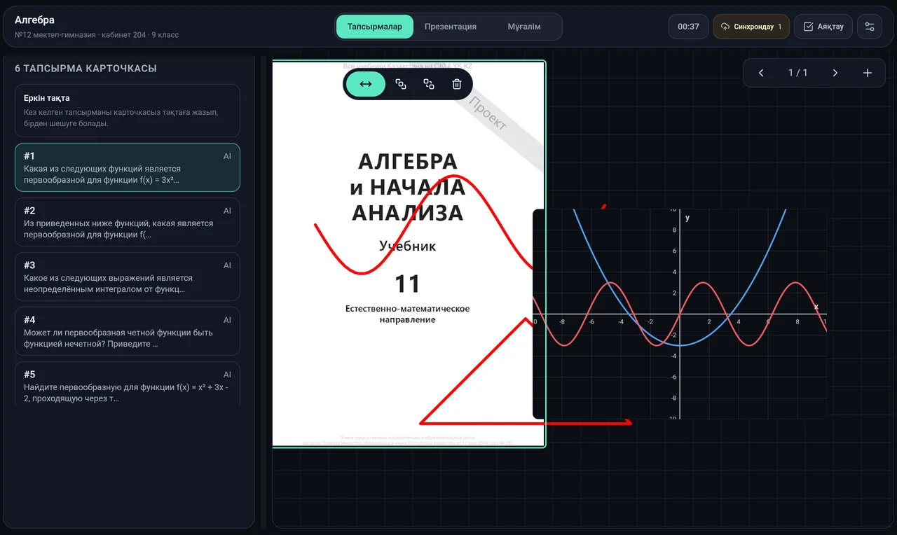

✋ **Жылжыту** құралы таңдалған кезде суретті:

- **жылжытуға** — саусақпен тартып;
- **өлшемін өзгертуге** — жасыл ↔ батырмасын оңға (үлкейту) немесе солға (кішірейту) тартып;
- **қабатын жоғары не төмен жылжытуға** — қасындағы екі батырма ([Қабаттар](#10-қабаттар-не-неден-жоғары-жатады) бөлімін қараңыз);
- **алып тастауға** — себет.

Қайта жазу үшін Қаламды таңдаңыз.

---

## 10. Қабаттар: не неден жоғары жатады

Суреттер мен графиктерде **«Қабатты жоғары»** және **«Қабатты төмен»** батырмалары бар. Олар нысандар бірін-бірі жапқанда керек:

- сурет суреттің үстінде — мысалы, оқулықтың екі беті;
- сурет графиктің үстінде және керісінше.

Әр басу нысанды бір орынға жылжытады. Әрекетті болдырмауға болады.

Маңызды: **қаламмен жазылғандар әрқашан суреттердің үстінде, ал графиктер жазудың үстінде жатады.** Суретті графиктен жоғары көтерсеңіз, ол астындағы жазуды да жабады, оған жазу мүмкін болмайды. Қайта жазу үшін оны график астына түсіріңіз.

---

## 11. Жылжыту, лассо, тақта беттері

- **✋ Жылжыту** — бүкіл тақтаны саусақпен немесе стилуспен жылжыту. Екі саусақпен тақтаны кез келген режимде жылжытуға болады.
- **🔓 Құлып** — тақтаны жылжытуға және масштабтауға тыйым салады. Тақтаның жанында балалар тұрып, үнемі тиіп кететін кезде пайдалы.
- **Лассо** — суреттің бір бөлігін тұзақпен қоршап, белгіленгенді басқа жерге апарыңыз.
- **Беттер** (тақтаның жоғарғы оң жағында): «+» жаңа таза бет қосады, көрсеткілер парақтайды. Бұл парақты аударғанмен бірдей — бұрынғысы өшпейді.
- **▦ Тақта** — тор (қосу/өшіру), масштаб, «Орталау» батырмасы (тақтаның басына оралу) және фон түсі.

  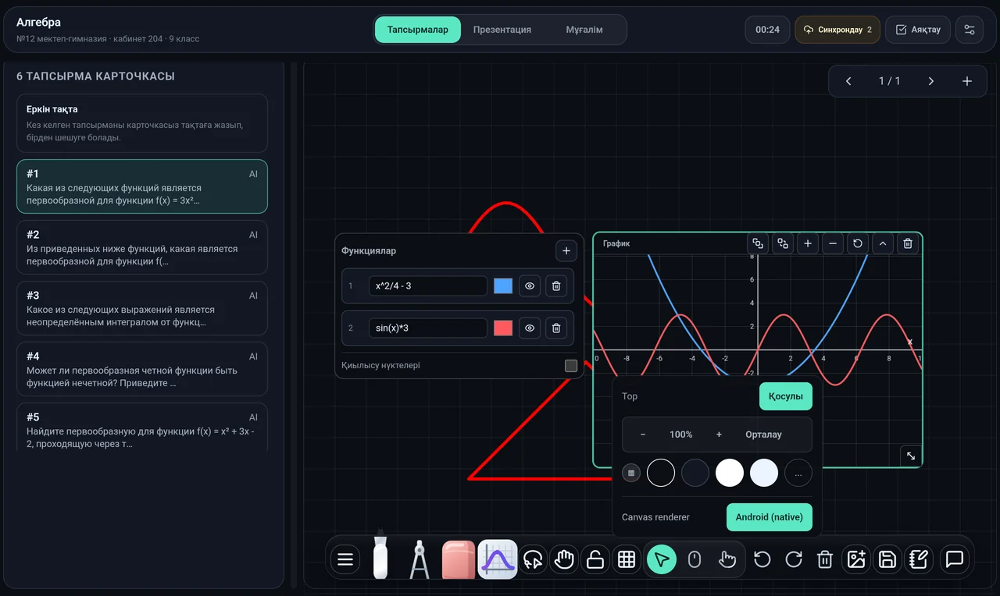

---

## 12. Тапсырмалар және ЖИ-көмекші

**Тапсырма.** Сол жақтан карточканы таңдап, панельдегі **Тапсырма** батырмасын басыңыз: шарты тақтаның үстінен ашылады, оны бүкіл сынып көреді. Шешімі тура тақтада жазылады.

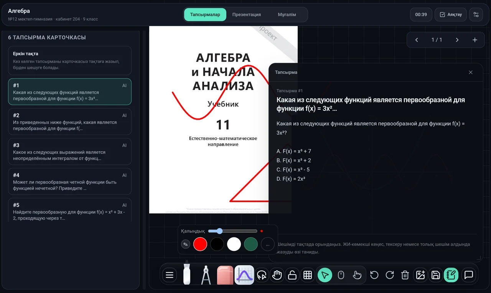

**ЖИ-көмекші** (💬) тақтада жазылғанды өзі «оқиды» және:

- **Кеңес** — тапсырманы толық шешпей, әрі қарай не істеу керегін меңзейді;
- **Шешімді тексеру** — жазылғандағы қатені табады;
- **Толық шешім** — шешімді қадамдап көрсетеді.

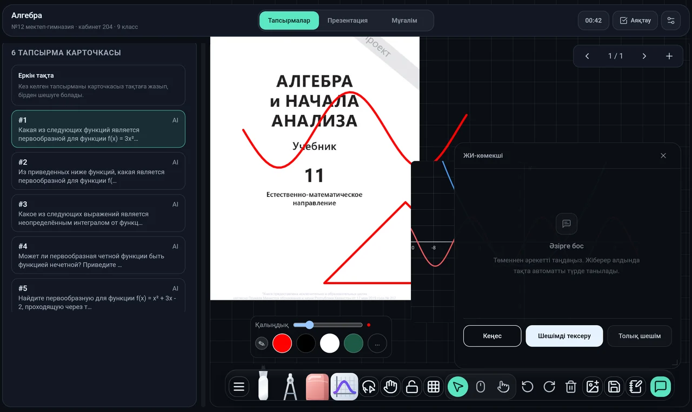

ЖИ мектеп серверінде жұмыс істейді, ол үшін интернет қажет емес. Терезенің төменгі жағында «OCR қолжетімсіз» деген жазу шықса немесе ЖИ ұзақ үндемесе, серверде ЖИ модельдері іске қосылмаған. Бұл туралы жүйелік әкімшіге айтыңыз.

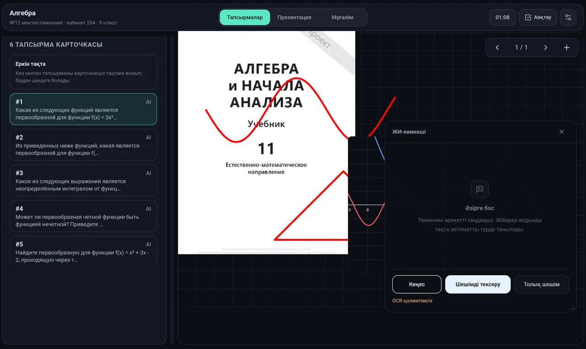

---

## 13. Презентация

**«Презентация»** қойындысы сабақтың слайдтарын көрсетеді. «Артқа» және «Алға» батырмалары слайдтарды парақтайды, «Слайдшоу» оларды толық экранға жаяды. «Ескертпелер» — баяндамашы режимі: мұғалім слайдқа жазылған ескертпелерді көреді.

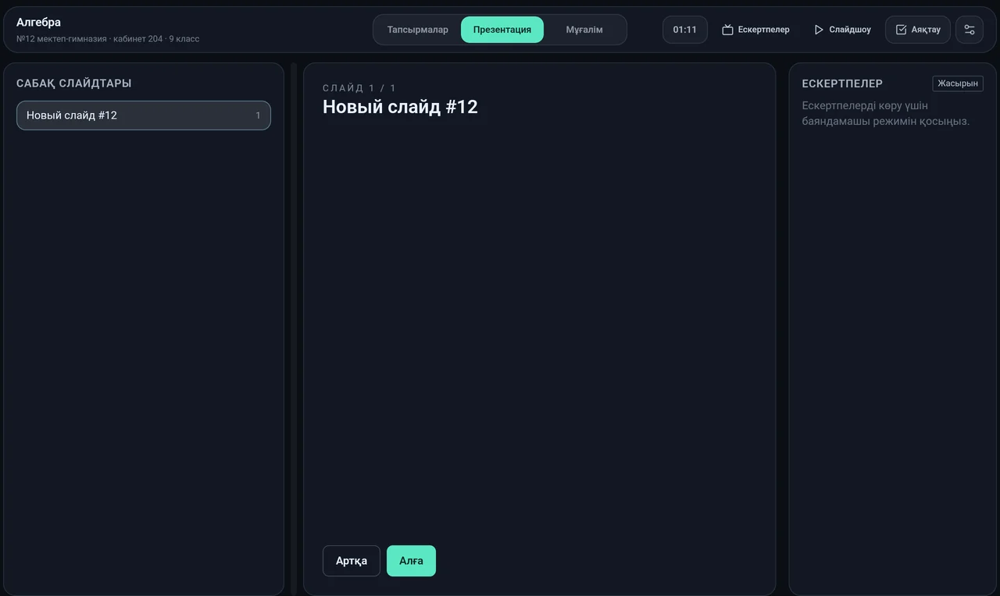

Слайдтар мұғалім панелінде дайындалады: оларды PowerPoint-тен жүктеуге немесе ЖИ арқылы құруға болады (төменде қараңыз).

---

## 14. Мұғалім панелі: сабаққа дайындық

**«Мұғалім»** қойындысы оқушылар сабақты өзгертпеуі үшін PIN-кодпен жабылған. Алғаш кіргенде 4–8 цифрдан тұратын PIN ойлап тауып, оны қайталаңыз.

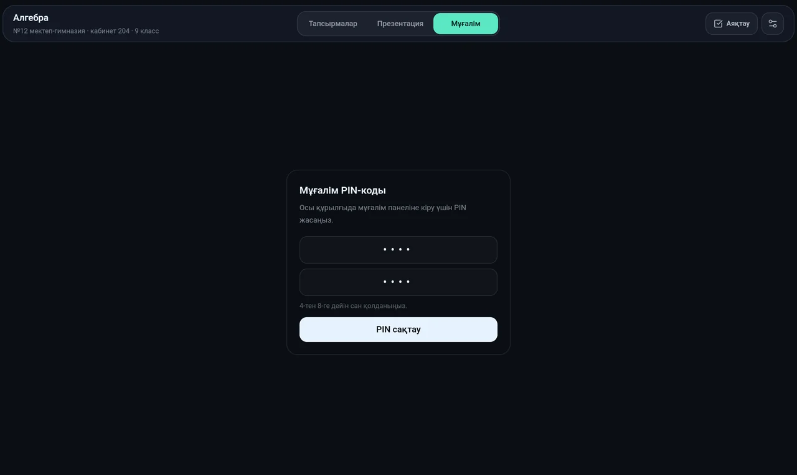

> PIN **тек осы тақтада** сақталады. Басқа тақтада оны қайта орнату керек.

Кіргеннен кейін:

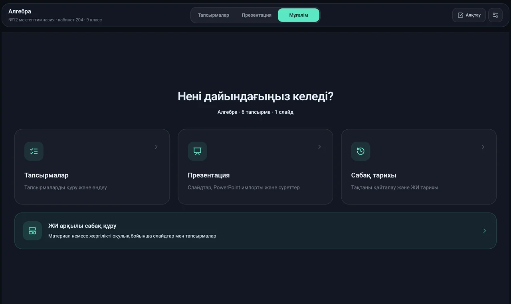

- **Тапсырмалар** — сабақтың тапсырмаларын қосу, түзету немесе өшіру. Тапсырманың тақырыбы, шарты (формулалар `$...$` ішінде жазылады, мысалы `$x^2$`), тегтері және ЖИ шешімді салыстыратын үлгі жауабы болады.

  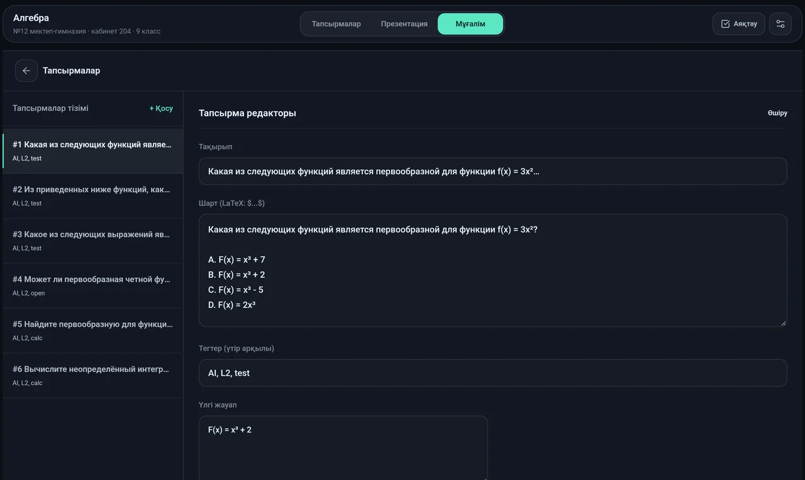

- **Презентация** — слайдтар: жаңасын жасау, PowerPoint жүктеу, суреттер қосу.

  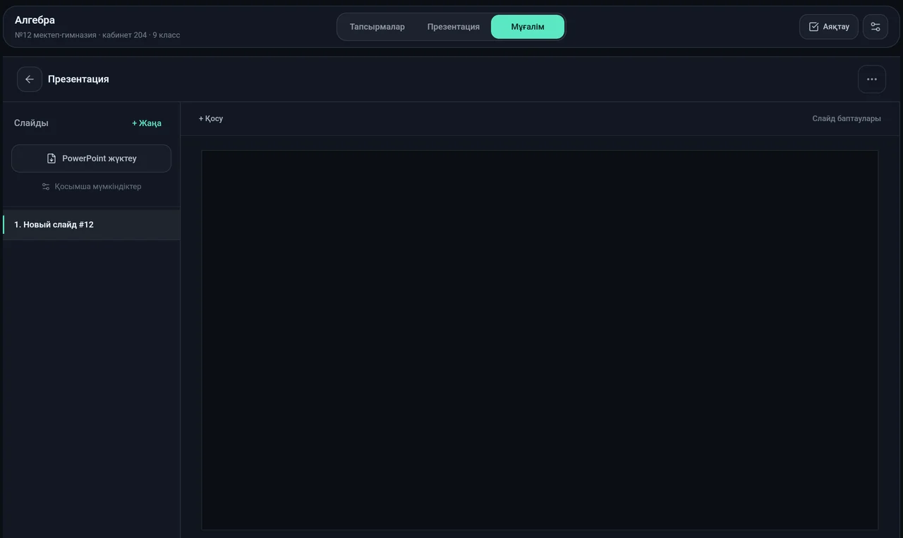

- **Сабақ тарихы** — тақтада болғанның бәрінің жазбасы. Оны бейне сияқты ойнатуға, тіпті жүктеп алуға болады. ЖИ жауаптарының тарихы да сонда.

  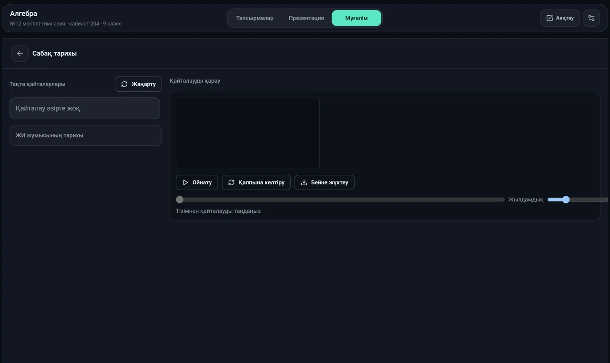

- **ЖИ арқылы сабақ құру** — келесі бөлімді қараңыз.

---

## 15. Оқулық бойынша ЖИ арқылы сабақ құру

ЖИ слайдтар мен тапсырмаларды өзі дайындайды — сіздің мәтініңіз немесе оқулық параграфы бойынша.

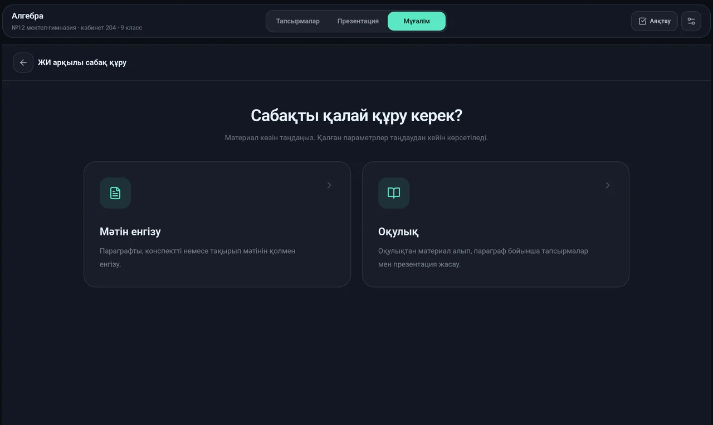

1. **«Оқулық»** таңдаңыз (немесе өз мәтініңізді не конспектіңізді қою үшін «Мәтін енгізу»).
2. Оқулық пен **параграфты** таңдаңыз немесе **тақырыпты** жазыңыз.
3. Қаласаңыз, сабақ атауын, тілін, слайдтар мен тапсырмалар санын көрсетіңіз.
4. **«Сабақты құру»** батырмасын басып, күтіңіз: мектеп серверінде бұл бірнеше минутқа созылуы мүмкін.

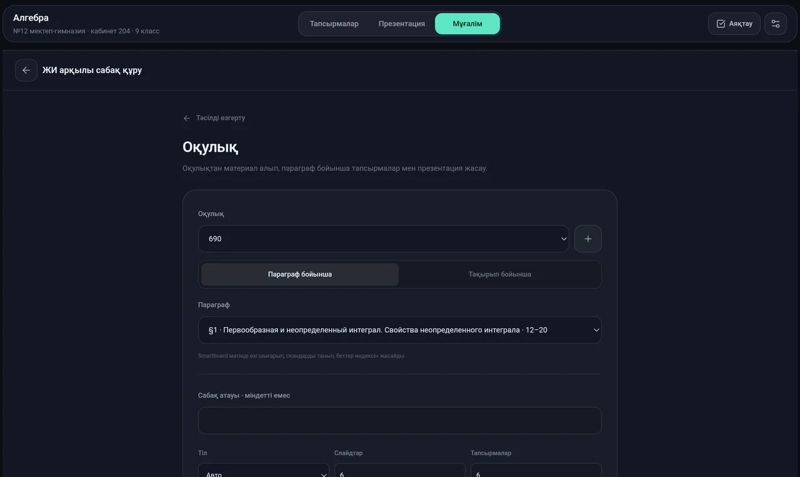

**Өз оқулығыңыз.** Оқулықтар тізімінің қасындағы «+» батырмасын басып, PDF таңдаңыз. Сервер мәтінді өзі шығарады, сканерленген беттерді таниды және параграфтарды табады. Ол кітапты өңдеп жатқанда, тақырып бойынша іздеу дайын беттерде бірден жұмыс істейді.

ЖИ жасағанның бәрі — жоба. Оны «Тапсырмалар» және «Презентация» бөлімдерінде тексеріңіз.

---

## 16. Сабақты аяқтау және тарих

**«Аяқтау»** батырмасы сабақты бірден жабады да, сыныпты таңдауға қайтарады. Сабақ жоғалмайды: ол кабинеттің **Сабақтар тарихына** түседі.

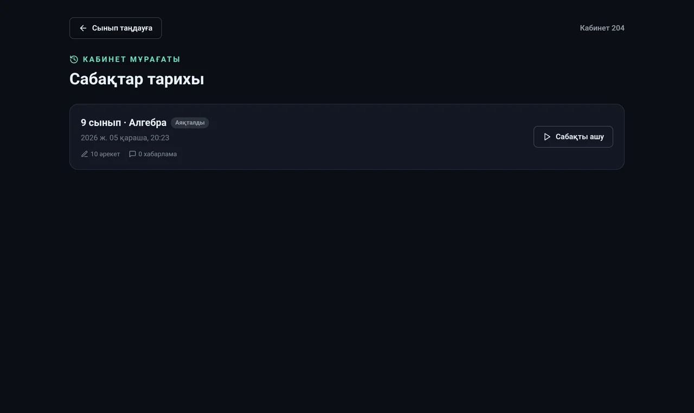

Тарихта сынып, пән, күні мен уақыты, тақтадағы әрекеттер саны және ЖИ хабарлары көрінеді. «Сабақты ашу» батырмасы оны қайта ашады.

---

## 17. Баптаулар

Жоғарғы оң жақтағы жүгірткілер белгішесі.

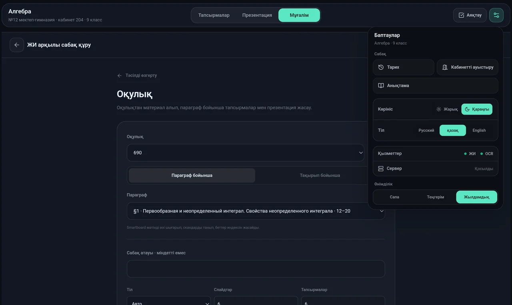

- **Тарих**, **Кабинетті ауыстыру** және **Анықтама** (осы нұсқаулық).
- **Көрініс**: жарық немесе қараңғы тақырып.
- **Тіл**: русский, қазақ, English.
- **Қызметтер**: «ЖИ» және «OCR» жанындағы жасыл нүктелер олардың жұмыс істейтінін білдіреді. «Сервер» сервер экранын ашады — ол жүйелік әкімшіге керек.
- **Өнімділік**: «Сапа» — әдемірек, «Жылдамдық» — әлсіз тақтада тезірек, «Теңгерім» — ортасы.

---

## 18. Мұғалімге арналған FAQ

**Қате салып қойдым. Қалай қайтарамын?**
↶ «Болдырмау» батырмасын қажетінше басыңыз. Бәрі болдырылады: сызықтар, өшіру, тақтаны тазарту, суреттерді жылжыту.

**Тақтаны байқаусызда тазартып қойдым!**
↶ басыңыз. Тазарту кез келген басқа әрекет сияқты болдырылады.

**Құралдар панелі жоғалып кетті.**
Жазып жатқанда ол жасырынады. Тақтаның төменгі шетімен саусақпен жүргізіңіз — ол пайда болады.

**Тақта ығысып кетті, ештеңе көрінбейді.**
▦ «Тақта» батырмасын ашып, «Орталау» батырмасын басыңыз. Ол енді ығыспауы үшін 🔓 «Құлыпты» қосыңыз.

**Қалам жазбайды.**
1. Қалам таңдалғанын тексеріңіз, ✋ Жылжыту немесе Лассо емес.
2. «Авто / Тінтуір / Сенсор» ауыстырғышына қараңыз: «Тінтуір» режимінде қалам мен саусақ жазбайды. «Авто» таңдаңыз.
3. Графикке және графиктен жоғары көтерілген суретке жазуға болмайды. Қасына жазыңыз немесе суретті қабатын төмен түсіріңіз.

**Сызық сызғышқа жабысып қалды, ал маған керек емес.**
Сызықты сызғыштың дәл шетінен бастасаңыз, ол жабысады. Шетінен сәл алысырақ бастаңыз немесе мәзірде сызғышты қайта басып, оны алып тастаңыз.

**Маған қисық сызық керек, ал тақта оны тегіс фигураға айналдырады.**
Демек, сызықтың соңында қаламды ұстап тұрғансыз. Оны бірден көтеріңіз — сызық сол күйінде қалады. Немесе ↶ басып, қайта салыңыз.

**Суретті жылжыта алмаймын.**
Суреттер тек ✋ «Жылжыту» режимінде жылжиды. Алдымен суретті басыңыз — оның айналасында жасыл жиек пайда болады.

**Сурет көрінбейді, ол графиктің астында.**
✋ режимінде суретті белгілеп, «Қабатты жоғары» басыңыз немесе графиктегі «Қабатты төмен» батырмасын басыңыз.

**Суретке жаздым, ал жазулар жоғалып кетті.**
Сурет графиктен жоғары көтерілген, сондықтан жазуларды жабады. Оны «Қабатты төмен» түсіріңіз — жазулар қайта көрінеді: олар ешқайда жоғалмаған.

**ЖИ «OCR қолжетімсіз» деп жазады немесе ештеңе жауап бермейді.**
Бұл тақтаның емес, сервердің мәселесі. Жүйелік әкімшіге хабарлаңыз. Тақтада жазуға және сабақ өткізуге ЖИ-сіз де болады.

**«Байланыс жоқ» деген жазу шықты.**
Сервермен байланыс үзілді, бірақ сабақты жалғастыра беріңіз: салғаныңыздың бәрі тақтада сақталады және байланыс қалпына келгенде серверге өзі жіберіледі.

**Веб-режим туралы жазу шықты («…нативті сызу істен шықты…»).**
Сабаққа кедергі болмауы үшін тақта сызудың қосалқы, баяуырақ тәсіліне ауысты. «Қайта көру» батырмасын басуға болады. Жазу жиі шықса, жүйелік әкімшіге айтыңыз.

**Мұғалімнің PIN-кодын ұмытып қалдым.**
PIN тек тақтадағы қолданба баптауларымен бірге тасталады. Мұны жүйелік әкімші жасайды, содан кейін тақтаны серверге қайта қосу керек.

**Тақтадағыны сақтауға бола ма?**
Иә: «Сурет» батырмасы тақтаны сурет ретінде сақтайды. Сонымен қатар әр сабақ тақтадағы бүкіл жұмыстың жазбасымен бірге Сабақтар тарихында сақталады.

**Интернет керек пе?**
Жоқ. Тақта мектеп ішіндегі сервермен жұмыс істейді. Интернет тек жүйелік әкімшіге орнату мен жаңартулар үшін керек.

**Басқа кабинеттер нені көреді?**
Тек өздерінікін. Әр кабинеттің өз сабақтар тарихы бар. Мектеп аккаунты ортақ.
