# Matrix Smartboard: руководство сисадмина

Это руководство для того, кто ставит систему в школе: сервер, приложение на доски и подключение одного к другому. Учителю это читать не нужно, для него есть [руководство учителя](teacher.md).

Все скриншоты сделаны в настоящем приложении на планшете Android. Это руководство встроено и в само приложение: ссылка «Справка для сисадмина» на экранах первой настройки и подключения.

**Содержание**

1. [Как это устроено](#1-как-это-устроено)
2. [Что нужно для сервера](#2-что-нужно-для-сервера)
3. [Установка приложения на доску](#3-установка-приложения-на-доску)
4. [Первый запуск: два пути](#4-первый-запуск-два-пути)
5. [Путь А: автонастройка сервера по SSH](#5-путь-а-автонастройка-сервера-по-ssh)
6. [Путь Б: подключение к уже настроенному серверу](#6-путь-б-подключение-к-уже-настроенному-серверу)
7. [Защита подключения: Server ID и PIN ключа](#7-защита-подключения-server-id-и-pin-ключа)
8. [Как доска находит сервер при следующих запусках](#8-как-доска-находит-сервер-при-следующих-запусках)
9. [Аккаунт школы и кабинеты](#9-аккаунт-школы-и-кабинеты)
10. [Экран «Сервер»: мониторинг, обновление, резервные копии](#10-экран-сервер-мониторинг-обновление-резервные-копии)
11. [Где что лежит на сервере](#11-где-что-лежит-на-сервере)
12. [Сеть и порты](#12-сеть-и-порты)
13. [Обновление и откат](#13-обновление-и-откат)
14. [Подключение следующих досок](#14-подключение-следующих-досок)
15. [Кластер из нескольких серверов](#15-кластер-из-нескольких-серверов)
16. [FAQ для сисадмина](#16-faq-для-сисадмина)

---

## 1. Как это устроено

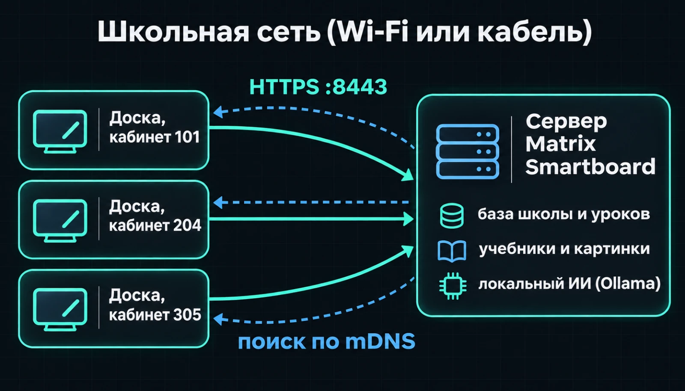

- **Сервер один на школу.** На нём хранятся аккаунт школы, кабинеты, уроки, доски, учебники и картинки. Локальный ИИ тоже работает на нём.
- **Доски** — это Android-приложение на интерактивных досках или планшетах. Само по себе оно ничего не хранит надолго: всё уходит на сервер.
- **Интернет не нужен** для уроков. Он нужен только для установки, обновлений и загрузки моделей ИИ.
- Связь только по **HTTPS** с проверкой ключа сервера (подробнее в [разделе 7](#7-защита-подключения-server-id-и-pin-ключа)). Обычный HTTP приложение не принимает.

---

## 2. Что нужно для сервера

Подойдёт любой компьютер, который всегда включён и находится в той же сети, что и доски.

| | Без ИИ | С локальным ИИ |
|---|---|---|
| Процессор | любой 64-битный | 4+ ядра |
| Память | 2 ГБ | **16 ГБ** (модели занимают около 8 ГБ) |
| Диск | 2 ГБ + учебники | ещё ~8 ГБ на модели |
| Видеокарта | не нужна | ускоряет ИИ, но не обязательна |

**Поддерживаемые системы и что подготовить:**

- **Windows 10/11 или Server** — нужен компонент **OpenSSH Server**. Пользователь SSH должен входить в группу **Administrators**. Нужен `winget`: через него установщик сам поставит Python 3.13 и Ollama, если их нет.
- **Linux — Debian / Ubuntu** — нужен включённый SSH-сервер и пользователь с `sudo` (или `root`). Остальное (git, Python, curl) установщик поставит сам через `apt`.
- **Linux — Arch** — автонастройка по SSH на Arch пока **не работает**: установщик ставит пакеты через `apt`. Для сервера выберите Debian или Ubuntu. Команды для Arch ниже пригодятся, если Arch стоит на компьютере сисадмина.
- **macOS** — нужен «Удалённый вход» (Remote Login), пользователь-администратор и через Homebrew `python3`, `git` и `curl`.

**Как включить SSH на будущем сервере:**

**Windows** (PowerShell от имени администратора):

```powershell
Add-WindowsCapability -Online -Name OpenSSH.Server~~~~0.0.1.0
Start-Service sshd
Set-Service -Name sshd -StartupType Automatic
```

**Linux — Debian / Ubuntu:**

```bash
sudo apt install -y openssh-server
sudo systemctl enable --now ssh
```

**Linux — Arch:**

```bash
sudo pacman -S --needed openssh
sudo systemctl enable --now sshd
```

**macOS** (или Системные настройки → Общий доступ → Удалённый вход):

```bash
sudo systemsetup -setremotelogin on
brew install python git curl
```

Серверу лучше дать **постоянный IP** (резервирование в DHCP на роутере). Это не обязательно: доски найдут сервер и после смены адреса. Но с постоянным IP подключение быстрее.

---

## 3. Установка приложения на доску

Приложение распространяется файлом APK.

1. Скопируйте `app-debug.apk` на флешку, или передайте его по сети, или установите по ADB.
2. На доске разрешите установку из неизвестных источников (Настройки → Безопасность). Названия пунктов зависят от модели доски.
3. Откройте APK и установите.

Через ADB (на доске должна быть включена отладка по USB или по сети). ADB ставится на компьютер сисадмина:

| Платформа | Как поставить ADB |
|---|---|
| Windows | `winget install Google.PlatformTools` |
| Linux — Debian / Ubuntu | `sudo apt install -y adb` |
| Linux — Arch | `sudo pacman -S android-tools` |
| macOS | `brew install --cask android-platform-tools` |

Сами команды одинаковые на всех платформах (на Windows — в PowerShell):

```bash
adb connect 192.168.1.55:5555
adb install -r app-debug.apk
```

Ключ `-r` обновляет приложение и сохраняет его данные: подключение к серверу и PIN учителя останутся.

---

## 4. Первый запуск: два пути

Сначала выберите язык: русский, қазақша или English. Заголовок экрана по очереди показывается на всех трёх языках.

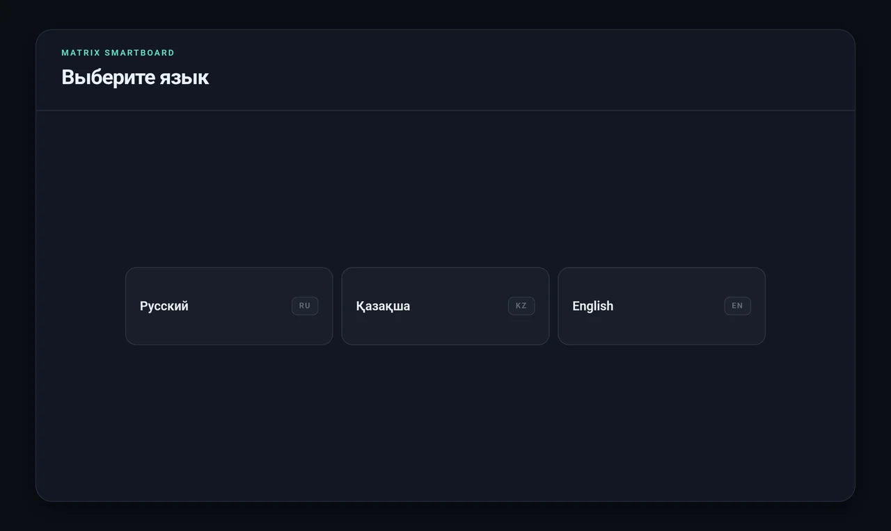

Потом приложение предлагает два пути:

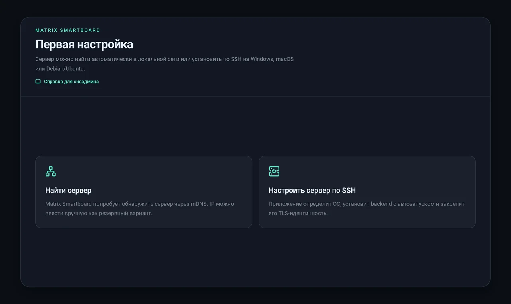

- **«Найти сервер»** — если сервер в школе уже установлен ([путь Б](#6-путь-б-подключение-к-уже-настроенному-серверу)). Так подключаются все доски, кроме первой.
- **«Настроить сервер по SSH»** — если сервера ещё нет. Доска сама установит его на выбранный компьютер ([путь А](#5-путь-а-автонастройка-сервера-по-ssh)).

Ссылка «Справка для сисадмина» под заголовком открывает это руководство на разделе текущего шага.

---

## 5. Путь А: автонастройка сервера по SSH

Сервер устанавливается **прямо с доски**: вы вводите адрес компьютера и пароль SSH, а приложение делает всё остальное. Командная строка не нужна.

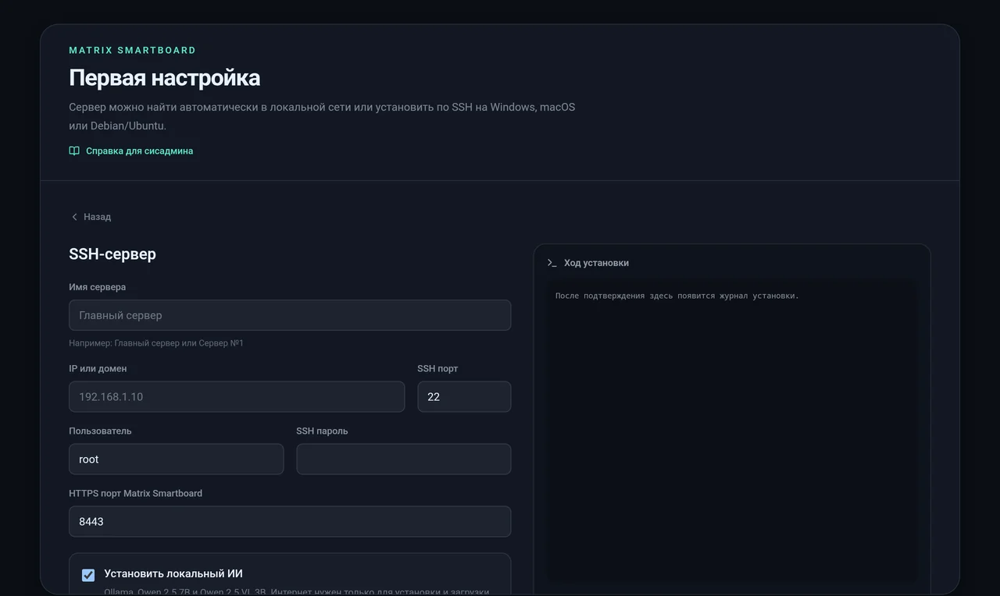

### Поля формы

| Поле | Что вписать |
|---|---|
| **Имя сервера** | Понятное имя, которое увидят на досках: «Главный сервер», «Сервер №1». До 48 символов |
| **IP или домен** | Адрес будущего сервера в школьной сети, например `192.168.1.10` |
| **SSH порт** | Обычно `22` |
| **Пользователь** | `root` или пользователь с правами администратора |
| **SSH пароль** | Пароль этого пользователя. **Не сохраняется**: используется только во время установки |
| **Пароль sudo** | Появляется, если система — macOS или Linux, а пользователь не `root`. Можно оставить пустым, тогда используется пароль SSH |
| **HTTPS порт** | Обычно `8443`. Меняйте, только если он занят |
| **Установить локальный ИИ** | Ставит Ollama и две модели: Qwen 2.5 7B (подсказки, проверка, создание уроков) и Qwen 2.5 VL 3B (распознавание написанного на доске). Нужен интернет и около 8 ГБ на диске |

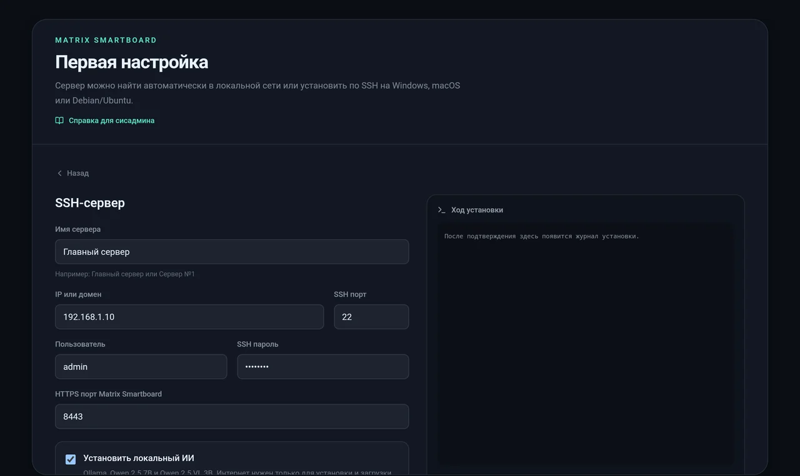

### Что происходит после нажатия «Проверить SSH»

1. **Проверка ключа SSH.** Приложение подключается и показывает отпечаток (fingerprint) ключа SSH этого компьютера, а также определяет систему: «Windows» или «macOS / Linux». Сверьте отпечаток с настоящим, чтобы убедиться, что вы подключились к нужному компьютеру, а не к подменённому:
   - **Windows** (PowerShell от администратора): `ssh-keygen -lf $env:ProgramData\ssh\ssh_host_ed25519_key.pub`
   - **Linux** (Debian, Ubuntu, Arch — одинаково): `ssh-keygen -lf /etc/ssh/ssh_host_ed25519_key.pub`
   - **macOS**: `ssh-keygen -lf /etc/ssh/ssh_host_ed25519_key.pub`

   Отпечаток в приложении записан в том же формате, что выдаёт эта команда: `SHA256:…`. Если на сервере нет ключа ed25519, сверяйте файл `ssh_host_ecdsa_key.pub`.
2. Поставьте галочку подтверждения и нажмите **«Установить Matrix Smartboard»**. Справа в окне «Ход установки» будет виден журнал в реальном времени.

### Шаги установки (их видно в журнале)

**Debian / Ubuntu:**

| Шаг | Что делает |
|---|---|
| `[1/7]` | Ставит системные пакеты: `git curl python3 python3-venv python3-pip` |
| `[2/7]` | Создаёт системного пользователя `matrix-smartboard` и папку данных `/var/lib/matrix-smartboard` |
| `[3/7]` | Скачивает программу с GitHub в `/opt/matrix-smartboard` |
| `[4/7]` | Создаёт Python-окружение и ставит зависимости |
| `[5/7]` | Ставит Ollama и загружает модели (если выбран ИИ) |
| `[6/7]` | Создаёт службу systemd `matrix-smartboard` с автозапуском. Если включён `ufw`, открывает порт 8443/TCP и mDNS 5353/UDP |
| `[7/7]` | Проверяет, что сервер ответил по HTTPS |

**macOS** — те же шаги, но вместо systemd используется launchd (`/Library/LaunchDaemons/ru.matrixhost.smartboard.plist`). Если включён брандмауэр macOS, установщик разрешает для Python входящие подключения.

**Windows** — всё лежит в `C:\ProgramData\MatrixSmartboard` (`app` — программа, `data` — данные). Сервер запускается задачей планировщика **«Matrix Smartboard Server»** от имени `SYSTEM` при старте системы, Ollama — задачей «Matrix Smartboard Ollama». В брандмауэре Windows создаются правила «Matrix Smartboard HTTPS» и «Matrix Smartboard mDNS».

Кроме того, на Linux и macOS устанавливаются два служебных помощника:

- `/usr/local/sbin/matrix-smartboard-update` — обновление с автоматическим откатом;
- `/usr/local/sbin/matrix-smartboard-service-control` — перезапуск Ollama.

Только эти две команды разрешены службе через `sudo` без пароля: так кнопки «Обновить» и «Перезапустить» в приложении работают без root-доступа к остальной системе.

### Чем всё заканчивается

Сразу после установки приложение само закрепляет ключ нового сервера. Отдельно подтверждать его не нужно: вы уже подтвердили этот компьютер по отпечатку SSH. Доска переходит к созданию аккаунта школы ([раздел 9](#9-аккаунт-школы-и-кабинеты)).

> Пароли SSH и sudo стираются из памяти приложения сразу после установки и нигде не сохраняются.

---

## 6. Путь Б: подключение к уже настроенному серверу

Нажмите **«Найти сервер»**. Приложение ищет серверы около 15 секунд: три раунда по 5 секунд, чтобы сервер, который ответил не сразу, тоже успел попасть в список.

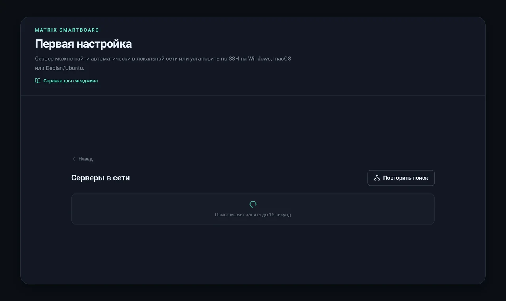

### Как работает поиск

1. **mDNS / DNS-SD.** Сервер объявляет себя в сети как службу `_matrixboard._tcp.local` вместе с именем («Главный сервер») и Server ID. Это работает в обычной школьной сети без настроек, если роутер пропускает multicast.
2. **Запасной вариант: сканирование подсети.** В гостевых сетях, на точках доступа с телефона и в сетях с «изоляцией клиентов» multicast часто заблокирован. Тогда приложение само проверяет свою подсеть `/24` (все адреса вида `192.168.1.1–254`) на порту **8443**. В список попадают только те, кто на `/api/status` отвечает, что это Matrix Smartboard. Чужие устройства не добавляются.
3. **Ручной ввод.** Через 5 секунд появляется кнопка «Ввести адрес сервера вручную». Достаточно ввести IP: если не указать порт и протокол, приложение подставит `https://…:8443`.

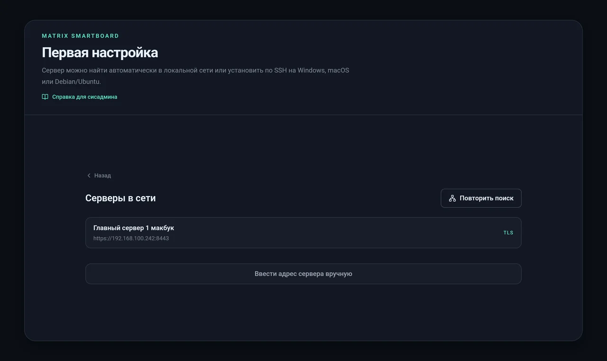

Нажмите на сервер в списке. Если он не нашёлся, введите адрес вручную:

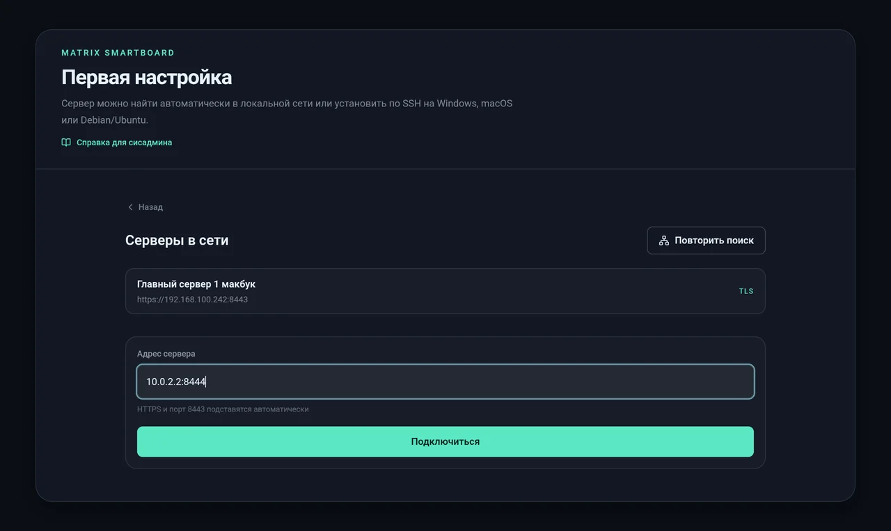

При первом подключении приложение показывает **Server ID** и **PIN открытого ключа** и просит их подтвердить:

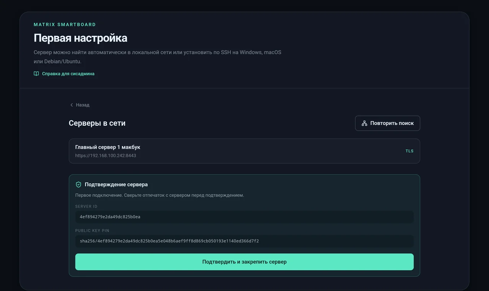

Сверьте их с сервером (как это сделать, см. [раздел 7](#7-защита-подключения-server-id-и-pin-ключа)) и нажмите **«Подтвердить и закрепить сервер»**.

---

## 7. Защита подключения: Server ID и PIN ключа

У каждого сервера есть постоянная **TLS-идентичность**: собственный ключ, созданный при установке. Из ключа получаются:

- **Server ID** — короткий идентификатор, например `4ef894279e2da49dc825b0ea`;
- **Public key pin** — отпечаток ключа вида `sha256/…`.

При первом подключении доска **закрепляет** (pin) этот ключ и дальше разговаривает только с ним. Даже если в сети появится поддельный сервер с тем же именем, доска к нему не подключится.

**Как проверить PIN на самом сервере.** Выполните на сервере или любом компьютере в той же сети.

**Windows** (PowerShell; именно `curl.exe`, а не `curl`: так PowerShell не подменит команду своей):

```powershell
curl.exe -k https://192.168.1.10:8443/api/status
```

**Linux** (Debian, Ubuntu, Arch) и **macOS**:

```bash
curl -k https://192.168.1.10:8443/api/status
```

В ответе есть поля `serverId` и `publicKeyPin`. Они должны совпадать с тем, что показала доска. Флаг `-k` здесь нужен, потому что сертификат самоподписанный. Доверие обеспечивает именно сверка pin.

**Если IP сервера сменился,** сертификат перевыпускается на тот же ключ. Server ID и pin не меняются, переподтверждать ничего не нужно.

---

## 8. Как доска находит сервер при следующих запусках

При каждом запуске приложение:

1. пробует **последний сохранённый адрес**;
2. если он не отвечает, до **6,5 секунды** ищет в сети **тот же Server ID** через mDNS (так переживается смена IP);
3. принимает новый адрес, только если ключ сервера совпадает с закреплённым.

Если ничего не получилось, появляется экран диагностики:

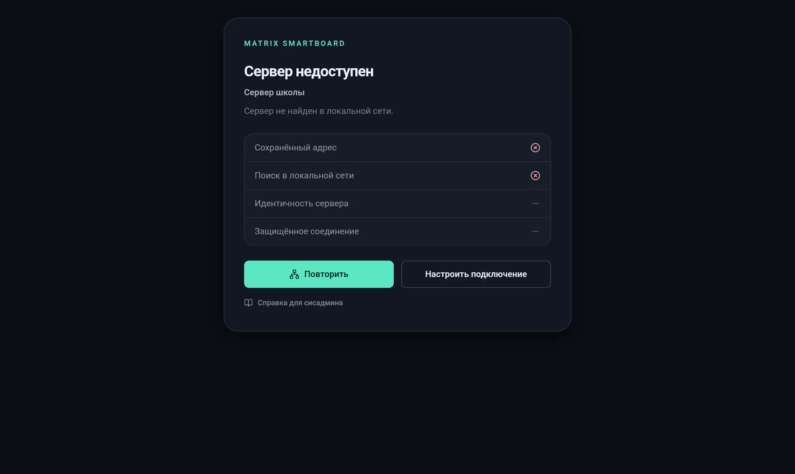

Он показывает, на каком шаге произошёл сбой:

| Строка | Если красный крестик |
|---|---|
| **Сохранённый адрес** | Сервер не отвечает по старому адресу: выключен, сменил IP, служба упала |
| **Поиск в локальной сети** | mDNS не нашёл сервер с этим Server ID: другая сеть или заблокирован multicast |
| **Идентичность сервера** | Ответил сервер, но с **другим ключом**. Это переустановка без восстановления резервной копии или подмена |
| **Защищённое соединение** | Сервер найден, но HTTPS или backend не работает |

Кнопка «Повторить» запускает проверку заново. «Настроить подключение» возвращает к выбору сервера. «Справка для сисадмина» открывает этот раздел.

> Во время урока при кратком обрыве связи работа не останавливается. Учитель видит «Нет связи», изменения копятся в очереди на доске и сами уходят на сервер, когда связь вернётся.

---

## 9. Аккаунт школы и кабинеты

После подключения к серверу один раз создаётся **аккаунт школы**: название и пароль (не короче 8 символов). Все доски школы входят в один и тот же аккаунт.

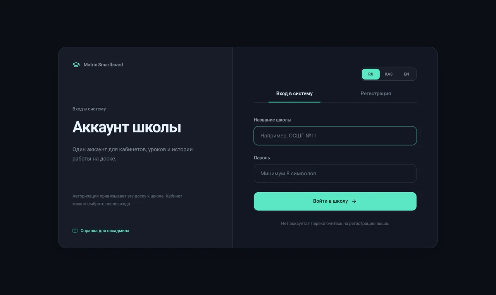

Для первой доски выберите вкладку **«Регистрация»**:

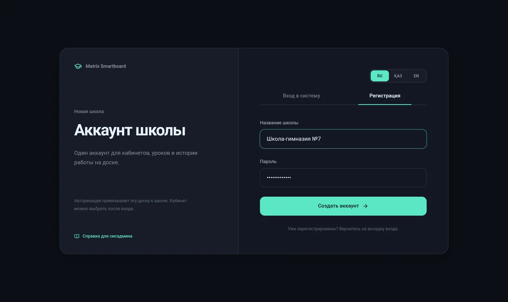

Дальше доска **привязывается к кабинету**. У каждого кабинета своя история уроков.

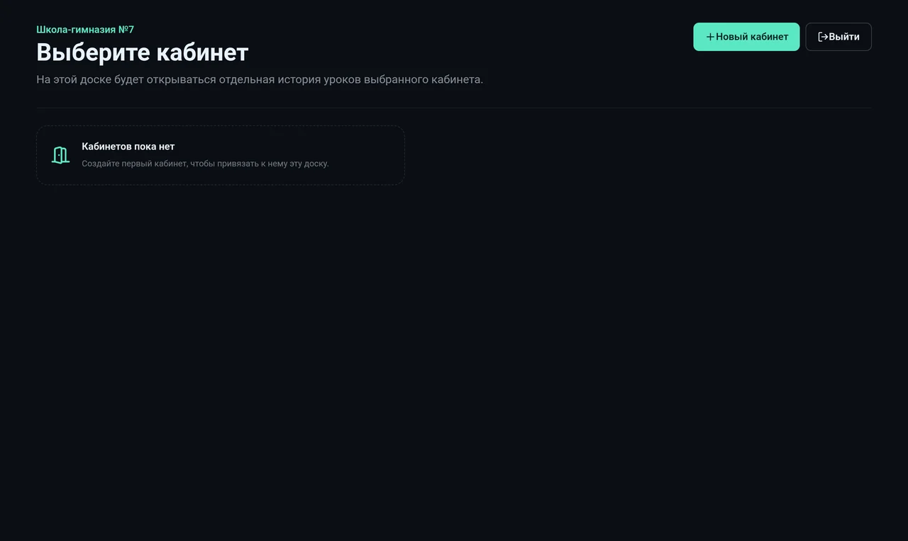

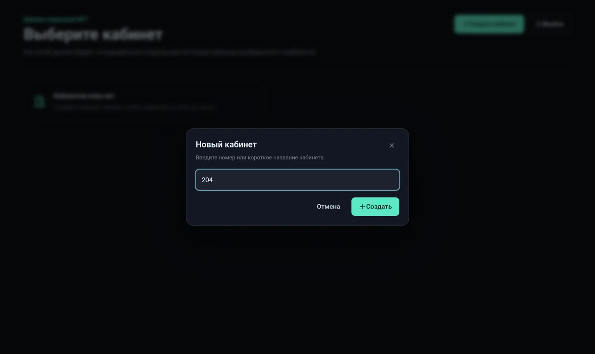

На следующих досках выберите «Вход в систему», введите те же название и пароль и выберите кабинет из списка или создайте новый.

> Пароль школы храните как служебный. Сбросить его через приложение нельзя.

---

## 10. Экран «Сервер»: мониторинг, обновление, резервные копии

Откройте во время урока настройки (значок с ползунками справа вверху) и нажмите строку **«Сервер»**.

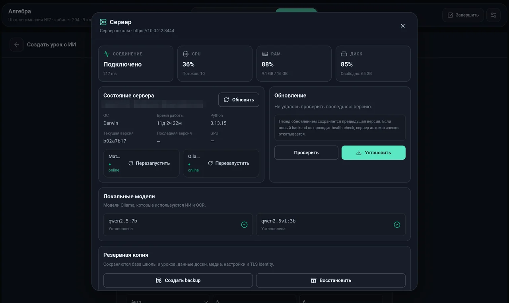

- **Соединение, CPU, RAM, диск** — задержка до сервера и загрузка.
- **Состояние сервера** — ОС, время работы, версия Python, текущая и последняя версии программы. Отдельно показано состояние **Matrix backend** и **Ollama**, у каждого есть кнопка «Перезапустить».
- **Обновление** — «Проверить» и «Установить» (подробнее в [разделе 13](#13-обновление-и-откат)).

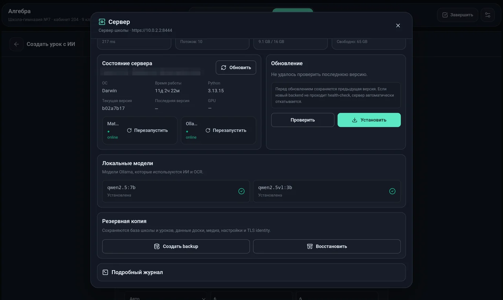

- **Локальные модели** — установлены ли `qwen2.5:7b` и `qwen2.5vl:3b`. Недостающую модель можно скачать отсюда.
- **Резервная копия** — «Создать backup» скачивает архив: база школы и уроков, доски, учебники и картинки, настройки и **TLS-идентичность**. «Восстановить» загружает такой архив обратно.
- **Подробный журнал** — логи сервера, их удобно приложить к обращению.

> Резервная копия содержит приватный ключ сервера и все данные школы. Храните её как пароль: не в общем чате и не на общей флешке.

---

## 11. Где что лежит на сервере

| | Linux | macOS | Windows |
|---|---|---|---|
| Программа | `/opt/matrix-smartboard` | `/opt/matrix-smartboard` | `C:\ProgramData\MatrixSmartboard\app` |
| Данные | `/var/lib/matrix-smartboard` | `/var/lib/matrix-smartboard` | `C:\ProgramData\MatrixSmartboard\data` |
| База (школа, уроки, доски) | `…/practice.db` | `…/practice.db` | `…\practice.db` |
| TLS-идентичность | `…/identity` | `…/identity` | `…\identity` |
| Служба | systemd `matrix-smartboard` | launchd `ru.matrixhost.smartboard` | задача «Matrix Smartboard Server» |
| Журнал сервера | `journalctl -u matrix-smartboard` | `/var/tmp/matrix-smartboard.log` | `C:\ProgramData\MatrixSmartboard\backend.log` |
| Журнал Ollama | `journalctl -u ollama` | `/var/tmp/matrix-smartboard-ollama.log` | `C:\ProgramData\MatrixSmartboard\ollama.log` |
| Журнал обновлений | `/var/lib/matrix-smartboard/update.log` | `/var/tmp/matrix-smartboard-update.log` | `C:\ProgramData\MatrixSmartboard\update.log` |

Полезные команды — состояние, перезапуск и последние строки журнала.

**Windows** (PowerShell от имени администратора):

```powershell
Get-ScheduledTask -TaskName "Matrix Smartboard Server" | Select-Object TaskName, State
Stop-ScheduledTask -TaskName "Matrix Smartboard Server"
Start-ScheduledTask -TaskName "Matrix Smartboard Server"
Get-Content C:\ProgramData\MatrixSmartboard\backend.log -Tail 100
```

**Linux** (Debian, Ubuntu, Arch — везде systemd, команды одинаковые):

```bash
sudo systemctl status matrix-smartboard
sudo systemctl restart matrix-smartboard
sudo journalctl -u matrix-smartboard -n 100
```

**macOS:**

```bash
sudo launchctl print system/ru.matrixhost.smartboard | head -20
sudo launchctl kickstart -k system/ru.matrixhost.smartboard
tail -n 100 /var/tmp/matrix-smartboard.log
```

---

## 12. Сеть и порты

| Порт | Протокол | Зачем |
|---|---|---|
| **8443** | TCP | HTTPS: всё общение доски с сервером |
| **5353** | UDP (multicast `224.0.0.251`) | mDNS: доски сами находят сервер |
| 22 | TCP | SSH: только на время автонастройки |
| 11434 | TCP, только локально | Ollama, наружу открывать не нужно |

Если доски и сервер в разных VLAN или multicast запрещён, автопоиск не сработает. Ничего страшного: введите IP вручную один раз. Дальше доска сама помнит адрес и ключ.

---

## 13. Обновление и откат

Обновить сервер можно двумя способами:

- **С доски:** настройки → «Сервер» → «Проверить» → «Установить».
- **На самом сервере:**

  **Windows** (PowerShell от имени администратора):

  ```powershell
  powershell -ExecutionPolicy Bypass -File C:\ProgramData\MatrixSmartboard\app\deploy\update-server.ps1
  ```

  **Linux** (Debian, Ubuntu) и **macOS**:

  ```bash
  sudo /usr/local/sbin/matrix-smartboard-update
  ```

Что делает обновление:

1. запоминает текущую версию;
2. **сохраняет данные** (базу, учебники, картинки) и потом возвращает их на место с прежним владельцем файлов;
3. скачивает новую версию с GitHub и ставит зависимости;
4. перезапускает службу и ждёт, пока новая версия ответит по HTTPS;
5. **если новая версия не поднялась, автоматически откатывается** на старую.

Ход обновления пишется в журнал обновлений (см. [раздел 11](#11-где-что-лежит-на-сервере)). Последняя строка будет `Update successful: <версия>` или сообщением об откате.

Приложение на досках обновляется установкой нового APK поверх старого (`adb install -r`). Данные и подключение при этом сохраняются.

---

## 14. Подключение следующих досок

Для каждой новой доски:

1. Установите APK ([раздел 3](#3-установка-приложения-на-доску)).
2. Язык → **«Найти сервер»** → выберите сервер → сверьте PIN → «Подтвердить и закрепить сервер».
3. **«Вход в систему»** → название и пароль школы.
4. Выберите кабинет этой доски или создайте новый.

Всё. Учитель увидит экран выбора класса. Дальше работу с доской описывает [руководство учителя](teacher.md).

---

## 15. Кластер из нескольких серверов

Несколько серверов школы можно объединить в **кластер**. Они работают как один сервер:

- **данные одинаковые на всех:** любой сервер принимает урок, доску и задания, изменения сами расходятся по остальным примерно за секунду;
- **нагрузка делится:** если сервер загружен (обычно запросами к ИИ), доски сами переходят на более свободный;
- **сервер может упасть:** доски переходят на живой сервер, вход в аккаунт школы сохраняется, урок продолжается. Когда упавший сервер вернётся, он сам догонит остальных.

### Как собрать кластер

1. На первом сервере: настройки урока → «Сервер» → раздел «Кластер серверов» → **«Создать кластер»**.
2. Там же нажмите **«Добавить сервер»**. Появится код из 8 цифр, он действует 10 минут.
3. Подключите доску ко второму серверу, откройте там тот же раздел → **«Присоединиться к кластеру»** → введите адрес первого сервера и код.

Третий и следующие серверы присоединяются так же, через любой сервер кластера: код можно взять на любом из них.

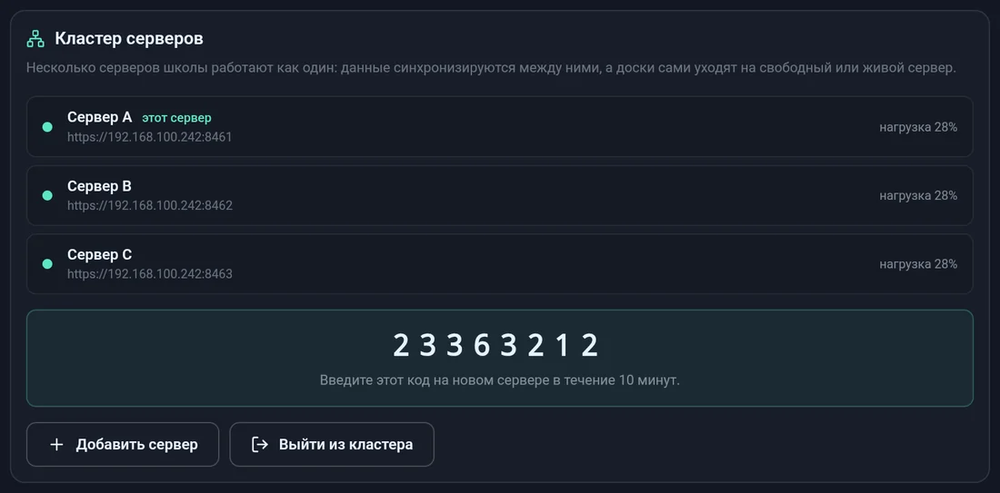

Зелёная точка значит, что сервер отвечает, красная — что не отвечает. Справа показана его нагрузка.

### Что синхронизируется

| Данные | Как |
|---|---|
| Школы, вход в аккаунт, кабинеты, уроки, доски, чат с ИИ | На всех серверах, сразу |
| Задания и слайды предметов | На всех серверах, сразу |
| Картинки на доске | Копируются на сервер, когда их там впервые открывают |
| Учебники (PDF) | Остаются на сервере, куда их загрузили, но видны со всех. Страницы, поиск и создание урока по такому учебнику выполняет сервер, где он лежит |
| Старые журналы повторов доски и история ИИ по предметам | Остаются на своём сервере |

### Как доска выбирает сервер

- Раз в 20 секунд доска сравнивает нагрузку серверов кластера.
- Если её сервер загружен больше чем на 80%, а другой меньше чем на 50%, она переходит на другой.
- Если её сервер не отвечает, она сразу переходит на самый свободный живой.
- Когда несколько серверов почти одинаково свободны, разные доски выбирают разные, чтобы не перегрузить один.
- Неотправленные линии доска досылает на новый сервер, дубли сервер отбрасывает сам.

### Что важно знать

- **Адреса.** Серверы должны видеть друг друга по тем же адресам, по которым их видят доски (порт 8443). Поэтому кластер собирайте с доски, подключённой по обычному школьному адресу, а не по `localhost`.
- **Безопасность.** Все запросы между серверами подписаны общим секретом кластера, а ключ каждого сервера сверяется с закреплённым. Код присоединения одноразовый, после пяти неверных попыток все выданные коды сгорают.
- **Разрыв сети.** Если сеть разделилась и половины работали отдельно, после восстановления связи они сойдутся сами. В кабинете останется один активный урок — тот, что запустили позже. Если школу или кабинет с одинаковым названием создали по разные стороны разрыва, сохранятся оба, а по названию будет открываться созданный раньше.
- **Обновление.** Обновляйте серверы по одному, а не все сразу: пока один обновляется, доски работают на других.
- **Резервные копии.** Делайте копию с любого сервера: данные на всех одинаковые. Учебники копируйте с каждого сервера, где они лежат.
- **Выход из кластера** («Выйти из кластера», нужно нажать дважды). Данные на сервере остаются, но перестают синхронизироваться.

---

## 16. FAQ для сисадмина

**Поиск не находит сервер.**
1. Доска и сервер в одной сети? Гостевой Wi-Fi часто изолирован от основной сети.
2. Сервер работает? Откройте `https://<IP>:8443/api/status` в браузере на любом компьютере. Предупреждение о сертификате — это нормально.
3. Брандмауэр пропускает 8443/TCP?
4. Введите IP вручную: кнопка появляется через 5 секунд поиска.

**Автонастройка: «SSH недоступен».**
Не запущен SSH-сервер или указан не тот порт. Проверьте на будущем сервере:

| Платформа | Команда |
|---|---|
| Windows (PowerShell) | `Get-Service sshd` — должно быть `Running` |
| Linux — Debian / Ubuntu | `sudo systemctl status ssh` |
| Linux — Arch | `sudo systemctl status sshd` |
| macOS | `sudo systemsetup -getremotelogin` — должно быть `On` |

Если SSH выключен, включите его командами из [раздела 2](#2-что-нужно-для-сервера).

**Автонастройка: «Неверный пользователь или пароль SSH».**
Проверьте раскладку клавиатуры и имя пользователя. Вход выполняется по паролю: вход только по ключу SSH приложение не поддерживает.

**Автонастройка на Windows падает с ошибкой прав.**
Пользователь SSH должен входить в группу **Administrators**. Проверьте, что `winget` доступен: на старых Windows его нужно установить из Microsoft Store («Установщик приложений»).

**Автонастройка: «SSH fingerprint сервера изменился».**
Ключ SSH этого адреса отличается от того, что приложение уже видело. Если вы переустанавливали систему, это нормально. Если нет, проверьте, тот ли это компьютер.

**Ошибка «Это не сервер Matrix Smartboard».**
По этому адресу и порту отвечает что-то другое. Проверьте IP и порт (по умолчанию 8443).

**Ошибка «Версия сервера устарела» или «Эта версия приложения устарела».**
Версии приложения и сервера несовместимы. Обновите сервер ([раздел 13](#13-обновление-и-откат)) или поставьте на доску свежий APK.

**«Идентичность сервера» с красным крестиком / «TLS-идентичность сервера не совпадает с ожидаемой».**
Сервер ответил с другим ключом. Обычно это значит, что его переустановили с нуля без восстановления backup. Если так и было, на доске нажмите «Настроить подключение» и подключитесь заново: доска закрепит новый ключ. Если сервер никто не трогал, кто-то может подменять сервер в сети. Разберитесь, прежде чем подтверждать.

**Как перенести сервер на другой компьютер, не перенастраивая доски?**
Создайте backup на старом сервере (экран «Сервер» → «Создать backup»), установите сервер на новый компьютер и восстановите backup. TLS-идентичность переедет вместе с данными, Server ID останется прежним, и доски сами найдут новый адрес через mDNS. Если mDNS в сети не работает, на каждой доске один раз введите новый IP.

**Сменился IP сервера. Нужно ли что-то делать на досках?**
Нет, если в сети работает mDNS: доски найдут сервер по Server ID. Если не работает, на экране «Сервер недоступен» нажмите «Настроить подключение» и введите новый IP. Ключ останется прежним.

**ИИ пишет «OCR недоступен» или не отвечает.**
Откройте экран «Сервер»: Ollama должна быть «online», обе модели — «Установлена». Если Ollama не работает, нажмите «Перезапустить». Если моделей нет, скачайте их там же или на сервере. Команды одинаковые на Windows (PowerShell), Linux (Debian, Ubuntu, Arch) и macOS:

```bash
ollama pull qwen2.5:7b
ollama pull qwen2.5vl:3b
```

Перезапустить Ollama вручную:

| Платформа | Команда |
|---|---|
| Windows (PowerShell от администратора) | `Stop-ScheduledTask "Matrix Smartboard Ollama"; Start-ScheduledTask "Matrix Smartboard Ollama"` |
| Linux (Debian, Ubuntu, Arch) | `sudo systemctl restart ollama` |
| macOS | `sudo launchctl kickstart -k system/ru.matrixhost.ollama` |

На сервере с 8 ГБ памяти ИИ может не помещаться. Нужно 16 ГБ.

**ИИ отвечает очень долго.**
Без видеокарты модель 7B отвечает десятки секунд, это ожидаемо. Ускорит видеокарта NVIDIA или Mac на Apple Silicon. Уроки на доске это не тормозит: ИИ нужен только для подсказок, проверки и генерации.

**Учитель забыл PIN.**
PIN хранится только на этой доске. Чтобы его сбросить, очистите данные приложения: Настройки Android → Приложения → Matrix Smartboard → Хранилище → Очистить данные, или через ADB с компьютера сисадмина (команда одинаковая на Windows, Linux и macOS):

```bash
adb shell pm clear ru.matrixhost.smartboard
```

После этого доску нужно заново подключить к серверу ([раздел 14](#14-подключение-следующих-досок)). Уроки и доски хранятся на сервере и не пропадут.

**Забыли пароль школы.**
Через приложение он не сбрасывается. Доски, которые уже вошли в аккаунт, продолжают работать. Для сброса нужен доступ к серверу, обратитесь к разработчику.

**На доске появилось сообщение про веб-режим («Нативная отрисовка дала сбой…»).**
Быстрая отрисовка чернил (нативная, через Android) несколько раз подряд не запустилась, и доска сама переключилась на запасную, веб-отрисовку, чтобы урок не встал. Учитель может нажать «Попробовать снова». Если это повторяется, пришлите разработчику модель доски и журнал. Журнал снимается с компьютера сисадмина.

**Windows** (PowerShell; так файл сохранится в UTF-8, а не в UTF-16):

```powershell
adb logcat -d | Out-File -Encoding utf8 board-log.txt
```

**Linux** (Debian, Ubuntu, Arch) и **macOS**:

```bash
adb logcat -d > board-log.txt
```

**Касания или линия смещены относительно ручки.**
Обновите приложение на доске до последней версии: в ней исправлен сдвиг касаний, который появлялся, когда у окна сверху есть системная полоса. Если сдвиг остался, откалибруйте сенсор в настройках самой доски.

**Где лежат уроки и что бэкапить?**
Всё в папке данных ([раздел 11](#11-где-что-лежит-на-сервере)). Проще всего делать backup с экрана «Сервер» раз в неделю или перед обновлениями. Можно копировать и саму папку данных, но только при остановленной службе.

**Нужно ли открывать сервер в интернет?**
Нет, и не стоит. Сервер рассчитан на работу внутри школьной сети.

**Сколько досок выдержит сервер?**
Доски передают на сервер только штрихи и операции, это мало данных. Обычный компьютер спокойно обслуживает все кабинеты школы. Узкое место — ИИ: одновременные запросы ИИ от нескольких досок выстраиваются в очередь.
