# Matrix Smartboard: руководство учителя

Это руководство для учителя, который ведёт урок на интерактивной доске. Ничего устанавливать не нужно: доску уже подготовил сисадмин школы. Если на доске открылся экран «Первая настройка» или «Сервер недоступен», позовите сисадмина. Для него есть [отдельное руководство](admin.md).

Все скриншоты сделаны в настоящем приложении.

**Содержание**

1. [Начало урока за одну минуту](#1-начало-урока-за-одну-минуту)
2. [Экран урока](#2-экран-урока)
3. [Панель инструментов](#3-панель-инструментов)
4. [Ручка и цвета](#4-ручка-и-цвета)
5. [Ровные фигуры без линейки](#5-ровные-фигуры-без-линейки)
6. [Линейка, транспортир и циркуль](#6-линейка-транспортир-и-циркуль)
7. [Ластик, отмена, очистка](#7-ластик-отмена-очистка)
8. [Графики функций](#8-графики-функций)
9. [Страницы учебника и картинки на доске](#9-страницы-учебника-и-картинки-на-доске)
10. [Слои: что над чем лежит](#10-слои-что-над-чем-лежит)
11. [Перемещение, лассо, страницы доски](#11-перемещение-лассо-страницы-доски)
12. [Задания и ИИ-ассистент](#12-задания-и-ии-ассистент)
13. [Презентация](#13-презентация)
14. [Панель учителя: подготовка урока](#14-панель-учителя-подготовка-урока)
15. [Создать урок с ИИ по учебнику](#15-создать-урок-с-ии-по-учебнику)
16. [Завершение урока и история](#16-завершение-урока-и-история)
17. [Настройки](#17-настройки)
18. [FAQ для учителя](#18-faq-для-учителя)

---

## 1. Начало урока за одну минуту

Урок начинается в три шага: класс → предмет → тип доски.

**Шаг 1. Класс.** Нажмите на номер класса.

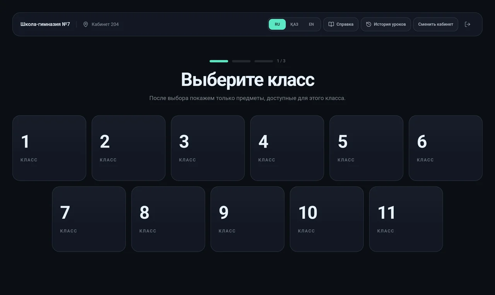

Сверху видно название школы и кабинета. Справа есть кнопки «История уроков» (прошлые уроки этого кабинета) и «Сменить кабинет». Кнопка «Справка» открывает это руководство.

**Шаг 2. Предмет.** Список зависит от класса: например, в 9 классе есть алгебра, геометрия, физика, химия, биология, география и три языка.

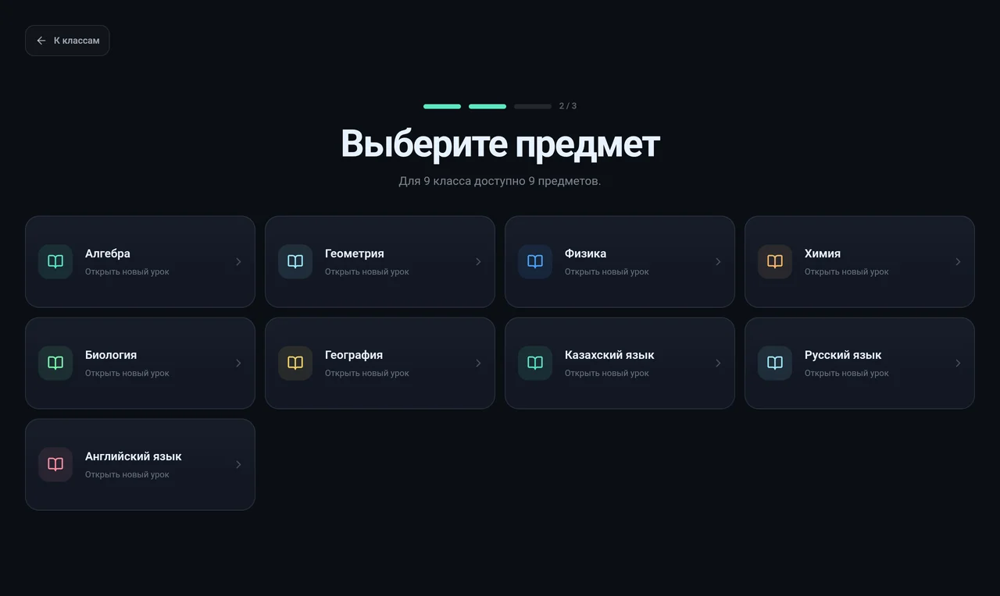

**Шаг 3. Тип доски.** Он меняет набор инструментов под урок:

- **Аналитическая** — для математики, физики и других точных предметов: клетка, графики, линейка.
- **Текстовая** — для языков и истории: линейки как в тетради, маркер, подчёркивание.
- **Универсальная** — все инструменты сразу.

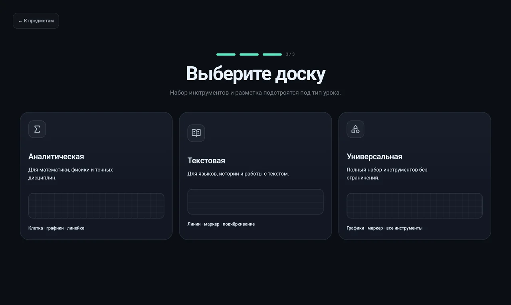

Всё, урок открыт. Таймер урока в правом верхнем углу пошёл.

> **Если приложение закрыли посреди урока** (выключили доску, пропал свет, кто-то нажал «Домой»), при следующем запуске оно предложит вернуться к уроку. Доска, история изменений и переписка с ИИ сохраняются.
>
> 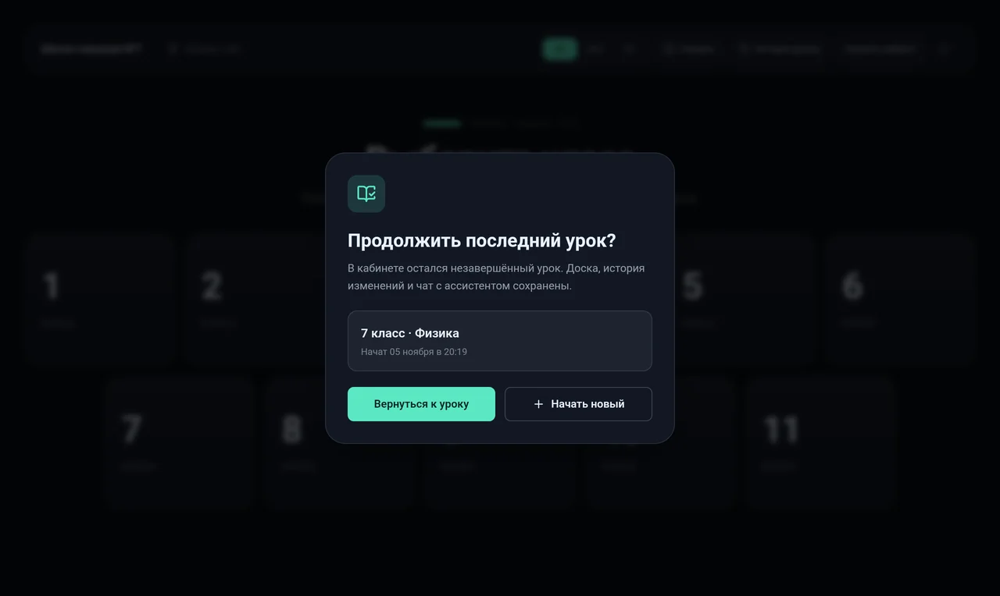

---

## 2. Экран урока

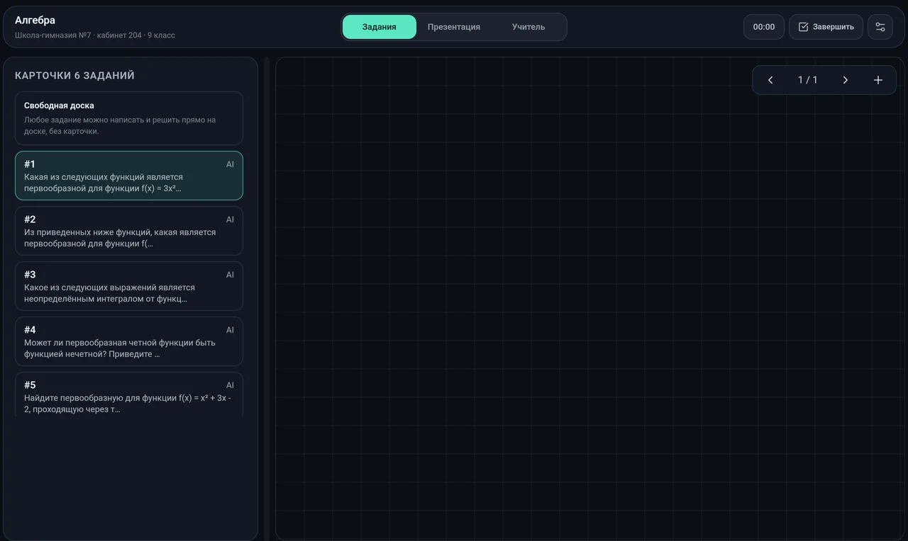

- **Слева — карточки заданий.** «Свободная доска» — просто доска без задания. Карточки с номерами — задания урока. Нажмите на карточку, чтобы выбрать задание.
- **Посередине — доска.** На ней пишут ручкой или пальцем.
- **Сверху посередине — три вкладки:** «Задания» (доска), «Презентация» (слайды) и «Учитель» (подготовка урока, закрыта PIN-кодом).
- **Справа сверху:** таймер урока, кнопка «Завершить» и настройки (значок с ползунками).
- **В правом верхнем углу доски — страницы:** стрелки листают страницы, «+» добавляет новую.

---

## 3. Панель инструментов

Панель инструментов находится внизу доски. Пока вы пишете, она прячется и не мешает. Чтобы её вернуть, проведите пальцем или ручкой у нижнего края доски.

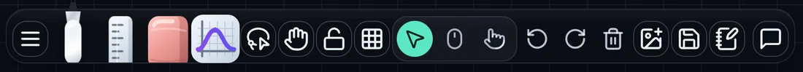

Слева направо:

| Кнопка | Что делает |
|---|---|
| ☰ **Панели** | Прячет или показывает левую колонку с заданиями — доска становится шире |
| **Ручка** | Пишет. Повторное нажатие открывает толщину и цвета |
| **Линейка** | Линейка, транспортир и циркуль |
| **Ластик** | Стирает. Повторное нажатие — размер ластика |
| **График** | Ставит координатную плоскость с графиками функций |
| **Лассо** | Обвести часть рисунка и передвинуть её |
| ✋ **Перемещение** | Двигать доску и картинки на ней |
| 🔓 **Лок** | Запрещает случайно сдвигать и масштабировать доску |
| ▦ **Доска** | Сетка, масштаб, цвет фона |
| **Авто / Мышь / Сенсор** | Чем можно рисовать: всем, только мышью или только ручкой и пальцем |
| ↶ ↷ | Отменить и повторить |
| 🗑 **Очистить доску** | Стереть всё на доске |
| **Вставить картинку** | Страница учебника или картинка из файла |
| **Снимок** | Сохранить доску как картинку |
| **Задание** | Показать условие выбранного задания поверх доски |
| 💬 **ИИ-ассистент** | Подсказка, проверка решения, полное решение |

---

## 4. Ручка и цвета

Нажмите **Ручку** ещё раз — откроются толщина и цвета. Кнопка «…» показывает остальные цвета.

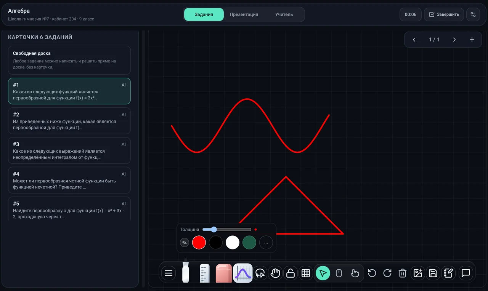

- Писать можно стилусом от доски или пальцем.
- **Писать можно вдвоём одновременно**: доска различает два касания, и два ученика могут решать рядом.
- Чтобы сдвинуть или увеличить доску, разведите или сведите **два пальца**.

---

## 5. Ровные фигуры без линейки

Нарисуйте фигуру от руки и **в конце задержите ручку на полсекунды, не отрывая её**. Доска сама превратит набросок в ровную фигуру:

- прямая линия;
- окружность или овал;
- треугольник;
- прямоугольник или четырёхугольник.

На скриншоте выше треугольник нарисован от руки, а доска выровняла его сама. Если фигура не нужна, просто оторвите ручку сразу: линия останется такой, как вы её нарисовали.

---

## 6. Линейка, транспортир и циркуль

Нажмите **Линейку** на панели. На доске появится линейка, а над панелью откроется меню из трёх инструментов: линейка, транспортир, циркуль.

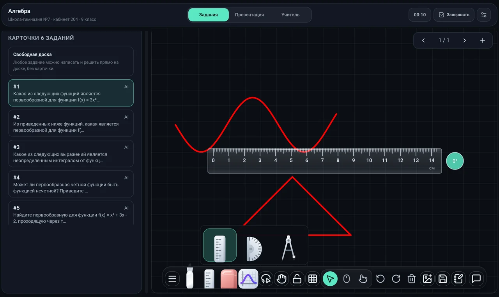

- **Линейка.** Ведите ручкой вдоль края — линия получится идеально прямой. Тяните линейку пальцем за середину, чтобы передвинуть. Круглая ручка справа поворачивает её. Угол показан на этой ручке и сам прилипает к 15°, 30°, 45° и так далее.
- **Транспортир.** Двигается и поворачивается так же. Удобно мерить и строить углы.

  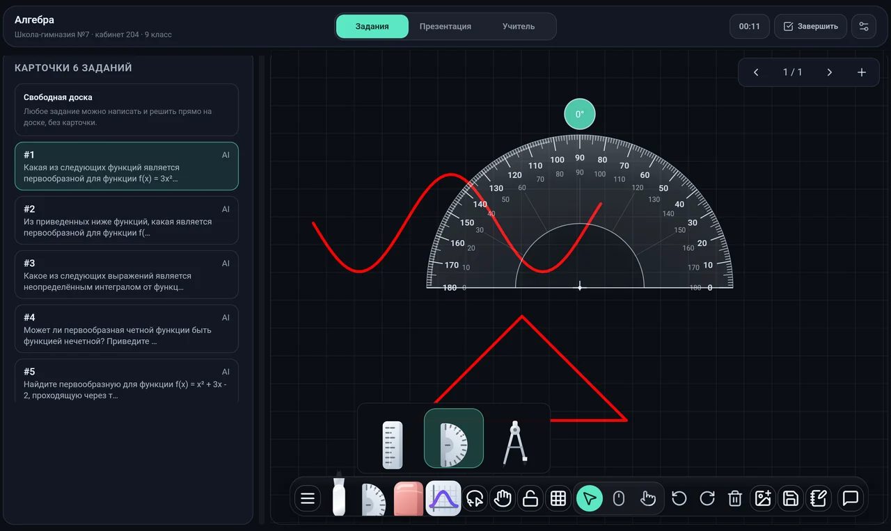

- **Циркуль.** Левый кружок — игла (центр окружности). Средний меняет радиус, радиус подписан в сантиметрах. Поставьте ручку на правый кружок и ведите — получится ровная окружность или дуга.

  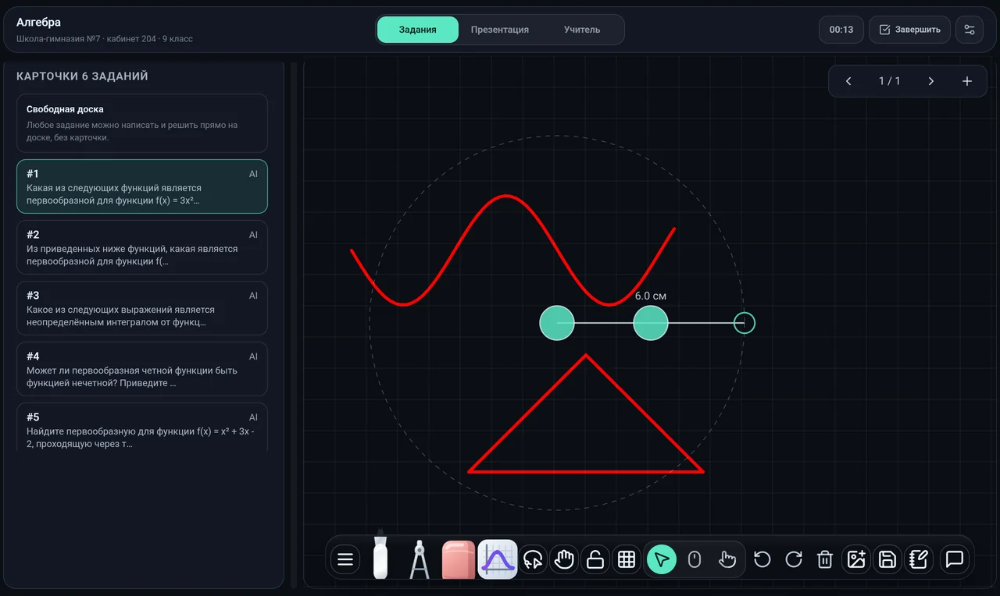

Чтобы убрать инструмент с доски, нажмите на него в меню ещё раз. Кнопка на панели показывает последний выбранный инструмент.

---

## 7. Ластик, отмена, очистка

- **Ластик** стирает то, по чему проводите. Нажмите на него ещё раз, чтобы поменять размер.

  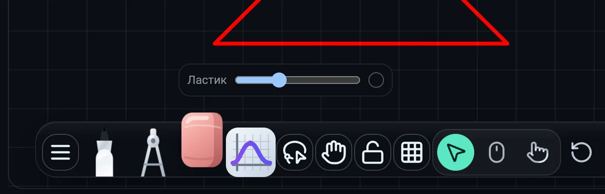

- **↶ Отменить / ↷ Повторить** — отменяют любое действие: линию, стирание, перемещение графика или картинки.
- **🗑 Очистить доску** — стирает всё. Чтобы не стереть доску случайно, нужно сдвинуть ползунок до конца. Очистку тоже можно отменить кнопкой ↶.

---

## 8. Графики функций

Нажмите **График**, потом нажмите на доску — появится координатная плоскость.

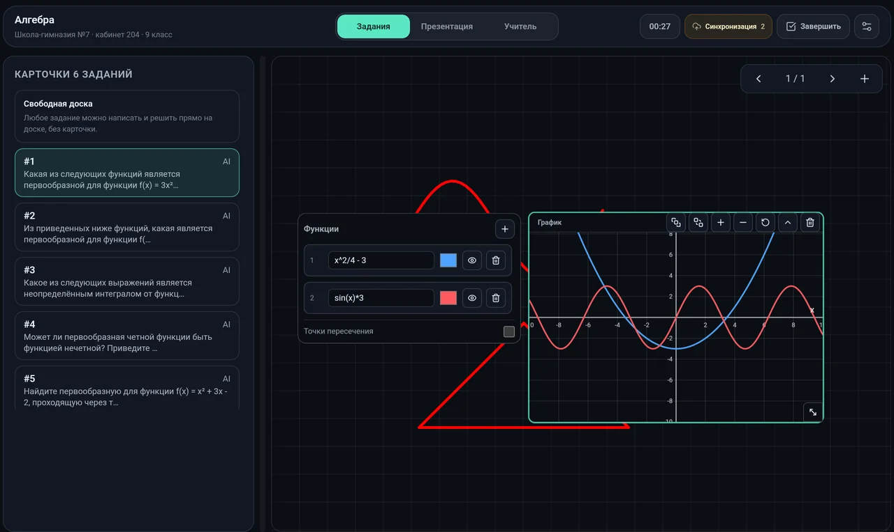

- **Функции** вводятся слева, например `x^2/4 - 3` или `sin(x)*3`. «+» добавляет ещё одну функцию, у каждой свой цвет. Глаз прячет функцию, корзина удаляет.
- **Точки пересечения** — включите галочку, и доска отметит, где графики пересекаются.
- **Двигать график:** тяните за верхнюю полоску со словом «График».
- **Размер:** тяните за уголок справа внизу.
- **Масштаб:** кнопки «+» и «−» на полоске или два пальца на самом графике. Кнопка ↻ возвращает обычный масштаб.
- **Подписи осей** (`x`, `y`) можно поменять нажатием, например на `t, с` и `v, м/с` для физики.

Что можно писать: `+ - * / ^`, `sqrt` (корень), `abs` (модуль), `sin cos tg ctg` (углы в радианах), `ln log`, `pi`, `e` и другие.

---

## 9. Страницы учебника и картинки на доске

Нажмите **Вставить картинку**.

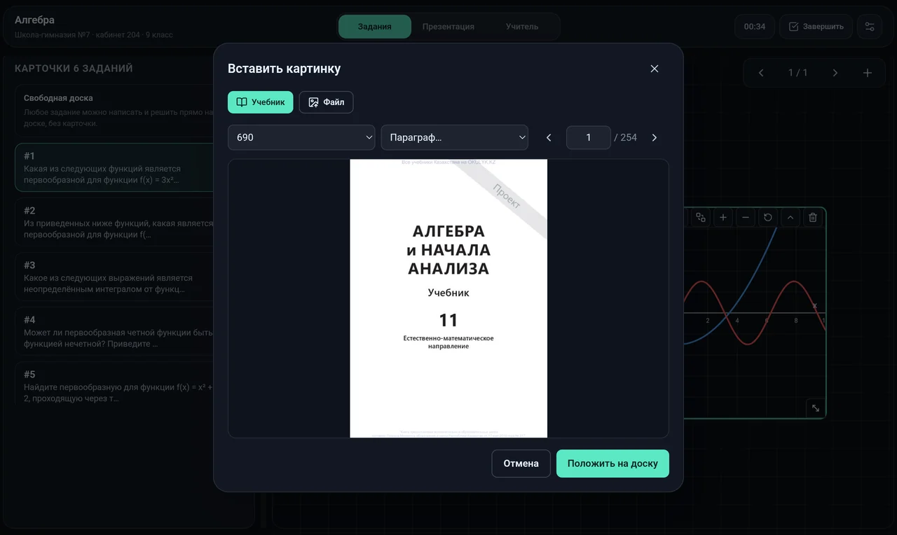

- Вкладка **«Учебник»**: выберите учебник, параграф или номер страницы и нажмите «Положить на доску».
- Вкладка **«Файл»**: картинка с устройства (PNG, JPG, WebP).

Картинка ложится **под чернила**: на странице учебника можно подчёркивать, обводить и писать прямо поверх текста.

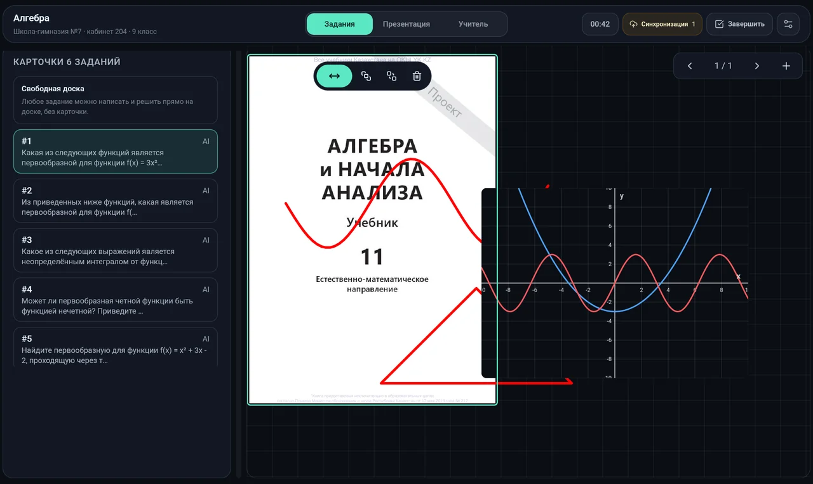

Пока выбран инструмент ✋ **Перемещение**, картинку можно:

- **передвинуть** — тянуть её пальцем;
- **изменить размер** — тянуть зелёную кнопку ↔ вправо (больше) или влево (меньше);
- **поднять или опустить слоем** — две кнопки рядом (см. [Слои](#10-слои-что-над-чем-лежит));
- **убрать** — корзина.

Чтобы снова писать, выберите Ручку.

---

## 10. Слои: что над чем лежит

У картинок и графиков есть кнопки **«Выше слоем»** и **«Ниже слоем»**. Они нужны, когда объекты перекрывают друг друга:

- картинка над картинкой — например, две страницы учебника;
- картинка над графиком и наоборот.

Каждое нажатие сдвигает объект на одну позицию. Действие можно отменить.

Важно: **надписи ручкой всегда лежат над картинками, а графики — над надписями.** Если поднять картинку выше графика, она закроет и надписи под собой, и писать на ней станет нельзя. Опустите её обратно под график, чтобы снова писать поверх неё.

---

## 11. Перемещение, лассо, страницы доски

- **✋ Перемещение** — двигать всю доску пальцем или стилусом. Двумя пальцами доску можно двигать в любом режиме.
- **🔓 Лок** — запрещает сдвигать и масштабировать доску. Полезно, когда у доски дети и всё время что-то задевают.
- **Лассо** — обведите петлёй часть рисунка, потом перетащите выделенное в другое место.
- **Страницы** (справа вверху на доске): «+» добавляет новую чистую страницу, стрелки листают. Это как перевернуть лист — старое не стирается.
- **▦ Доска** — сетка (вкл/выкл), масштаб, кнопка «Центр» (вернуться к началу доски) и цвет фона.

  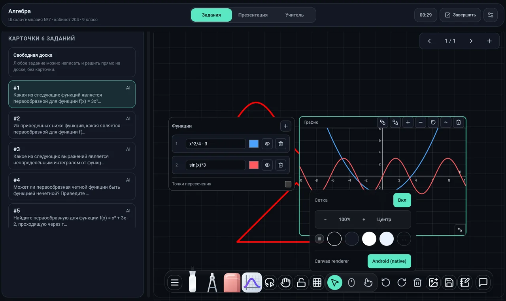

---

## 12. Задания и ИИ-ассистент

**Задание.** Выберите карточку слева и нажмите на панели **Задание**: условие откроется поверх доски, его видит весь класс. Решение пишут прямо на доске.

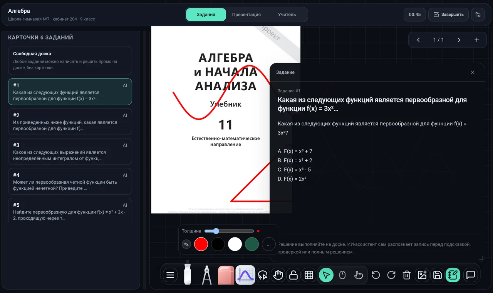

**ИИ-ассистент** (💬) сам «читает» то, что написано на доске, и может:

- **Подсказка** — намекнуть, что делать дальше, не решая задачу целиком;
- **Проверить решение** — найти ошибку в написанном;
- **Полное решение** — показать решение по шагам.

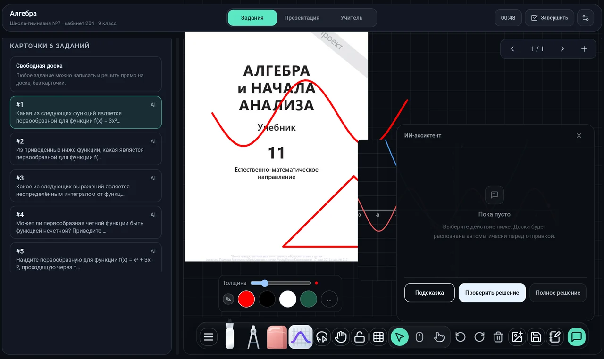

ИИ работает на школьном сервере, интернет для этого не нужен. Если внизу окна появилась надпись «OCR недоступен» или ИИ долго молчит, значит, на сервере не запущены модели ИИ. Скажите об этом сисадмину.

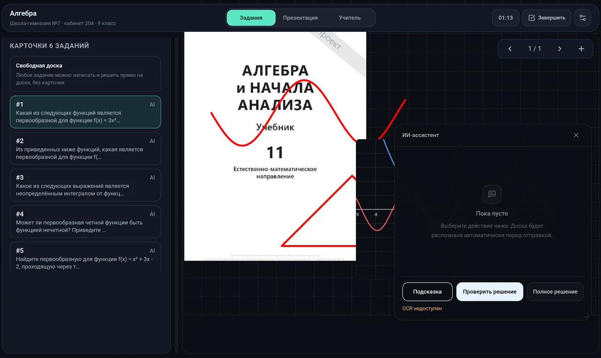

---

## 13. Презентация

Вкладка **«Презентация»** показывает слайды урока. Кнопки «Назад» и «Вперёд» листают слайды, «Слайдшоу» разворачивает их на весь экран. «Заметки» — режим докладчика: учитель видит заметки к слайду.

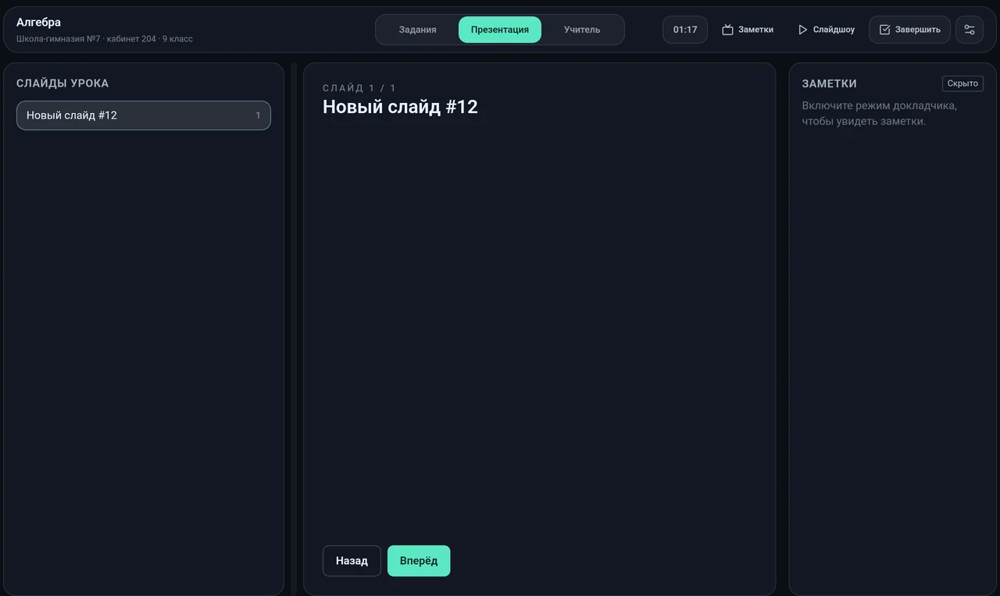

Слайды готовятся в панели учителя: их можно загрузить из PowerPoint или создать с ИИ (см. ниже).

---

## 14. Панель учителя: подготовка урока

Вкладка **«Учитель»** закрыта PIN-кодом, чтобы ученики не меняли урок. При первом входе придумайте PIN из 4–8 цифр и повторите его.

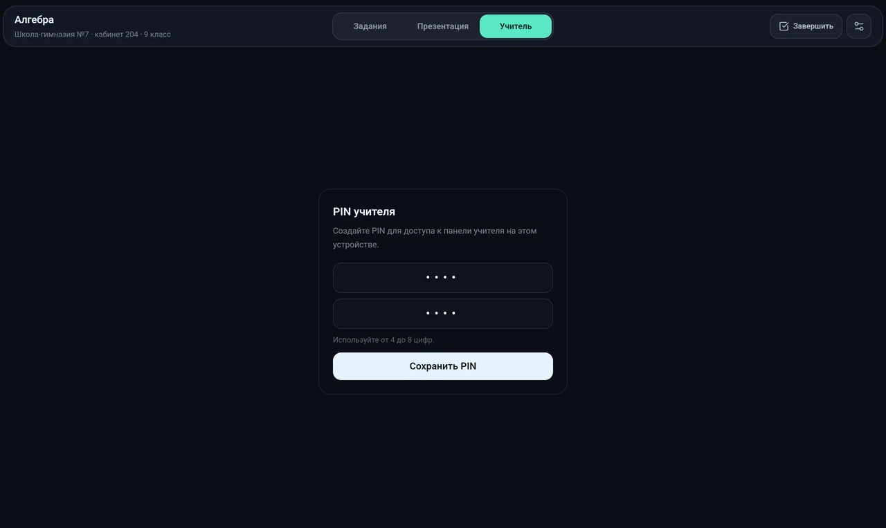

> PIN хранится **только на этой доске**. На другой доске его нужно задать заново.

После входа:

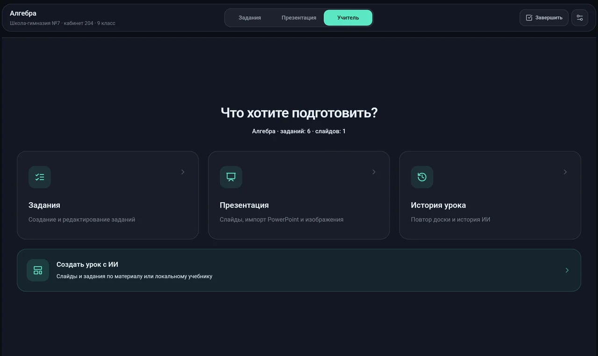

- **Задания** — добавить, поправить или удалить задания урока. У задания есть заголовок, условие (формулы пишутся в `$...$`, например `$x^2$`), теги и эталонный ответ, с которым ИИ сверяет решение.

  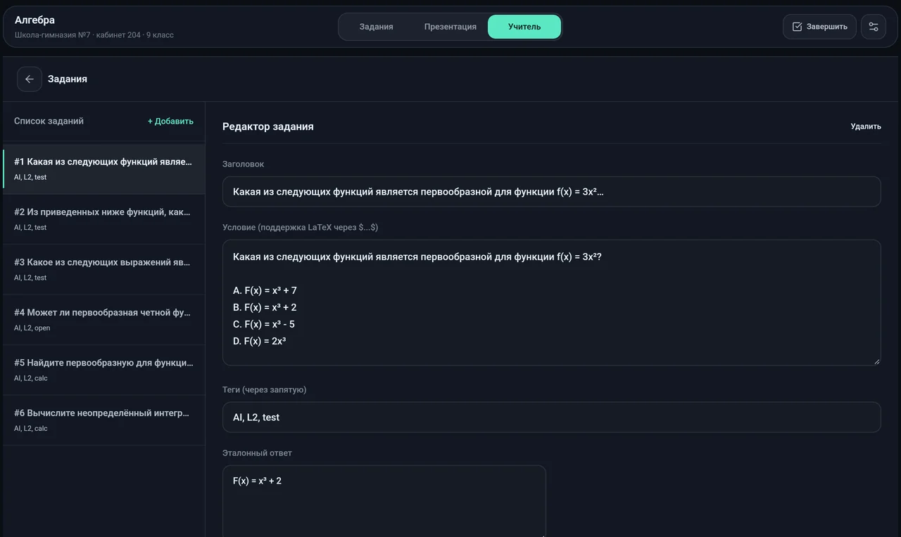

- **Презентация** — слайды: создать новый, загрузить PowerPoint, добавить картинки.

  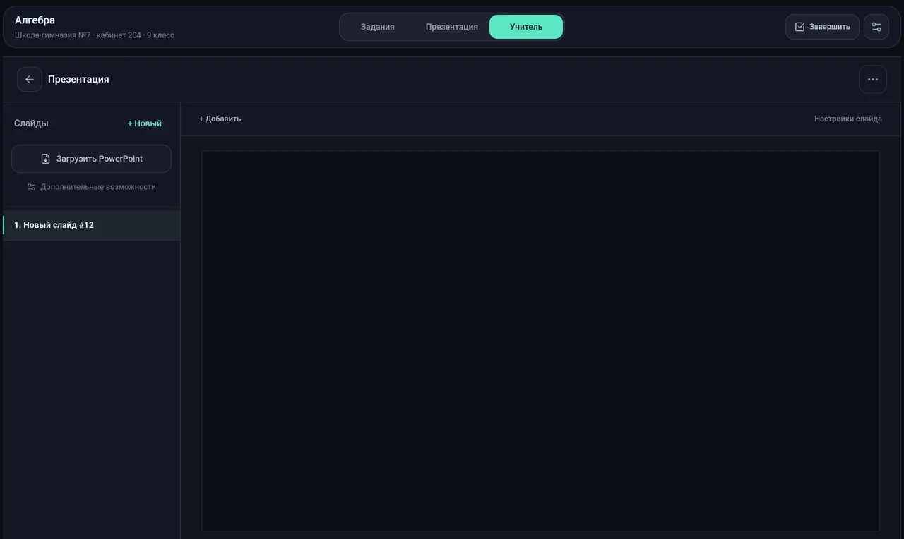

- **История урока** — запись всего, что происходило на доске. Её можно проиграть как видео и даже скачать. Там же история ответов ИИ.

  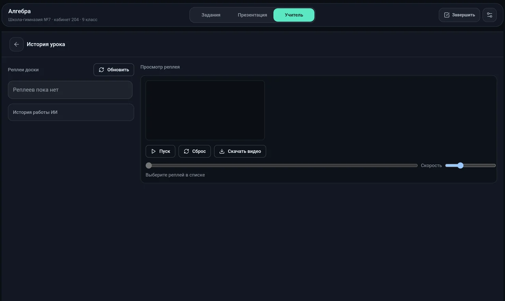

- **Создать урок с ИИ** — см. следующий раздел.

---

## 15. Создать урок с ИИ по учебнику

ИИ готовит слайды и задания сам — по вашему тексту или по параграфу учебника.

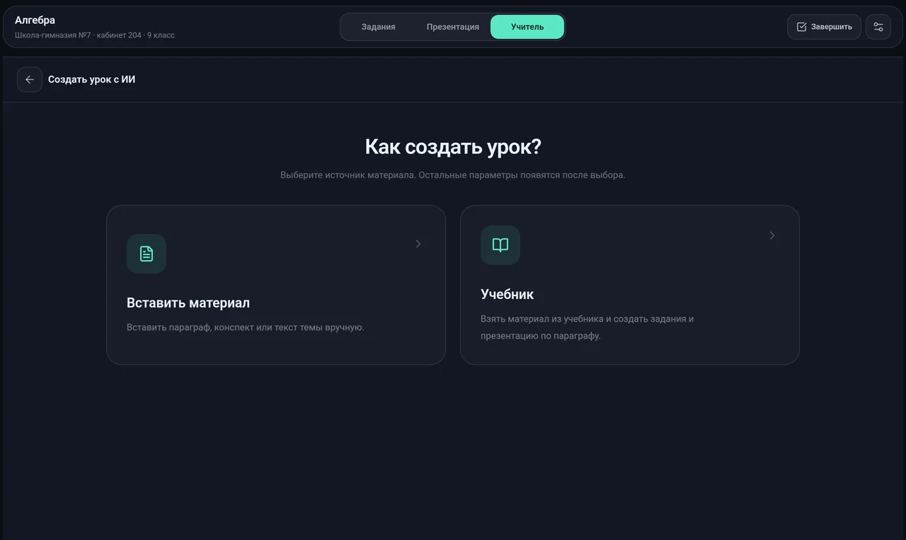

1. Выберите **«Учебник»** (или «Вставить материал», если хотите вставить свой текст или конспект).
2. Выберите учебник и **параграф** или напишите **тему**.
3. При желании укажите название урока, язык, количество слайдов и заданий.
4. Нажмите **«Сгенерировать урок»** и подождите: на школьном сервере это может занять несколько минут.

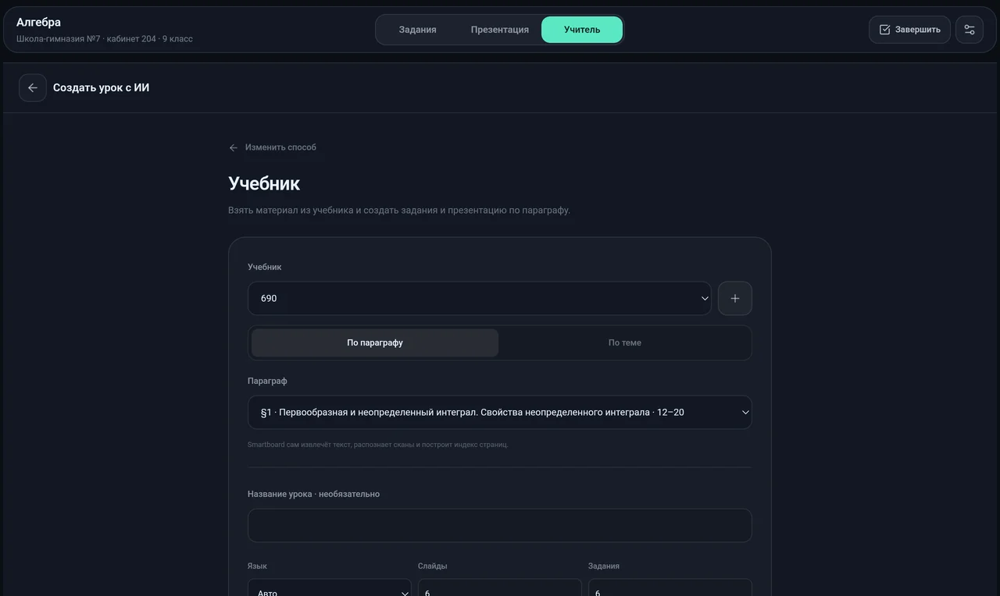

**Свой учебник.** Нажмите «+» рядом со списком учебников и выберите PDF. Сервер сам вытащит текст, распознает сканы и найдёт параграфы. Пока он обрабатывает книгу, искать по теме можно уже на готовых страницах.

Всё, что создал ИИ, — это черновик. Проверьте его в разделах «Задания» и «Презентация».

---

## 16. Завершение урока и история

Кнопка **«Завершить»** сразу закрывает урок и возвращает к выбору класса. Урок не пропадает: он попадает в **Историю уроков** кабинета.

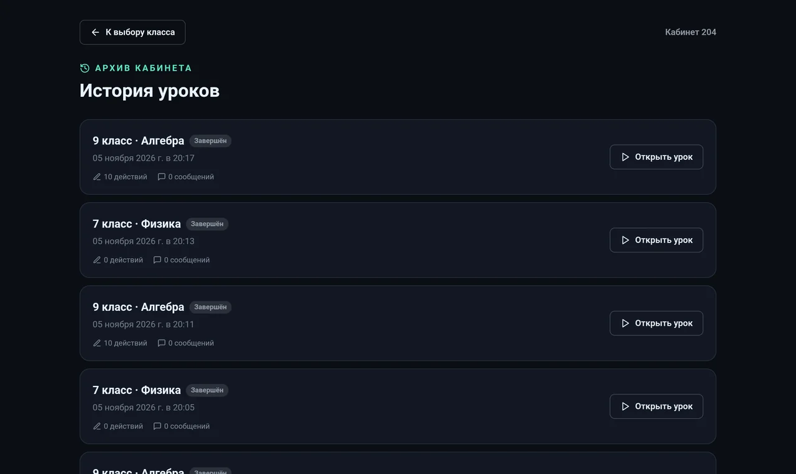

В истории видно класс, предмет, дату и время, сколько было действий на доске и сообщений ИИ. Кнопка «Открыть урок» открывает его снова.

---

## 17. Настройки

Значок с ползунками справа вверху.

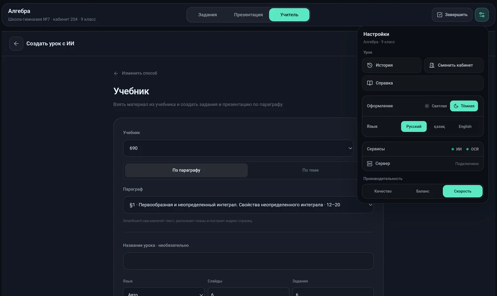

- **История**, **Сменить кабинет** и **Справка** (это руководство).
- **Оформление**: светлая или тёмная тема.
- **Язык**: русский, қазақ, English.
- **Сервисы**: зелёные точки у «ИИ» и «OCR» значат, что они работают. «Сервер» открывает экран сервера — он нужен сисадмину.
- **Производительность**: «Качество» — красивее, «Скорость» — быстрее на слабой доске, «Баланс» — середина.

---

## 18. FAQ для учителя

**Я нарисовал(а) не то. Как вернуть?**
Нажмите ↶ «Отменить» — столько раз, сколько нужно. Отменяется всё: линии, стирание, очистка доски, перемещение картинок.

**Случайно очистил(а) доску!**
Нажмите ↶. Очистка отменяется так же, как любое другое действие.

**Панель инструментов пропала.**
Она прячется, пока вы пишете. Проведите пальцем у нижнего края доски, и она появится.

**Доска уехала, ничего не видно.**
Откройте ▦ «Доска» и нажмите «Центр». Чтобы она больше не уезжала, включите 🔓 «Лок».

**Ручка не пишет.**
1. Проверьте, что выбрана Ручка, а не ✋ Перемещение или Лассо.
2. Посмотрите на переключатель «Авто / Мышь / Сенсор»: в режиме «Мышь» ручка и палец не пишут. Выберите «Авто».
3. На графике и на картинке, поднятой над графиком, писать нельзя. Пишите рядом или опустите картинку слоем ниже.

**Линия прилипла к линейке, а мне не надо.**
Линия прилипает, если начать её у самого края линейки. Начните чуть дальше от края или уберите линейку, нажав её в меню ещё раз.

**Хочу кривую, а доска делает из неё ровную фигуру.**
Значит, вы задерживали ручку в конце линии. Отрывайте её сразу — тогда линия останется как есть. Или нажмите ↶ и нарисуйте снова.

**Не получается подвинуть картинку.**
Картинки двигаются только в режиме ✋ «Перемещение». Сначала нажмите на картинку, чтобы она выделилась зелёной рамкой.

**Картинку не видно, она под графиком.**
Выделите картинку в режиме ✋ и нажмите «Выше слоем», или нажмите «Ниже слоем» у графика.

**Написал(а) на картинке, а надписи пропали.**
Картинка поднята над графиком и поэтому закрывает надписи. Опустите её «Ниже слоем», и надписи снова будут видны: они никуда не делись.

**ИИ пишет «OCR недоступен» или ничего не отвечает.**
Это проблема сервера, а не доски. Сообщите сисадмину. Писать и вести урок на доске можно и без ИИ.

**Появилась надпись «Нет связи».**
Пропала связь с сервером, но продолжайте урок: всё, что вы рисуете, сохраняется на доске и само отправится на сервер, когда связь вернётся.

**Появилась надпись про веб-режим («Нативная отрисовка дала сбой…»).**
Доска переключилась на запасной, более медленный способ рисования, чтобы не мешать уроку. Можно нажать «Попробовать снова». Если надпись появляется часто, скажите сисадмину.

**Забыл(а) PIN учителя.**
PIN сбрасывается только вместе с настройками приложения на доске. Это делает сисадмин, и после этого доску нужно заново подключить к серверу.

**Можно ли сохранить то, что на доске?**
Да: кнопка «Снимок» сохраняет доску как картинку. Кроме того, каждый урок хранится в Истории уроков вместе с записью всей работы на доске.

**Нужен ли интернет?**
Нет. Доска работает с сервером внутри школы. Интернет нужен только сисадмину для установки и обновлений.

**Что видят другие кабинеты?**
Только своё. У каждого кабинета своя история уроков. Аккаунт школы общий.
